# Quill

<p align="center"></p>

<p align="center">
  <a href="https://github.com/liminal-hq-labs/quill/actions/workflows/ci.yml"></a>
  
  
</p>

One word processor for DOS, Windows 3.1 and Windows 95, written in Rust.

Quill is a small rich-text word processor for the PCs of 1992 to 2000: fonts, lists, tab stops, headers and footers, pictures, a spelling checker and a real WinHelp help file, in a program that fits on a floppy and runs in 4 MB. It is built in 2026 with modern Rust and no C compiler, and one shared core drives all three versions, so a letter typed in blue-screen DOS opens with its fonts on Windows 3.1 and in LibreOffice today. Quill is the companion application to the *Cross-compiling to the past* series on the Liminal HQ blog, which explains the toolchains it is built with.

> **Status:** experimental. The portable core, the `.QLD` and RTF formats and the DOS text-mode editor run and are tested (the DOS build is compared with the host screen for screen under headless DOSBox); the Win16 toolchain has been probed on Windows 3.11. The Windows builds are not written yet. See [docs/progress.md](docs/progress.md) for what is shown to work. There are no releases.

## What it's for

- Writing a letter on a period PC, or in DOSBox-X, and printing it with the fonts Windows 3.1 came with.
- Opening the same document on DOS, Windows 3.1 and Windows 95 without converting anything.
- Carrying an RTF from a 1990s machine to a modern word processor, pictures and page numbers included.
- Reading how one Rust core becomes three programs for three very different machines.

## Install and run

Nothing to install yet. When v1 ships, it comes as 1.44 MB floppy images, one per platform, each with its own installer ([release disks](docs/roadmap.md#release-disks)).

```sh
# Planned, once the workspace exists:
cargo test                       # the portable core, on the host
cargo run -p quill-host --bin quill-render -- tests/docs/letter.rtf --png out/
```

## Documentation

- [SPEC.md](SPEC.md) — what Quill does, on each platform
- [docs/architecture.md](docs/architecture.md) — how it is built
- [docs/roadmap.md](docs/roadmap.md) — milestones and how each is checked
- [docs/decisions.md](docs/decisions.md) — decisions and why
- [docs/toolchain-needs.md](docs/toolchain-needs.md) — what the Win16, Win32 and DOS toolchains must provide
- [docs/testing.md](docs/testing.md) — from host tests to Windows 3.11 in DOSBox-X
- [docs/documentation-plan.md](docs/documentation-plan.md) — screenshots, diagrams and the capstone post
- [AGENTS.md](AGENTS.md) — contributor and agent rules

## Contributing

Issues and pull requests are welcome. The house rules are in [AGENTS.md](AGENTS.md); run the checks it lists before opening a pull request.

## Part of Liminal HQ Labs

Quill is a [Liminal HQ Labs](https://github.com/liminal-hq-labs) experiment. Experiments from Liminal HQ — early, rough and open. If it proves itself, it [graduates](https://github.com/liminal-hq-labs/.github/blob/main/docs/labs-charter.md#graduation) to [Liminal HQ](https://github.com/liminal-hq).

## Licence

Licensed under either of the [Apache License, Version 2.0](LICENSE-APACHE) or the [MIT licence](LICENSE-MIT), at your option. The DOS graphics faces are Desk's, under the SIL Open Font License 1.1; the spelling dictionaries are built from SCOWL, whose notice they carry.
