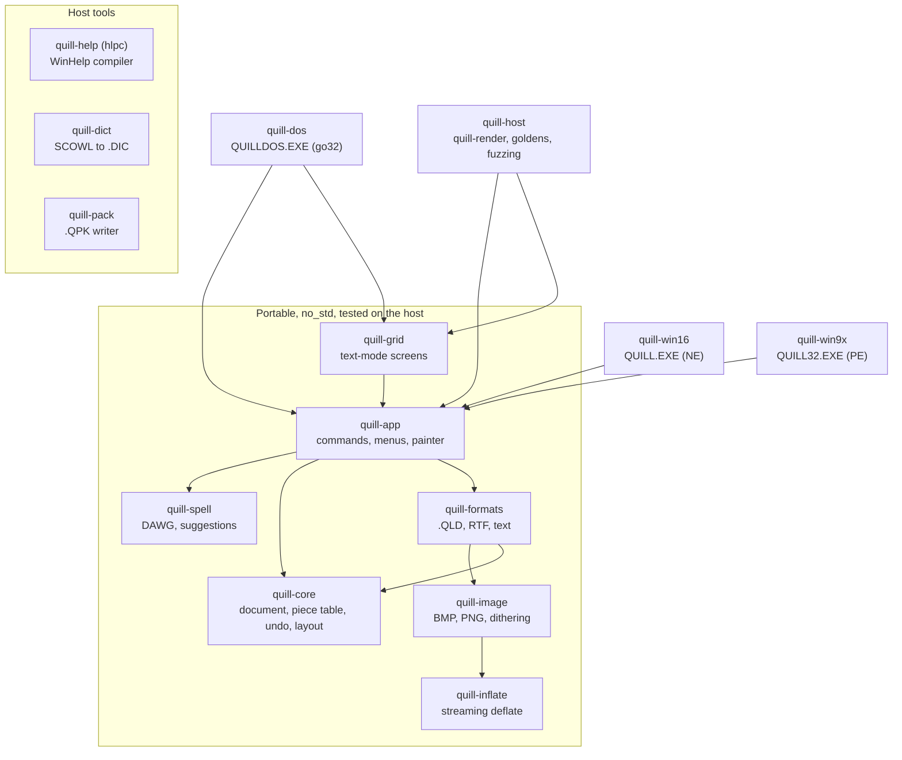
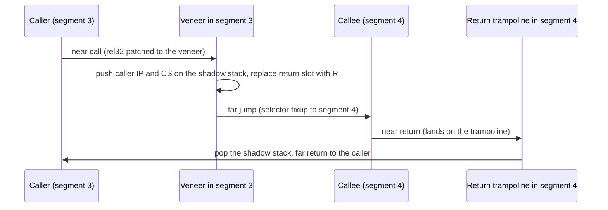
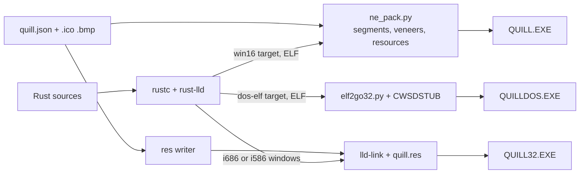

# Architecture

How Quill is built. [SPEC.md](../SPEC.md) says what it does, [decisions.md](decisions.md) why it is built this way, and [roadmap.md](roadmap.md) in what order. Where this document describes something the toolchain does not yet do, [toolchain-needs.md](toolchain-needs.md) lists it.

## Table of contents

- [The shape of it](#the-shape-of-it)
- [Crates and workspaces](#crates-and-workspaces)
- [The core](#the-core)
- [What every platform can rely on](#what-every-platform-can-rely-on)
- [The app layer and the two renderers](#the-app-layer-and-the-two-renderers)
- [Win16 platform layer](#win16-platform-layer)
- [Win32 platform layer](#win32-platform-layer)
- [DOS platform layer](#dos-platform-layer)
- [What the platforms share and where they part](#what-the-platforms-share-and-where-they-part)
- [Errors without panics](#errors-without-panics)
- [Host tools](#host-tools)
- [Build pipeline](#build-pipeline)
- [Risks and unknowns](#risks-and-unknowns)

## The shape of it

One portable core holds the document and knows how to edit it, lay it out and save it. Three thin platform layers put it on a screen: one for Windows 3.1, one for Windows 95, one for DOS. A host build of the same core runs the tests and draws reference pages, so most bugs are found and fixed on Linux before any emulator starts.



Figure 1. Crates and who depends on whom.

The rule that keeps it honest: **the core never names a platform.** Anything that needs Windows or DOS (memory, fonts, drawing, files, the clock) comes in through a trait the platform implements.

## Crates and workspaces

| Crate | Kind | Holds |
|---|---|---|
| `quill-core` | `no_std`, no `alloc` | `Store` and `FarVec`, the piece table, character and paragraph format tables, the document, positions and selections, edit commands, undo, the `Measure` trait, layout, pagination, hit testing, find |
| `quill-formats` | `no_std`, no `alloc` | The `.QLD` RIFF reader and writer, the RTF subset reader and writer, plain text with ANSI and CP437 tables, all over `Source` and `Sink` byte-stream traits |
| `quill-app` | `no_std`, no `alloc` | The `Command` enum, the menu tree and accelerator table (one definition for every build), enabled and checked state, status-line text, the `Surface` drawing trait and the painter for the page, ruler, toolbar and status bar |
| `quill-grid` | `no_std`, no `alloc` | The text-mode renderer: document, menu bar, pull-downs, dialogs, help viewer and status line into a `Grid` of 80 × 25 or 80 × 50 cells (CP437 byte plus attribute) |
| `quill-image` | `no_std`, no `alloc` | BMP and PNG decoding by rows into a caller's sink, scaling (box filter while decoding), dithering to 16 colours (ordered and error diffusion), the halftone palette, DIB building |
| `quill-inflate` | `no_std`, no `alloc`, no `unsafe` | A streaming raw-deflate decoder with a 32 KB ring window and resumable state, grown from Lt. Fizz 2's `fizz-pack` decoder; used by PNG and by `.QPK` packs |
| `quill-spell` | `no_std`, no `alloc` | `.DIC` page reader over a `PageSource`, word lookup, case rules, the bounded suggestion search, the user dictionary, the word scanner |
| `quill-pack` | `no_std` reader, `std` writer behind a feature | The `.QPK` pack: header, directory, chunked deflate, checksums. The reader is shared with the installer |
| `quill-help` | `std`, also a library | `hlpc`, the WinHelp 3.1 compiler, and `hlpdump`, its reader; written to move to a `rust-winhelp` repository |
| `quill-dict` | `std` | Builds `.DIC` files from SCOWL and VarCon |
| `quill-host` | `std` | `HostStore`, the measures (`GridMeasure`, `CapturedMeasure`, `LiberationMeasure`, `DeskMeasure`), `quill-render`, the golden test runner and the fuzz targets |
| `quill-win16` | Win16 binary | `QUILL.EXE`: window procedures, GDI, COMMDLG, clipboard, printing, files, the far-memory `Store` |
| `quill-win9x` | Win32 binary | `QUILL32.EXE`: the same, over Win32's flat memory and ANSI APIs |
| `quill-dos` | DOS binary | `QUILLDOS.EXE`: text video, keyboard, mouse, files, ports, and graphics mode |

The portable crates and `quill-host` form the root Cargo workspace, built and tested with stable Rust. Each platform crate lives in its own workspace with its own target, toolchain file and lockfile, as Desk's `dos/` and the Liminal Installer's `retro/win16/` do, and reaches the portable crates by path:

```text
crates/     quill-core quill-formats quill-image quill-inflate quill-spell quill-app quill-grid
            quill-pack quill-help quill-dict quill-host
win16/      quill-win16, the Win16 runtime (rt), tools, resources, segments.toml
win9x/      quill-win9x, the Win32 runtime (rt), tools, resources
dos/        quill-dos, Desk's runtime (rt) with PROVENANCE.md, tools, font strikes
help/       the help sources (.qhm, help.toml, bitmaps)
dict/       SCOWL inputs with their licence, and the language list
fuzz/       cargo-fuzz targets
installer/  the Liminal Installer project and the disk image recipes
tests/      golden layouts, screens, RTF and picture corpus, self-test scripts, captured metrics
```

## The core

### Storage: `Store` and `FarVec`

On Windows 3.1 a document cannot live in the 64 KB data segment, and Rust references there are near pointers that cannot reach global memory. So the core never holds a reference into document storage. It asks a `Store` for chunks and copies values in and out:

```rust
pub trait Store {
	/// Allocates a chunk of at least `len` bytes (at most 32 KB). None when memory is short.
	fn alloc(&mut self, len: u16) -> Option<ChunkId>;
	fn free(&mut self, id: ChunkId);
	fn read(&self, id: ChunkId, offset: u16, out: &mut [u8]);
	fn write(&mut self, id: ChunkId, offset: u16, data: &[u8]);
	fn copy(&mut self, from: (ChunkId, u16), to: (ChunkId, u16), len: u16);
}
```

`FarVec<T: Pod>` is a growable array on top: elements never straddle a chunk, `get` and `set` copy one element, `insert` and `remove` shift within and across chunks, and every growing operation reserves its chunks before it changes anything, so out of memory leaves the vector as it was. On the host and on Win32 and DOS a chunk is a heap block and a copy is a `memcpy`; on Win16 it is a `GlobalAlloc` block and a copy goes through the far-memory helpers.

### Text: a piece table

The text is a piece table over two byte buffers in the `Store`: the **original** buffer holds the file as loaded and never changes, and the **add** buffer only ever grows as text is typed or pasted. The document is the list of pieces:

| Field | Type | Meaning |
|---|---|---|
| `source` | `u8` | Original buffer, add buffer, or an inline object |
| `start` | `u32` | Offset in that buffer |
| `len` | `u32` | Characters |
| `cfmt` | `u16` | Character format index |
| `pfmt` | `u16` | Paragraph format index, used by the paragraph marks the piece holds (D58) |

Pieces carry the character format, so the style runs are the pieces: making a word bold splits at most two pieces and changes the `cfmt` of the ones between. Typing at the end of the last piece extends it in place, which keeps the piece count near the number of edits and format changes, not the number of keystrokes. Finding the piece for a position scans from a cached cursor, which is fast for the local edits typing makes; a block index over the pieces is the planned fix if large documents show the scan.

Paragraphs end with `0x0D` in the text, and a paragraph's format is the `pfmt` of the piece that holds its mark, so formats follow the text through edits and undo with no second structure to keep in step (D58). A `FarVec` of paragraph records, rebuilt from the text, holds per paragraph its start position, its list number (computed, see below), and its layout (the first line index, the line count, the height and the top in layout units).

### Stories and inline objects

A document is up to five **stories**: the body, the header, the footer and the first-page header and footer. Each story is its own piece table and paragraph list; they share the buffers, the format tables and the undo log. The header view is the same editing view pointed at another story.

Pictures and fields are **inline objects**: one `0x01` character in the text, carried by a piece whose `source` is `Object` and whose `start` is an index into the object table (picture or field kind). An object is one character for the caret, selection, undo, find (which never matches it) and RTF, and the layout asks the object for its size instead of the font. Field values are filled in at paint time from the page being drawn.

### Formats

Character formats (font, size in half points, colour index, vertical position, flags) and paragraph formats (alignment, spacing, list and level, tab set, flags, indents and spacing in twips) are interned in tables: equal formats share one index, so a 300-page document with ten looks has ten entries. Tab sets and list definitions are interned the same way and referenced from paragraph formats. Tables are collected (unused entries dropped, indices renumbered) before saving and when a table fills.

### Lists

A paragraph format names a list definition and a level. Numbers are not stored: a pass over the paragraph records computes them (one counter per list and level, reset by a restart flag or a paragraph at a shallower level of the same list), and an edit recomputes only from the first changed paragraph to the point where the counters agree with what was there. The label (`3.`, `c)`, `iv.`, `2.1.`) is made at paint time and measured like text.

### Edits and undo

Every change is a `Command` that the core turns into primitive edits (`Insert`, `Delete`, `SetCharFormat`, `SetParaFormat`) applied as one transaction: reserve memory, apply, record the inverse. The undo log is a `FarVec` ring of inverse edits grouped into steps with a label (`Typing`, `Bold`, `Paste`). Deleted text is not copied into the log: the pieces that held it are kept, since the buffers never lose bytes. Redo is the same log walked forward.

### Layout and the `Measure` trait

Layout breaks paragraphs into lines, places lines on pages and answers "which character is at this point" and back. It works in the **reference device's units**, integers throughout (D9):

```rust
pub trait Measure {
	/// Device units per inch across and down: 300 × 300 for a laser printer, 96 × 96 for a VGA screen, 10 × 6 for a text screen.
	fn resolution(&self) -> (u16, u16);
	/// Ascent, descent and external leading of a font, in device units.
	fn metrics(&mut self, font: &FontRef) -> FontMetrics;
	/// Advance widths of ANSI characters 0x20 to 0xFF, in device units.
	fn widths(&mut self, font: &FontRef, out: &mut [u16; 224]);
}
```

A `FontRef` is the face name, the family, the size in half points and the bold and italic flags. The core caches widths per `FontRef` (eight fonts, least recently used) and never asks per character.

Line breaking is greedy: take the widest run of whole words that fits the text width minus indents, break after the last space or hyphen, and break mid-word only when one word is wider than the line. A list label or bullet sits in the hanging indent and does not count against the line.

- **Tabs.** A tab ends the current segment. A left stop places the next segment at the stop; centre, right and decimal stops hold the next segment back until its width (or, for decimal, its width up to the first `.`) is known, then place it. The leader is drawn as repeated leader characters in the gap, clipped to whole characters. Past the last set stop, default stops every half inch apply.
- **Justification** spreads the leftover units across the spaces after the last tab with an integer remainder walk, so the first `rem` spaces get one unit more and the line ends exactly at the margin.
- **Baselines.** Superscript and subscript use two-thirds of the size and shift the baseline by a third of the full size's ascent, up or down. The line's ascent and descent are the largest after the shifts, so a raised character makes room for itself.
- **Objects.** A picture is a box with its shown size in layout units, sitting on the baseline (its height is all ascent). A field is measured with a placeholder value of the widest digits (`88`) so the header's layout does not move from page to page.
- **Line height** is the tallest ascent plus the tallest descent, times 1, 1½ or 2 (in halves, integer), plus space before and after on the first and last lines.
- **Pagination** fills pages to the text height and starts a new page at a page break. The header and footer are laid out once per kind (first or other) and take space from the margin; if one is taller than its margin, it takes the rest from the text height of that page.

An edit lays out only the paragraphs it touched, then moves the tops of the paragraphs below. A whole-document layout (open, printer change) runs in slices from the idle loop, so the window stays responsive and the status bar says `Page 3 of ?` until it is done.

### Units

| Quantity | Unit | Why |
|---|---|---|
| Document geometry (margins, indents, spacing, paper) | Twips, `i32` | What RTF uses; exact for inches and points |
| Font size | Half points, `u16` | What RTF uses |
| Layout positions and widths | Reference device units, `i32` | Exact for the device that prints |
| Screen positions | Screen pixels, from layout units by an integer scale | The screen is a view of the layout, never its source |

Because the screen is already a scaled view of the layout, zoom (a stretch goal) is a different scale and a different font height for the screen; the layout does not change.

## Pictures

A picture has three forms, and only the first is permanent:

| Form | Where | When |
|---|---|---|
| Original file bytes (BMP or PNG) | The `Store` | From insert or open until the picture is deleted; saved as they came |
| Display DIB | The `Store`, through a picture cache | Decoded when the picture first scrolls into view, at its shown size and the screen's depth; dropped when out of view and memory is needed |
| Print bands | A band buffer | Decoded again per band while printing, at the printer's resolution |

`quill-image` decodes by rows into a sink, so it never holds a whole full-colour image: a BMP is read bottom-up row by row, a PNG is inflated through `quill-inflate` (a 32 KB window plus two rows for the filters), and each row is scaled (box filter) and reduced (error diffusion to the 16 VGA colours, or the 6 × 6 × 6 halftone palette plus the 20 system colours on 256-colour displays) before the next is read. The display DIB for a 640 × 480 picture on a 16-colour screen is about 150 KB, where its full-colour form would be 900 KB. Interlaced PNGs cannot be decoded by rows, so they are decoded whole when they fit the picture budget and shown as the placeholder when they do not.

Printing a picture calls `StretchDIBits` per band (the printer's band, or 64 rows when the driver does not band), re-decoding from the original each band. For a big PNG on a 300 dpi printer that is slow (the stream is inflated from the start for every band) and that is the price of fitting in 4 MB; a driver without `RC_STRETCHDIB` gets the band through a memory DC and `StretchBlt`.

JPEG waits for a `no_std` baseline decoder that fits about 12 KB of code and works by MCU rows; none is planned for v1.

## Spelling

`quill-spell` reads a `.DIC` through a `PageSource` (the platform reads 32 KB pages from the file, or from a `.QPK` chunk, into `Store` chunks) and keeps the four most recently used pages, so the working set is 128 KB however large the dictionary is. A lookup walks one edge list per letter, usually inside one or two pages.

- **Words.** The scanner takes runs of ANSI letters (including accented ones) with inner apostrophes, skips words with digits and, by setting, words in capitals, and folds case: a word is known if its exact form is in the dictionary, or its lower-case form is and the word is lower case, capitalized or all capitals.
- **Suggestions** are a depth-first walk of the automaton that allows up to two edits (insertion, deletion, substitution, transposition), pruned when the edit count is exceeded, with a budget of nodes visited and a clock check every 1,024 nodes. Results are ranked by edit count, then by a keyboard-distance tiebreak, then alphabetically.
- **As you type** runs in idle time over the visible paragraphs only, caches a per-paragraph "checked at edit number" mark, and paints the wavy underline after the text, so typing is never slowed by the checker.

`quill-dict` builds the automaton on the host from SCOWL at size 50 with the `en_CA`, `en_US` or `en_GB` variant from VarCon, minimizes it, and lays it out so that the edges near the root share pages. The budget is under 300 KB per language on disk; if size 50 does not fit, size 35 does.

## Help

`quill-help` is a host library and the `hlpc` command. It reads `help.toml` and the `.qhm` sources and writes:

- **`QUILL.HLP`**, a WinHelp 3.1 file: the internal file system (a B+ tree directory of internal files), `|SYSTEM` (title, contents topic, window definitions, the browse-button macro), `|TOPIC` (topic blocks of 4 KB with LZ77 compression, topic headers, paragraph records with font changes, jumps and popups, bitmap references), `|CONTEXT` (hashed context strings), `|CTXOMAP` (the numbers Quill passes to `WinHelp`), `|TTLBTREE` (topic titles), `|FONT`, `|KWBTREE`, `|KWDATA` and `|KWMAP` (search keywords), and `|bm0`, `|bm1`... bitmaps as uncompressed device-independent bitmaps in the multi-resolution bitmap container. `|Phrases` compression is optional and off at first.
- **`QUILL.HLX`**, the same topics in a compact form for the DOS help viewer in `quill-grid`.
- Optionally a `.CNT` contents file for Windows 95's Help Topics window.

The format is implemented from published descriptions of it, chiefly Manfred Winterhoff's `helpfile.txt` and the WinHelp chapter of Pete Davis and Mike Wallace's *Windows Undocumented File Formats*, and checked against the real `WINHELP.EXE` of Windows 3.11. HelpDeco (GPL) and Wine's `winhlp32` (LGPL) explain behaviour but no code is copied from them (D50). `hlpdump` reads a `.HLP` back into a topic tree for round-trip tests and for reading period help files. The crate depends on nothing in Quill, so it can move to a `rust-winhelp` repository with its own history.

## Packs

`.QPK` is Quill's pack format for the release disks and, optionally, for read-only data on the installed disk (dictionaries, the DOS font strikes). It follows Lt. Fizz 2's `.FAP` container (`~/source/experiments/fizz-2/docs/FAP.md`): a 32-byte header with magic `QPK` and 0x1A, a format version, an entry count, the total length and a checksum; a directory of fixed-size entries; and sections on 16-byte boundaries, each with its own FNV-1a checksum. Quill's changes: entries name files (an 8.3 name, a DOS date and time and a target mask for DOS, Win16, Win32 or all), and codec 2 is **chunked deflate**, where a file is a run of raw-deflate chunks of at most 32 KB decoded each, so the unpacker needs one 32 KB buffer, Win16 can unpack into a global block, and a dictionary page can be read from the middle of a packed `.DIC`. The reader in `quill-pack` is `no_std`, allocation-free and `unsafe`-free, so the Liminal Installer's DOS and Win16 runtimes can link the same code to unpack Quill's disks.

## What every platform can rely on

The core makes these promises, and the tests hold it to them, so three different screens never disagree about the document:

1. **One document model.** Text in ANSI with `0x0D` paragraph marks, character formats on pieces, paragraph formats on paragraphs. No platform adds or drops a property; a build that cannot show something keeps it (the build differences table in the spec).
2. **One file format.** The `.QLD` and RTF writers are in `quill-formats` and nowhere else, and saving the same document gives the same bytes on every build. A cross-platform test saves the same scripted document on each build and compares the files.
3. **Layout is a pure function** of the document, the page geometry and the `Measure`. Same inputs, same lines, on every target, because there is no float and no platform code inside it. So each platform's layout can be tested on the host by replaying that platform's metrics (`GridMeasure` for text mode, `DeskMeasure` for DOS graphics, `CapturedMeasure` with width tables recorded from real Windows 3.11 for Win16 and Win32), with golden files per platform.
4. **Commands are the same everywhere.** Keys and menu items map to the same `Command` values in `quill-app`, and the core decides what a command does. Two platforms that send the same commands end with the same document, which is what the self-test scripts check.
5. **No panics and no partial edits.** Every operation either completes or leaves the document unchanged and returns an error the platform turns into a message.

## The app layer and the two renderers

`quill-app` is the editor without a screen: it owns the document, the selection, the view's scroll position and the chrome's state, turns input into `Command`s and says what needs repainting. The menu tree, accelerators, menu help strings and status templates are defined once there and become each platform's menus (an NE `RT_MENU`, a PE menu resource, the text-mode menu bar).

Painting is split by kind of screen:

- **`Surface`** is a small drawing trait (`fill_rect`, `text_run` with explicit character positions, `line`, `bitmap`, `invert_rect`, `clip`). The painter for the page, the ruler, the toolbar and the status bar is written once against it. The Win16 and Win32 layers implement it over GDI, DOS graphics mode over its frame buffer, and the host over a PNG canvas. Generics, not `dyn`, so Win16 never calls through a function pointer across code segments.
- **`quill-grid`** draws the same state into a character grid for text mode: the page as text with attributes, the menu bar, pull-downs and dialogs as boxes. DOS text mode copies the grid to video memory; the host writes it out for golden comparison, as the Liminal Installer's `li-retro` does.

## Win16 platform layer

The hardest of the three, and the one the project is named after.

### Memory model

The program has one automatic data segment (DGROUP: DS = SS) of at most 64 KB that holds the statics, the stack and Windows' local heap. Near pointers are 32-bit values with a zero high half. Everything the size of a document lives in global memory instead.

| DGROUP item | Budget | Notes |
|---|---|---|
| Windows' reserved header | 16 B | First 16 bytes, required |
| Rust statics and read-only data | ≤ 10 KB | UI text lives in string resources, not here |
| Stack | 16 KB | Measured with a fill pattern in test builds |
| Local heap | 8 KB | Edit controls in dialogs allocate here |
| Width caches | 3.5 KB | Eight fonts × 224 widths × 2 bytes |
| Paint and line scratch | 2 KB | One line's text and its `ExtTextOut` position array |
| Chunk table | 1 KB | Up to 128 chunks of 32 KB (4 MB) |
| Shadow return stack | 1 KB | For cross-segment calls, 256 levels |
| RTF reader state | 2 KB | Group stack, font table |
| Staging buffer | 4 KB | File I/O, clipboard, undo coalescing |
| Picture and spelling state | 2 KB | Picture cache table, PNG row state pointers, page table, suggestion list |
| Headroom | ~14 KB | Reported in every build |

The inflater's 32 KB window, PNG rows, dictionary pages and print bands are all `Store` chunks, never DGROUP.

The Win16 `Store` allocates 32 KB `GMEM_MOVEABLE` blocks and locks each once: in protected mode a moveable block keeps its selector when Windows moves it, so the far pointer stays good. No block is larger than 64 KB, so the core never needs huge-pointer arithmetic. Only the clipboard, where Windows hands over one block of any size, uses `__AHINCR` tiling through a dedicated writer.

### Far memory access

The far-memory helpers are a few routines in inline assembly: copy from a far address to a near buffer, from near to far, far to far, and fill. They load the block's selector into FS (or GS) for each call and never assume it survived, because Windows 3.1 does not save FS and GS across task switches. ES stays equal to DS whenever Rust code runs, since LLVM's `rep movsb` writes through ES; the import stubs already reload it after every API call.

### Code segments

The spike links one code segment, and Quill will not fit in 64 KB. The plan, detailed in [toolchain-needs.md](toolchain-needs.md):

| Segment | Holds | Flags | Budget |
|---|---|---|---|
| 1 `_TEXT` | Entry, runtime, import stubs, compiler builtins, far helpers, message loop, view window procedure, painter, layout, piece table reads and edits, hit testing, veneer tables | Fixed, preload | 48 KB |
| 2 DGROUP | Data (stays segment 2, as in the spike) | Fixed, preload | 64 KB |
| 3 `EDIT` | Commands, undo, find and replace, clipboard, formatting, lists, tabs, drag and drop, toolbar, ruler, status bar | Moveable, preload | 48 KB |
| 4 `FILE` | `.QLD`, RTF and text readers and writers, file dialogs, file I/O | Moveable, load on call, discardable | 48 KB |
| 5 `PRINT` | Printing, page setup, print preview, headers and footers view | Moveable, load on call, discardable | 32 KB |
| 6 `INIT` | Start-up, class registration, font enumeration, settings, About box, help calls | Moveable, load on call, discardable | 16 KB |
| 7 `IMAGE` | `quill-image`, `quill-inflate`, the picture cache, picture sizing | Moveable, load on call, discardable | 32 KB |
| 8 `SPELL` | `quill-spell`, the Spelling dialog, as-you-type | Moveable, load on call, discardable | 24 KB |

The budgets add up to about 250 KB of code. That is a guess until the first multi-segment build measures the real `code16` sizes; the roadmap's size check reports each segment's size against its budget from then on.

Functions are assigned to segments by their mangled names (Rust paths survive LTO in `.text.<mangled>` section names), from a `segments.toml` that generates the linker script's `OVERLAY` entries. Hot code (anything called per character, per line or per paint) stays in segment 1; other segments are entered once per command.

LLVM's `code16` output only makes 32-bit near calls, so a call from one segment to another needs help. The packer finds those calls from relocations kept with `--emit-relocs` and sends each through a **veneer**:



Figure 2. A cross-segment call. Arguments and return values pass through untouched, because the veneer changes only the return slot and the shadow stack, never a register the caller set.

Function pointers (address-taken functions, which Quill avoids but `core` may produce) go through an **indirect-call table** at the same offset in every code segment, so a pointer value means the same function whichever segment calls through it. Exported window procedures can live in any segment; the entry table names the segment.

### Resources

Resources are described in `win16/res/quill.json` (as in the spike), with standard `.ico`, `.cur` and `.bmp` files beside it; resource IDs are generated into a Rust module so code and resources cannot drift.

| Resource | Contents |
|---|---|
| Menu `QUILL` | The menu tree from `quill-app` |
| Accelerators `QUILL` | The accelerator table from `quill-app` |
| Icon `QUILL` | 32 × 32, 16 colours (Program Manager and the About box) |
| Cursors | Selection-margin arrow; the I-beam and others are the system's |
| Bitmaps | Toolbar strip (16 × 15 glyphs, 16 colours), ruler markers and tab kinds, preview buttons |
| Dialogs | About, Indents and Spacing, Tabs, Numbering, Page Layout, Header and Footer, Size Picture, Spelling (and its Options), Zoom, Printing (abort) |
| Strings | Every message, menu help line, status template, file-type filter and title format |
| Version | `VERSIONINFO` for File Manager's properties and `VER.DLL` |

### Modules

| Module | Does |
|---|---|
| `app` | `WinMain`, the message loop with `TranslateAccelerator` and `IsDialogMessage` for the modeless find dialog, idle work |
| `frame` | The main window: menus, `WM_MENUSELECT` help, child layout, close and save prompts |
| `view` | The editing view: keys, mouse, caret (`CreateCaret`), scrolling, autoscroll timer, `WM_PAINT` through the painter |
| `gdi` | The `Surface` over a DC; the font cache (at most six `HFONT`s, since GDI's heap is shared by every program) |
| `measure` | The `Measure` over an information context for the default printer (`CreateIC`), or the screen when there is none |
| `chrome` | Toolbar (with two `COMBOBOX` children), ruler and status bar, each a child window drawn by the painter |
| `dialogs` | Resource dialogs and the `COMMDLG.DLL` wrappers: open, save, font, colour, find, replace, print |
| `pictures` | The picture cache over `Store` chunks, display DIBs with `SetDIBitsToDevice`, the halftone palette (`WM_QUERYNEWPALETTE`, `WM_PALETTECHANGED`), `CF_DIB` |
| `help` | `WinHelp` calls with context numbers from the generated map, and a `WH_MSGFILTER` hook so F1 works in menus and dialogs |
| `clipboard`, `print`, `files`, `settings`, `trace`, `store` | As named |

## Win32 platform layer

The Win32 build is the Win16 build with the hard parts taken away. Windows 95 gives a flat 32-bit address space, so there are no selectors, no far pointers, no DGROUP budget and no code segments: the `Store` is a heap and the code is one `.text` section. Everything Windows-shaped stays: GDI, fonts, `COMDLG32.DLL`, the clipboard, printing and resources work as on Windows 3.1, with wider types and `A` names.

It starts from `win9x-rust` (a `no_std`, `no_main` program for Windows 9x tested on the Windows ME VM):

- **Target and link.** `i686-pc-windows-msvc` code with no SSE, linked by `lld-link` with `/NODEFAULTLIB`, `/ENTRY:start`, `/SUBSYSTEM:WINDOWS,4.0`, `/FIXED` and `/DYNAMICBASE:NO`. The prebuilt `core` for that target assumes a Pentium 4 with SSE2, so Quill builds `core` itself or uses `i586-pc-windows-msvc`, and a check scans the executable for instructions a Pentium lacks (D33).
- **Imports.** `raw-dylib` blocks with `import_name_type = "undecorated"`, ANSI entry points only (`CreateWindowExA`, `GetOpenFileNameA`, `StartDocA`), generated from a table that lists only what Windows 95 exports.
- **Runtime.** `memcpy`, `memmove`, `memset` and `memcmp` written so LLVM cannot turn them into calls to themselves (as `win9x-rust` does), `__chkstk` for frames over 4 KB, `_fltused` if anything floating slips in, the entry point parsing `GetCommandLineA`, and a panic handler.
- **Structures.** Each one in its Windows 95 size: `OPENFILENAMEA` at the 76-byte version-4 size, `DOCINFOA` without the NT fields, `LOGFONTA` as 3.1 has it.
- **Resources.** The same `quill.json` written as a `.res` file that `lld-link` takes directly (D35). No manifest: Windows 9x ignores one and Quill draws its own chrome.
- **Long file names.** Up to 259 characters through the `A` file APIs; saving replaces the original with `DeleteFileA` and `MoveFileA`, since Windows 9x has no `MoveFileExA`.

Because it has none of Win16's constraints, the Win32 build is where the Windows user interface is first built and debugged, on the Windows ME VM and under Wine (D34). The Win16 layer then follows a working design and has only Win16's own problems left.

## DOS platform layer

The DOS build runs on Desk's Rust-on-DOS foundation, copied with a `PROVENANCE.md` as the Liminal Installer did (D36): a 32-bit flat program under a DPMI host, packed into a go32 executable behind `CWSDSTUB.EXE` so it carries CWSDPMI and runs from a bare floppy. Memory is flat, as on Win32, and plentiful, so the `Store` is the runtime's heap.

| Piece | From | Quill adds |
|---|---|---|
| Entry, DPMI client, heap, INT 21h, panic path, clean-up | Desk `dos/rt` | Nothing |
| Keyboard | Desk `bios_kbd` | Shift, Ctrl and Alt combinations as `Command`s |
| Timer | Desk `timer` | Caret blink, autoscroll |
| VGA | Desk `vga` | Text-mode setup (80 × 25, 80 × 50 with the 8 × 8 font) and mode 12h |
| Mouse | — | INT 33h through DPMI real-mode calls, optional |
| Text video | — | Copies the `quill-grid` grid to `B800:0000` through a DPMI selector; hardware cursor as the caret |
| VBE | — | Linear frame buffer through DPMI physical mapping, when present |
| Printing | — | Plain text to `LPT1`, `LPT2` or a file through INT 21h |
| Font strikes | Desk's outline faces | Bitmap strikes rendered offline (below) |

Text mode lays out with `GridMeasure` (resolution 10 × 6, every character one unit wide and one tall), so the page is a 10-pitch typewriter page and the grid shows it with no scaling. Graphics mode lays out with `DeskMeasure` over strikes that a host tool renders from Desk Sans, Desk Serif and Desk Mono at the sizes in the spec, packs into `QUILL.FNT` and also writes as width tables the host tests use.

DOS is the cheapest place to prove the core on a real machine: the runtime exists, the emulator is headless, and the screen is a grid of characters that can be compared exactly with the host's golden screens (D37).

## What the platforms share and where they part

| Concern | Win16 | Win32 | DOS |
|---|---|---|---|
| Core, formats, app | Shared | Shared | Shared |
| Address space | 64 KB DGROUP plus far chunks | Flat | Flat (DPMI) |
| `Store` | `GlobalAlloc` chunks, far copies | Heap chunks | Heap chunks |
| Code layout | Several 64 KB segments with veneers | One section | One section |
| Painter | `Surface` over GDI | `Surface` over GDI | `quill-grid` (text) or `Surface` over the frame buffer (graphics) |
| `Measure` | Printer IC, else screen | Printer IC, else screen | `GridMeasure` or `DeskMeasure` |
| Dialogs | Resources and `COMMDLG.DLL` | Resources and `COMDLG32.DLL` | Drawn by `quill-grid` or the painter |
| Resources | NE resource table from `quill.json` | `.res` from `quill.json` | Compiled into the program from the same menu tree |
| Executable | NE by `ne_pack.py` | PE by `lld-link` | go32 by `elf2go32.py` |
| Floating point | Banned (softfloat ABI, check fails the build) | Banned by the same check | Banned (the x87 is there; the core does not need it) |
| Toolchain | Nightly, `-Zbuild-std`, custom `code16` target | `build-std` or the `i586` target | Nightly, `-Zbuild-std`, Desk's `dos-elf.json` |

How the larger features land on each layer. The portable part is the same everywhere; the column says what the layer has to add.

| Feature | Win16 adds | Win32 adds | DOS adds |
|---|---|---|---|
| Headers and footers | Header dialog resource, preview and print of stories | The same | Header view in the grid; text print with headers |
| Pictures | Far-memory picture cache, `SetDIBitsToDevice`, palette messages, banded `StretchDIBits` | The same with flat memory; full colour on 16- and 24-bit displays | Placeholder boxes (text); dithered blit to planar VGA or the VBE buffer (graphics) |
| Lists, tabs, colour, strikethrough, super and subscript | Painting through `Surface` only | The same | Attributes in `quill-grid` (text); `Surface` (graphics) |
| Overtype, drag and drop | Caret shape, drag tracking with `SetCapture` | The same | Block cursor for overtype; mouse drag when INT 33h is present |
| Spelling | Pages in `Store` chunks; as-you-type off by default | Flat pages | Flat pages; red-background attribute in text mode |
| Help | `WinHelp` with `QUILL.HLP` | `WinHelpA` with the same file | `quill-grid` help viewer with `QUILL.HLX` |
| Zoom (stretch) | Screen scale and font heights | The same | Graphics mode only, if at all |

## Errors without panics

- Every build uses `panic = "abort"`. The portable crates deny `clippy::unwrap_used`, `expect_used`, `panic`, `indexing_slicing` and `arithmetic_side_effects` outside tests, and use checked or wrapping arithmetic on purpose.
- Fallible operations return `Result<T, QuillError>`, a small `Copy` enum (`OutOfMemory`, `TooLarge`, `BadFile`, `NewerVersion`, `Io(kind)`, `Cancelled`). The platform maps each to a string resource; no number reaches the user.
- The panic handler, which should never run, tries one emergency save of the document to `~QUILL01.QLD` with the fixed staging buffer, shows the message in the spec and exits. The packer and the DOS build report how many panic sites remain, so the count can only go down.

## Host tools

- **`HostStore`** is a `Vec` of chunks with the same 32 KB cap, so the host meets the same chunk boundaries the Win16 build does.
- **Measures.** `GridMeasure` (text mode), `DeskMeasure` (DOS graphics, from the generated width tables), `CapturedMeasure` (width tables recorded on real Windows 3.11 for the TrueType core fonts at common sizes, for the screen and a printer driver) and `LiberationMeasure` (Liberation Sans, Serif and Mono, metric-compatible with Arial, Times New Roman and Courier New, for anything not captured).
- **`quill-render`** lays out a document and writes PNG pages through a `Surface` on a canvas, text-mode screens from `quill-grid`, or a text dump of every line box. It is how a layout bug is looked at without starting an emulator.

## Build pipeline



Figure 3. From source to three executables.

## Risks and unknowns

| Risk | What could go wrong | What we do about it |
|---|---|---|
| Register state on Win16 | The spike found Windows 3.11 clobbers EBX, ESI and EDI's high halves across API calls, so the stubs save them. Not yet confirmed: whether a full task switch in `GetMessage`, a nested `DialogBox` loop or a timer interrupt can damage high halves the stubs do not cover, and FS and GS are known not to survive task switches | The spike's probes extend to `GetMessage` with a second task running, `DialogBox`, `SendMessage` across tasks and a busy loop under timer interrupts (toolchain need P0); helpers never cache FS or GS |
| Multi-segment veneers | `--emit-relocs` misses a call shape, LLVM materializes a function address the packer does not see, or veneer overhead shows in hot code | A packer check that every near branch lands in its own segment; the indirect-call table; segment 1 for hot paths; a static report of cross-segment call sites |
| Code size and speed on a 386 | Operand-size prefixes inflate `code16`; layout on every key is slow on a 386SX | Size budgets in CI; incremental layout; measurement at fixed DOSBox-X cycles from the first editing milestone |
| Printer metrics | Drivers differ; there may be no printer; the Windows 3.11 tree has no printer drivers installed | The no-printer path is the default test; a driver for the DOSBox-X printer emulation is an open item (testing plan) |
| Three platforms drifting | A fix in one layer is not made in the others | The shared `quill-app` and painter, cross-platform self-test scripts and byte-identical saves |
| Win32 CPU floor | The prebuilt `core` uses SSE2 and would fault on a Pentium | Build `core` for the floor and scan the executable |
| Pictures on 4 MB | A photo decoded at full size does not fit; banded printing re-inflates per band and is slow | Decode by rows to the shown size; a picture budget with eviction; the placeholder; honest limits in the spec |
| The help compiler | The WinHelp format is undocumented by Microsoft and community descriptions have gaps (topic block layout, bitmap containers); `WINHELP.EXE` may refuse files with no clear error | Start with the smallest file WinHelp opens and grow one internal file at a time, each checked in the real `WINHELP.EXE`; `hlpdump` reads period `.HLP` files from the Windows 3.11 tree to check the reader against real data |
| Scope | The v1 list is now long for a solo project on three platforms | The cut order in the roadmap, decided in advance |
