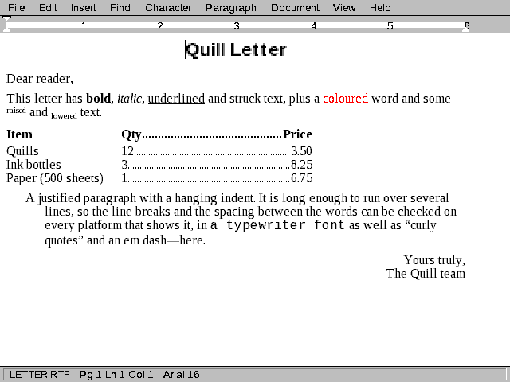
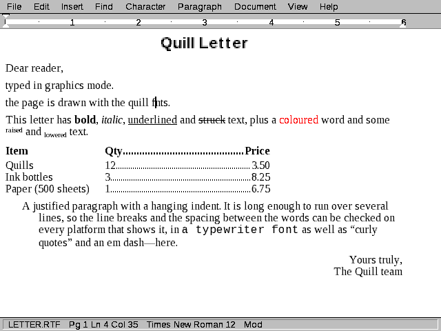
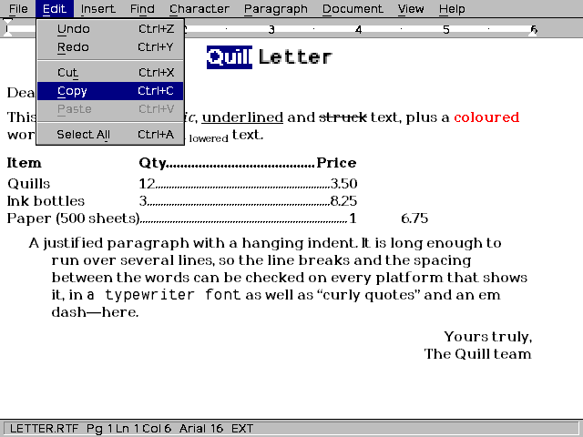
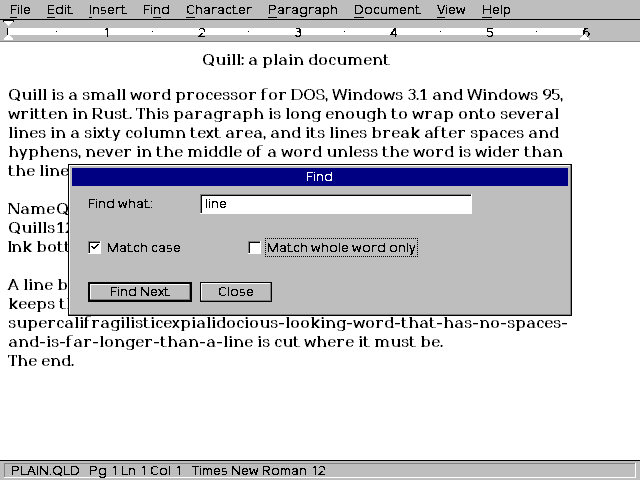
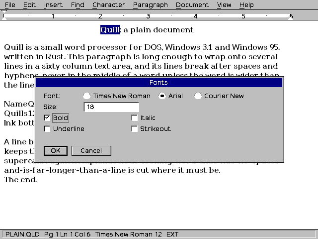
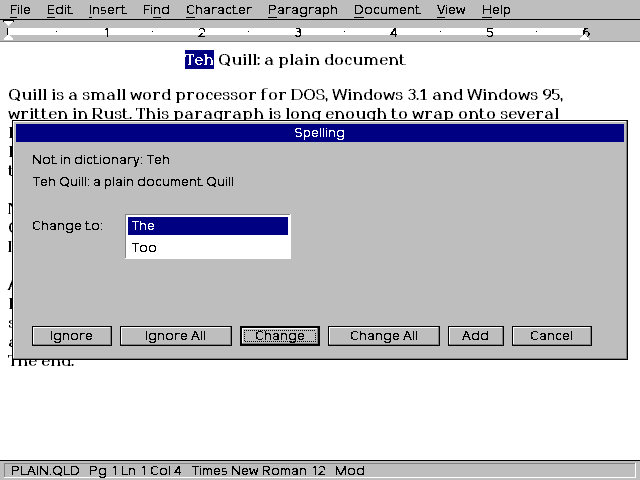
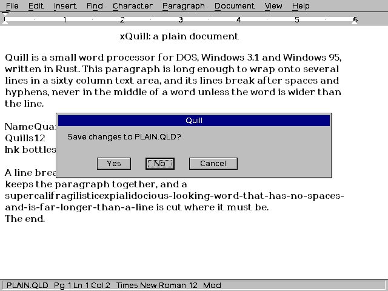
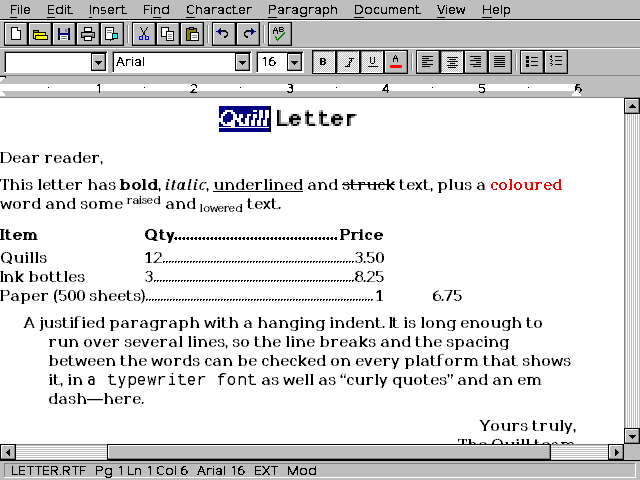
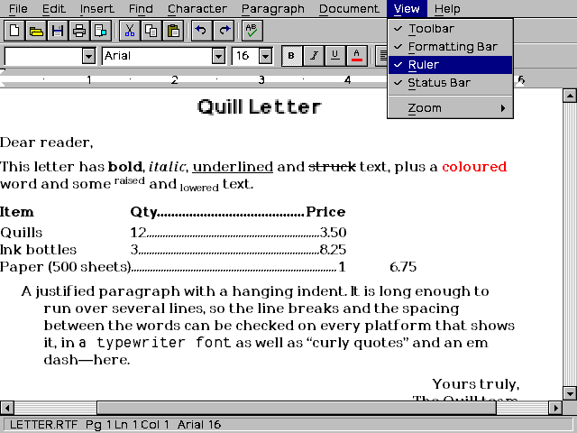
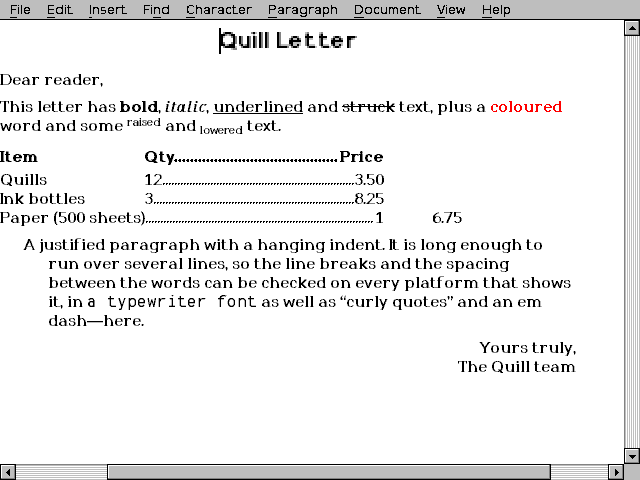

# Quill in DOS graphics mode

The design for a graphics mode beside text mode in `QUILLDOS.EXE`: video modes, fonts, the `QUILL.FNT` file, the `Surface` trait, the painter, input, tests and the order of work. The behaviour a user sees goes into [SPEC.md](../SPEC.md) when the first build lands; the decisions made here are numbered D130 to D144 and DOS-3 to DOS-9 (the area prefix scheme; they were D201 to D207 before it) below (D145 to D147 are in the [QUILL.FNT format page](dos-fnt-format.md) and D148 and D149 in the DOS hardware layer's pull request) and move into [decisions.md](decisions.md) when the open branches that also append to it have merged.

## Table of contents

- [Where things stand](#where-things-stand)
- [Video modes](#video-modes)
- [Fonts](#fonts)
- [The QUILL.FNT file](#the-quillfnt-file)
- [The Surface trait](#the-surface-trait)
- [The painter and the chrome](#the-painter-and-the-chrome)
- [Input, preview and printing](#input-preview-and-printing)
- [What the core needs and what goes in dos](#what-the-core-needs-and-what-goes-in-dos)
- [Tests](#tests)
- [The first slice: a page in graphics mode](#the-first-slice-a-page-in-graphics-mode)
- [Menus and dialogs](#menus-and-dialogs)
- [The toolbars and the scroll bars](#the-toolbars-and-the-scroll-bars)
- [Work list](#work-list)
- [Decisions](#decisions)
- [Risks and what is not proven](#risks-and-what-is-not-proven)

## Where things stand

| Piece | Where | State |
|---|---|---|
| Text mode | `crates/quill-grid`, `dos/quill-dos` | Built. Stays as it is |
| `QUILL.FNT` parser, `StrikeMeasure`, strike choice | `crates/quill-strike` | First wave (G2) |
| `Surface`, `Planar4`, `Linear8`, the page painter | `crates/quill-paint` | First wave (G3) |
| Font generator, proof sheets, the Windows comparison | `crates/quill-fntgen` | First wave (G1), with the format page [dos-fnt-format.md](dos-fnt-format.md) |
| Hardware layer copied from Desk | `dos/hal` | First wave (G4) |
| The graphics shell: start-up, the page, ruler, menu bar and status line, the presenters for mode 12h and VBE | `crates/quill-paint` (`shell`, `damage`), `dos/quill-dos` (`gfx`, `measure`) | First slice built (G5, and the plain part of G6): see [the first slice](#the-first-slice-a-page-in-graphics-mode) |
| Pull-down menus and every dialog | `crates/quill-paint` (`menu`, `dialog`, `ui`), `quill-app` (`overlay`) | Built (G7): see [Menus and dialogs](#menus-and-dialogs) |
| Toolbar, formatting bar, scroll bars drawn | `crates/quill-paint` (`layout`, `toolbar`, `scroll`) | Built (G6b): see [The toolbars and the scroll bars](#the-toolbars-and-the-scroll-bars) |
| Mouse, pictures, 800 × 600 | | Not started (the mouse is its own branch) |

What the code on `main` already gives this work:

- **There is no `Surface` trait.** `quill-app/src/paint.rs` only paints the text `Grid`. The page painter that draws with real fonts is `win9x/quill-win9x/src/gdi.rs`, and it uses only public `App` methods: `doc`, `for_each_line`, `selection`, `caret_xy`, `editing`, `story_view`, `field_text`, plus `line_label` and `walk_chars`. A painter can therefore live in a new crate without editing `quill-app`.
- **`App<M: Measure + Clone = GridMeasure>` is generic, and `walk_chars` clones the measure on every call.** The DOS measure is one type for both modes (an enum) and cheap to clone. Two instances of `App` in one executable would roughly double the core's code.
- **The view geometry is 96 dpi.** `quill-app/src/view.rs` has `DPI = 96`, `TB_H = 28`, `RULER_H = 22`, `PageGeom` and the sixteen Windows colours in `COLOURS`.
- **A Letter page at 96 dpi is 816 pixels wide**, so at 640 × 480 only the 6.5-inch text column (624 pixels) fits beside a scroll bar. The page area is about 346 pixels tall with two toolbar rows, the ruler and the status bar.
- **The toolbar art is ready for 16 colours.** `assets/toolbar/toolbar.bmp` is 352 × 15, 4 bits per pixel, in the Windows palette.
- **The runtime already has the DPMI calls.** `dos/rt/src/dpmi.rs` has `map_physical` (0800h), `unmap_physical`, `simulate_int` (0300h) and `alloc_dos_memory` (0100h), and DS has a 4 GiB limit, so a mapped frame buffer is a plain near pointer. Files can seek (`seek_start`), so strikes load lazily.
- **The DOS target is an i486**, and the unpacked executable budget is 360 KB against about 200 KB today.

Desk (`/liminal-hq/desk`, the commit `dos/PROVENANCE.md` names) has the hardware work: `desk-vga` (modes 12h and 13h, the DAC, planar and linear canvases, VBE 4F00h to 4F05h, a software cursor), `desk-int33`, a planar presenter that never reads video memory, and a DOSBox check that mapped a VBE linear frame buffer at physical C0000000h and checksummed modes 12h, 13h and VBE 640 × 480 × 8. Those results were read from Desk's documents and not rerun for Quill.

## Video modes

| Tier | Mode | Shadow buffer | When |
|---|---|---|---|
| Baseline | VGA mode 12h, 640 × 480 × 16, planar | 150 KB (four planes of 38,400 bytes) | Any VGA (INT 10h AX=1A00h returns AL=1Ah) |
| A | VBE 2.0 linear frame buffer, 640 × 480 × 8 | 300 KB | A VBE BIOS reports mode attribute bit 7 and a `PhysBasePtr` |
| B | VBE linear frame buffer, 800 × 600 × 8 | 480 KB | Only when asked for (`/G800`), because of memory on 4 MB |

**Dropped:** CGA, Hercules and MDA graphics (those machines keep text mode); EGA mode 10h (640 × 350 is not square, so 96 dpi layout would distort); 1024 × 768 (not in the SPEC, 768 KB of shadow); banked VBE, which falls back to mode 12h.

**Mode 12h** is set with INT 10h AX=0012h, then the identity attribute palette, then the DAC through ports 3C8h and 3C9h. The DAC holds the Windows 16 colours in the standard VGA index order (D136), so a failed DAC load still shows a sensible screen.

**VBE** is detected with 4F00h ("VBE2" signature) and 4F01h through `simulate_int`, with ES:DI pointing at a buffer from `alloc_dos_memory`. The mode is set with 4F02h and bit 14, the frame buffer is mapped with `map_physical(phys, pitch × height)`, and `BytesPerScanLine` is honoured because it can exceed the width. The DAC is loaded through ports unless mode attribute bit 5 says it is not VGA-compatible, and then through 4F09h. Calls that return a real-mode segment (the ROM font pointer, VBE pointers) go through 0300h, because a direct `int 0x10` cannot return a valid real-mode ES.

**Exit** registers `leave` with `cleanup`, as `video.rs` does, so a panic or an exit restores the saved text mode and unmaps the frame buffer.

**Double buffering.** The shell draws into a RAM shadow in the device's own format (four plane arrays in mode 12h, one byte per pixel with VBE), so presenting is a copy. It keeps one 32-bit hash per row per plane instead of a second frame, and presents only rows that changed: map mask to one plane, bit mask FFh, set/reset off, whole bytes with `rep movsd`, and never a read of video memory. The caret and the mouse cursor are composited at present time over a small rectangle and never enter the shadow.

**The 256-colour palette** is a 6 × 6 × 6 cube in entries 0 to 215, then the eight Windows colours that are not on the cube (maroon, green, olive, navy, purple, teal, silver and grey) in 216 to 223 (D136). The other eight (black, white, red, lime, blue, yellow, fuchsia and aqua) are corners of the cube and need no entry of their own. The remaining entries are free for chrome.

## Fonts

**Faces are rendered offline into strikes** (D39 stands), with three changes: grey is rendered at build time, the large sizes are synthesised, and strikes load lazily.

- **Source faces: the Quill Test faces** (D131): the renamed subsets of Liberation 2.1.5 from `docs/linux.md` (D196). They are metric-compatible with Times New Roman, Arial and Courier New, so DOS line breaks come as close to the Windows builds as bitmap advances allow, and their spacing is even. They are SIL OFL 1.1 Modified Versions: the names Liberation, Arimo, Tinos and Cousine do not appear, and the licence text travels with `QUILL.FNT` (`OFL.TXT` on the disk). Desk Serif, Sans and Mono (OFL, no Reserved Font Name, vendored by the font generator) stay available as the alternative set.
- **Desk's pixel faces** (UI, Title, Fixed, Small) are not part of `QUILL.FNT`. They serve the menus, dialogs and status bar in the Windows 3.1 style.
- **The generator** (`crates/quill-fntgen`, host only) autohints the outlines at each pixel size with `skrifa` and draws them at 96 dpi with `tiny-skia`; its proof sheets and its Windows ME comparison report are what the face choice was made on.
- **Grey is 2 bits per pixel** (D132). The four levels map exactly onto white, silver, grey and black of the Windows palette (ink 0, ¼, ½ and 1). Coloured and selected text thresholds the same data at ½, so it stays crisp. `[Quill] Smooth=0` forces 1-bit everywhere.
- **Sizes** (D133): 8, 10, 12, 14, 18 and 24 point are rendered (11 to 32 pixels). 36, 48 and 72 point are exact doublings and triplings of 18 and 24 point, and the 2× and 3× scales of every strike also give 16, 20, 28 and other sizes. Any other size uses the nearest strike, and the status line says so.

**One engine measures and draws** (the Windows 95 caret-drift lesson, D102). `StrikeMeasure` reports resolution 96 × 96, the strike's integer advances (times 2 or 3 when scaled) and its metrics. The painter puts each glyph at the `x` that `walk_chars` gives. Layout widths, caret positions, hit tests, justification and drawing are therefore the same integers by construction, and both sides pick the strike with the same function, `Strikes::strike_for`. Superscript and subscript arrive from `font_ref` already reduced to two thirds, and use the same mapping.

**Strike choice.** The pixel size wanted is `(half points × 96 + 72) / 144`, the formula the Windows build gives `CreateFontA`. The face is the font's family code (1 roman is face 0 Serif, 2 swiss face 1 Sans, 3 modern face 2 Mono, anything else Serif), or the lowest face the file has strikes for when that one has none. The style is the strike style with the fewest bits different from the bold and italic wanted. Among that face and style's strikes, and the scales 1, 2 and 3, the pair whose pixel size times scale is nearest the wanted size wins, a tie going to the smaller scale and then the smaller strike.

**Size and memory.** Measured by the generator on 72 strikes: 2-bit hinted strikes total 768 KB raw and 344 KB deflated for the Desk faces, and 713 KB raw and 341 KB for the Quill Test faces; 1-bit hinted strikes total 435 to 466 KB raw and 210 to 215 KB deflated. D138 raises the budgets from 250 KB raw and 120 KB packed to about 770 KB raw and 350 KB packed, and the sum for the 1.3 MB disk is rechecked when the pack is built. The fallbacks if it does not fit are grey only up to 14 point, or no bold italic for Mono. Resident memory is the index (about 18 KB for 72 strikes) plus up to 32 KB for each strike in use.

## The QUILL.FNT file

The byte layout is specified in [dos-fnt-format.md](dos-fnt-format.md) (D145 to D147): a 32-byte header with a CRC-32, a directory of 24-byte entries, 224 one-byte advances for every strike, then each strike's 224 six-byte glyph boxes and its bitmaps, all little-endian, uncompressed (the `.QPK` pack deflates it). A strike is one face (0 Serif, 1 Sans, 2 Mono), style (bit 0 bold, bit 1 italic) and size, at 1 or 2 bits per pixel, with data of at most 32 KB so that it fits one `Store` chunk.

Only the index (header, directory and advances, about 18 KB for 72 strikes) is read at start-up; a strike's data is read with a seek when it is first drawn.

### What `quill-strike` checks, and when

`Strikes::parse` is given the index bytes and the file length, and checks **every offset and length the index holds** once: magic and version, the glyph count, first character and entry length, the file length, the reserved bytes, each strike's face, style, size, pixel size, bits per pixel and reserved bytes, that its data lies inside the file after the index and after the strike before it, and that its length is at least the box table and at most 32 KB. After it returns `Ok`, advances, metrics and strike choice cannot fail.

The boxes and bitmaps are read lazily, so `Strikes::glyph` checks each against the strike's block as it reads (a box at most 64 by 64, a bitmap inside the block): a damaged one gives no glyph and nothing else. The checksum is not part of `parse`, because it needs the whole file; `Strikes::verify` streams the file through the CRC-32 when the shell chooses to pay for that read. A reader never panics on any input.

Two rules are stricter than the format page needs, because the generator writes them that way and they make the index checkable without searching: each strike's advances are the 224 bytes at the position its place in the directory gives, directly after the directory, and the directory is strictly ascending by face, style and size, so no strike is repeated. A file the format page would allow but that breaks them is refused.

## The Surface trait

`quill-paint` defines the trait the painter draws through. It is integer, pixel-addressed and generic (no `dyn`, per D31). Rectangles are half-open, `Rgb` is three bytes, and every drawing call is clipped to the surface and to the clip set with `clip`.

```rust
pub trait Surface {
	type Font: Copy;
	fn size(&self) -> (i32, i32);
	fn clip(&mut self, r: Option<Rect>);
	fn font(&mut self, f: &FontRef) -> Self::Font;
	fn advance(&mut self, f: Self::Font, ch: u8) -> i32;
	fn fill_rect(&mut self, r: Rect, c: Rgb);
	fn hline(&mut self, x0: i32, x1: i32, y: i32, c: Rgb);
	fn vline(&mut self, x: i32, y0: i32, y1: i32, c: Rgb);
	fn glyph_run(&mut self, f: Self::Font, base_y: i32, glyphs: &[(u8, i32)], fg: Rgb, smooth: bool);
	fn bitmap4(&mut self, x: i32, y: i32, rows: &[u8], w: i32, h: i32, pal: &[Rgb; 16]);
	fn rgb_row(&mut self, x: i32, y: i32, rgb: &[u8]);
	fn invert_rect(&mut self, r: Rect);
}
```

- **`font`** maps a `FontRef` to a strike and scale with `Strikes::strike_for`; **`advance`** is that strike's advance times the scale, so leaders and fields use the same integers as layout.
- **`glyph_run`** draws each glyph at the `x` given and the baseline `base_y`. `smooth` asks for the 2-bit grey (D132): it is for black text on white paper, and any other use thresholds at ½.
- **`bitmap4`** draws 4-bit rows, the high nibble first, each row `(w + 1) / 2` bytes, top row first, with `pal` mapping the nibbles. The toolbar bitmap goes through it.
- **`rgb_row`** draws one row of red, green, blue bytes at (`x`, `y`), reducing to the surface's palette with a 4 × 4 ordered dither keyed on the pixel's position, so a picture looks the same whichever way it is cut by the clip.
- **`invert_rect`** inverts colours, for a caret composited later.

Two points differ from the first sketch of the design. The picture call takes decoded rows, not an index: the painter decodes with `quill_app::picture::render` and the surface only reduces colours, so a surface needs no document. And a glyph run has no background colour: the painter fills the selection itself, because a glyph's own cell is not the line's height.

**Surfaces.** `Planar4` is 640 × 480 × 4 planes over a caller's `&mut [u8]` of 153,600 bytes: plane `p` at `p × 38,400`, 80 bytes a row, the leftmost pixel in the top bit, bit `p` of the colour index in plane `p`. `Linear8` is any width and height with a pitch, one byte a pixel. Both are pure code, so the host runs exactly the code DOS runs, and a host golden is byte-identical to a DOS frame read back from video memory.

Both take the parsed strikes (`quill_strike::Strikes`) and a `StrikeSource` that reads the file, which the shell implements over `rt::dos::File` and the host over a slice.

**Colours.** Mode 12h index `i` is the VGA-native order with the Windows values: 0 black, 1 navy, 2 green, 3 teal, 4 maroon, 5 purple, 6 olive, 7 silver, 8 grey, 9 blue, 10 lime, 11 aqua, 12 red, 13 fuchsia, 14 yellow, 15 white. A colour with no entry is the nearest by squared distance. `Linear8` uses the cube and the eight extra entries described under Video modes.

## The painter and the chrome

The painter is written from `gdi.rs` `draw_line`, `paint_page` and `paper_sheet`. It covers runs (each glyph at the layout's `x`), underline, strikethrough, raised and lowered text, colour, tab leaders, list labels, field values, the selection (navy background, white text), the caret, the sheets and the grey between them, and, for a preview sheet, headers and footers. It reads only the public `App` API and the geometry in `view::PageGeom`, so the vertical scroll is the app's own (by line). It draws at 100 %; the preview's fit scale arrives with G11.

**Text mode stays as it is.** `quill_app::draw` into a `Grid`, unchanged. The DOS measure becomes `enum ScreenMeasure { Grid(GridMeasure), Strikes(StrikeMeasure) }` in `dos/quill-dos`; `StrikeMeasure` holds a reference to the parsed index, so `Clone` is a pointer copy and the executable carries one `App<ScreenMeasure>` (D144).

**Choosing the mode** (D135): `/G` picks the best 640 × 480 (VBE 256 colours, else mode 12h), `/G16` mode 12h only, `/G800` 800 × 600 × 256, `[Quill] Graphics=0|1|16|800` sets the default and `/T` overrides it back to text. Quill falls back to text mode, with one status-line message, when there is no VGA, when `QUILL.FNT` is missing or fails its checks, or when the shadow cannot be allocated. `Rows` and `/50` stay text-only. There is no switching while running (D139), because that would need a relayout with a new measure.

**Chrome** keeps the Windows 3.1 look, takes its geometry from `view.rs`, and leaves the logic in `App`: the menu bar and pull-downs from the menu state, the toolbar from `toolbar.bmp` with bevels and pressed or mixed toggles, the face and size boxes as fixed fields, the ruler from `view::ruler_ticks` and `ruler_marks`, scroll bars, and the status bar from `status_text`. There is no caption at 640 × 480 (it costs 20 pixels) and one at 800 × 600 (D137).

**Dialogs** are text cells in v1 (D134): a `quill_app::draw_overlay` paints only menus, prompts, dialogs and the help viewer into a `Grid<30>` whose untouched cells are transparent, and the shell draws the cells at 8 × 16 with the VGA ROM font (exact CP437), mapping text attributes to silver, black, navy and white. That brings every dialog, the file dialog and the help viewer with no new dialog code. Graphical dialogs from `assets/dialogs/dialogs.json` are an optional later item (G12).

**Pictures** are decoded by rows, box-scaled and dithered to the active palette. A failed decode, or one over the cache budget, is a silver box, as on Win32. The dither takes a palette argument (G9): the Windows 16 for mode 12h, the cube for 256 colours.

**Colour schemes.** `Scheme` stays text-only. In graphics, `/MONO` maps everything to black, greys and white.

## Input, preview and printing

**Mouse.** INT 33h function 0 (present), 7 and 8 (range set to the mode's size, because drivers do not know VBE modes), 3 (position and buttons), 5 and 6 (press and release counters, so short clicks are not lost) and 2 (hide the driver's cursor). The arrow is a software cursor composited at present time. Double-click timing comes from the BIOS tick at 0040:046C. The same module gives text mode its missing mouse. The host scenario format gains `@click x y` and `@drag …` lines, and DOS reads them from a `QUILL_MOUSE` file in place of INT 33h, because AUTOTYPE cannot drive a mouse.

**Print preview** fits one or two sheets to the screen, greeks text as grey bars per run below 50 %, and scales pictures, using the painter's page walk. Printing stays plain text (SPEC).

## What the core needs and what goes in dos

Portable work (no floats, `no_std`, no panics, no `alloc`):

- `crates/quill-strike`: the `QUILL.FNT` parser, `StrikeMeasure`, `Strikes::strike_for`, glyph access over a `StrikeSource`.
- `crates/quill-paint`: `Surface`, `Planar4`, `Linear8`, the page painter, and later the chrome painters.
- `quill-image`: a palette-parameterised dither (G9). `quill-app` after the open DOS branches merge: `draw_overlay`.

`Store` holds strike bitmaps and the picture cache. The shadow buffers are shell-owned, because `dos/` may use `alloc`.

DOS-specific work:

- **`dos/hal`:** a host-testable workspace with the subset of `desk-hal` that is needed (`port`, `mmio`, `bios`, `video`, `error`), `desk-vga`, `desk-int33` and the register mock, copied from Desk and listed in `dos/PROVENANCE.md`.
- **`dos/rt`:** `mem.rs` (`rep movsd`, `stosd`; Fizz 2 measured a 64 KB present dropping from 3,589 to 599 µs) and `bios.rs` (`DosBios`).
- **`dos/quill-gfx`:** mode selection and fallback, VBE and mapping, the DAC, the presenters with row hashes, the ROM font, the mouse, the cursor, the strike loader and the frame read-back.
- **`dos/quill-dos`:** the `ScreenMeasure` enum, the main loop with non-blocking keys (INT 16h AH=11h and 10h), mouse polling, caret blink, and the choice between text and graphics.

## Tests

- **Host goldens** (`crates/quill-paint/tests`, files in `tests/golden/gfx/`) render `letter.rtf`, `lists.rtf`, `headers.rtf` and `pictures.rtf` through `Planar4` (16 colours) and `Linear8` (256) with a committed small test `QUILL.FNT` that `quill-strike`'s `builder` feature writes (a 5 by 7 pixel alphabet in three faces and two sizes, deterministic), so the goldens do not move when a real font is regenerated. A real file from `quill-fntgen` is checked by `quill-strike` when `QUILL_REAL_FNT` names one. Each frame is a 4- or 8-bit indexed PNG, and a `.sums` file holds `frame N crc32 XXXXXXXX` per frame, the CRC-32 of the surface's native bytes (the four planes in order, or the rows of pixels). `QUILL_UPDATE_GOLDEN=1` rewrites them.
- **Property tests** (proptest, 10,000 cases each, random documents with fonts, styles, sizes, tabs, leaders and super and subscript): every glyph's `x` equals `walk_chars`' `x`; `pos_at_point` at the caret's point returns the same position; a click left or right of a glyph's half-advance gives `i` or `i + 1`; nothing is drawn outside the clip; the painter never panics on damaged documents.
- **Scenario frames:** the host player runs `tests/scenarios/*.keys` through `App` and the painter and writes per-frame sums, so DOS frames can be compared to them.
- **DOSBox:** `QUILL_DUMP` in graphics writes `=== frame N crc32 … ===` per present, computed from video memory read back (planes through the read map select, or the linear frame buffer), as Desk did. `QUILL_SHOTS=D:\` writes `.RAW` and `.PAL` for chosen frames. Runs on `svga_s3`, `vesa_nolfb` and `vgaonly` check each fallback.

## The first slice: a page in graphics mode

`QUILLDOS.EXE /G16` (mode 12h) or `/G` (a VBE 640 × 480 mode with 256 colours if the card has one, else mode 12h) switches into graphics, draws the document page with the `QUILL.FNT` strikes and edits it from the keyboard. Text mode is still the default, and its golden screens did not change.





The screens are 1:1 captures of the DOSBox window in a private Xvfb (the typing one after `down end enter`, two typed lines, a slip mended with Backspace and a letter removed with Delete), with the strikes the generator wrote from the Quill Test faces. `media/dos-gfx-vbe-page.png` is the same page under `/G` on the `svga_s3` machine, where the VBE mode is chosen; with 256 colours the chrome and the black-on-white text use the same colours as the 16-colour palette, so it is pixel for pixel the same picture; the DOSBox run, which compares each frame's checksum with the 256-colour golden, is what shows the mode.

### What works

- **Start-up** (DOS-3): `/G`, `/GFX`, `/G16`, `/T` and `[Quill] Graphics=0|1|16`, read before the screen is touched. Text mode is the default. The mode is set first, the clean-up that restores the saved mode and unmaps the frame buffer is registered with the runtime's list before anything can fail, and a fatal error or a panic after the mode is set therefore leaves text mode. If there is no VGA, no `QUILL.FNT` (or `QUILL_FNT` names none), or the font fails its checks, Quill runs in text mode and prints one line on leaving saying why. The setting is kept in `QUILL.INI` when Quill saves its settings.
- **The screen** (DOS-4): a 20-pixel menu bar of the nine titles, the 22-pixel ruler of `view.rs` (the scale, inch numbers, tab stops and the indent markers for the paragraph at the caret), the page area on its grey desk with the sheet, and a 20-pixel status line with the app's own status text. The sheet is scrolled sideways so that the 6.5-inch text column fits in 640 pixels. Everything but the page is plain Windows 3.1 chrome without the toolbar, to be polished later. G6b adds the toolbar rows, the scroll bars and the View menu's choices: see [The toolbars and the scroll bars](#the-toolbars-and-the-scroll-bars).
- **The page** is `quill-paint`'s painter: each glyph at the `x` that `walk_chars` gives, bold, italic, underline, strikethrough, colours, raised and lowered text, tab leaders, lists, the selection and a two-pixel caret. Mixed faces and sizes come from the strikes (the proof is the letter in the screenshots, which has Times, Arial and Courier in several sizes).
- **Editing** goes through the same `quill-app` core as text mode: typing, Backspace, Delete, Enter, the arrows, Home and End, selection with F8, and Save with its file written exactly as the host writes it. `App<ScreenMeasure>` holds the text grid's measure or the strikes' (DOS-9), so one executable carries one copy of the core.
- **Presenting** (DOS-5): the whole page is redrawn into a shadow in the device's own format after each key, and only the rows that differ from the frame last presented are written to the card (a run of rows is one string move per plane in mode 12h, one move in VBE). In mode 12h video memory is written with whole bytes and read only by the dump.
- **Checks.** The host test plays `tests/scenarios/g6-gfx.keys` (90 frames: a selection formatted through the Character menu, two typed lines, Backspace, Delete, a save) through the shell with the committed test font and writes the CRC-32 of every frame in both formats to `tests/golden/gfx/g6-gfx.16.sums` and `g6-gfx.256.sums`. `dos/tools/e2e.sh` plays the same keys into `QUILLDOS.EXE` under headless DOSBox and requires, for every one of the 90 frames, that the DOS shadow has the host's CRC-32 and that the CRC-32 of the video memory read back from the card (planes through the read map select, or the frame buffer) equals it, and that the saved `LETTER.RTF` is byte-identical to the host's. It does this for `/G16` on `svga_s3`, for `/G` on `svga_s3` (VBE 256 colours), and for `/G` on `vesa_nolfb` (VBE without a linear frame buffer, which falls back to mode 12h and equals the 16-colour sums). A fourth run checks that a missing `QUILL.FNT` gives text mode and the note.

### What does not work yet

- **No mouse** (its own branch). The toolbar buttons, the three boxes, the scroll bars and the ruler are pictures until it lands; their hit tests are ready and tested. The style, face and size boxes do not drop their lists, the colour button has no colour list, and there are no tooltips.
- **Pictures** are painted by the painter's dithering code but were not exercised on DOS (G9). 800 × 600, graphics print preview and `/MONO` in graphics are not done.
- **The caret does not blink** and is part of the shadow, because nothing in the loop waits on a timer yet.
- **Speed** (below): every key redraws the whole page, and the laid-out document is rebuilt several times for each redraw. That is slow on anything but a fast machine; line damage and a layout cache belong to G10.
- **VBE and the real world:** only DOSBox Staging's `svga_s3` and `vesa_nolfb` were run, and DOSBox-X for the timing. No real card, no other DPMI host and no 4 MB run.

### Measured

All measured on this slice, with the 730,135-byte `QUILL.FNT` the generator writes for the Quill Test faces (`quill-fntgen --set test`, 2 bits per pixel, hinted), the letter (`tests/docs/letter.rtf`, 15 lines, 518 characters), and 43 characters typed into it by `QUILL_KEYS` (`the quick brown fox jumps over the lazy dog`), so the numbers do not depend on how fast the emulator types. `QUILL_TIMES` reads timer channel 0 (put in rate-generator mode for the run, 1.193182 MHz), the BIOS tick and the counter together.

| Where | CPU setting | Mode | Paint (median) | Present (median, 33 rows) | Per key |
|---|---|---|---|---|---|
| DOSBox Staging 0.83, normal core, `cputype = 486` | `cpu_cycles = 25000` | 12h | 560 ms | 14.5 ms | 575 ms |
| the same | `cpu_cycles = 10000` | 12h | 1,401 ms | 36.3 ms | 1,438 ms |
| the same | `cpu_cycles = 25000` | VBE 256 colours | 428 ms | 19.4 ms | 447 ms |
| DOSBox-X in a container, normal core, `cputype = 486`, `svga_s3` | `cycles = fixed 25000` | 12h | 569 ms | 14.6 ms | 583 ms |

- **What the cycle counts mean.** DOSBox runs a fixed number of instructions for each emulated millisecond, so the times are in emulated time and repeatable. They are not measurements of any real 486 (the usual rule of thumb is that 25,000 is a 486DX2 and 10,000 about a 386DX or a slow 486, which this page did not check). The first frame, which fills every row and loads the font pages, took 555 ms to paint and 4.4 ms to present at 25,000 cycles in mode 12h.
- **Where a key's time goes.** One pass over the laid-out document is 27 ms at 25,000 cycles. The painter and the status line need several of them for every redraw (the page geometry, the sheet count, the lines and their characters, the caret, the status position), which accounts for roughly half of the paint; the rest is drawing about 500 glyphs. The first working version took 1,222 ms to paint at 25,000 cycles; filling spans with string moves, comparing rows by words, unpacking a glyph row once and remembering the last strike chosen halved it. About 14,500 µs of present is comparing the two frames and copying 33 changed rows of 80 bytes to four planes.
- **Rows presented for one typed letter:** 29 to 33 for 42 of the 43 letters (the characters go into the centred title, so only its line changes), and 317 for the last one, where the title wrapped to a second line and pushed the page down.
- **Memory.** The heap had taken 1,048,576 bytes from DPMI by the end of the 12h run and 1,409,024 with VBE (the shadow and the presented copy are 153,600 bytes each in mode 12h and 307,200 each in VBE); 17 pages of 4 KB of the font file, 68 KB, were in memory, because the cache holds only the pages that were read. These are the heap's own figures (`HEAP.total_bytes`), not the DPMI host's.
- **Executable size.** `QUILLDOS.EXE` is 319,488 bytes, against 229,376 for `main` at `f204786` built the same way, so graphics costs 90,112 bytes; the unpacked budget is 360 KB.

Measured again with G7 (the layout cache had merged), the same way (the real `QUILL.FNT` of 786,341 bytes, the letter, the same 43 typed characters, `cputype = 486`, `cpu_cycles = 25000`, median over 42 keys): **407 ms a key in mode 12h** (paint 392 ms, present 14.5 ms for the rows that changed) and **289 ms a key in VBE** (paint 269 ms, present 19.3 ms), against 575 and 447 before. A pass over the laid-out document is 25 ms. A frame with a menu or a dialog open is the same page paint plus the overlay, which draws a few hundred rectangles; it was not timed separately. Heap at the end of the run: 1,048,576 bytes in 12h and 1,409,024 in VBE, 13 font pages (53,248 bytes) resident. `QUILLDOS.EXE` is **310,272 bytes** with G7 against 284,672 for `main` at `db3cee7` built the same way, so menus and dialogs cost 25,600 bytes; the unpacked budget is 360 KB.

With G6b (toolbars and scroll bars drawn, 640 × 480 page area of 624 × 346), the same run gives **512 ms a key in mode 12h** (paint 497 ms, present 14.5 ms) and **312 ms in VBE** (paint 293 ms, present 19.3 ms): the bars add about 105 ms to a mode 12h key (a toolbar button is some thirty small fills, and each fill in four planes costs more than a byte in VBE) and 23 ms to a VBE key. `QUILLDOS.EXE` is **327,680 bytes**, 17,408 more than G7 and 43,008 more than `main`; the budget is 360 KB. Every key repaints the whole screen, bars included, so damage tracking (G10) is what would cut it.

## Menus and dialogs











The pull-down menus and every dialog of the app are drawn in graphics, in the Windows 3.1 look, with the interface font strike (Arial 10 point from `QUILL.FNT`). The keyboard is exactly what it was: the app's own state machines still take every key (`F10`, the arrows, `Enter`, `Esc`, Tab, the mnemonics), and the painter only looks.

- **The bar** (`quill_paint::menu`): the nine titles with their mnemonic letters underlined, the open menu's title lit navy.
- **Pull-downs**: a silver panel with a black border and a raised bevel, an item 20 pixels high, a separator rule where the app has one, the accelerator text right-aligned, a check mark for what holds at the caret or in the view (Bold, Italic, Underline, Strikethrough, Superscript, Subscript, the alignment, spacing, bullets and numbering, Toolbar, Formatting Bar, Ruler and Status Bar, Check Spelling as You Type, Different First Page, the open story, the zoom), greyed text where the command would do nothing (Cut and Copy with nothing selected, Paste with an empty clipboard), a small arrow for the Zoom submenu, and the recent files numbered between the last group and Exit. The marks come from `App::menu_mark`, so a shell with a different drawing reads the same answers. The lit item is a navy bar with white text.
- **Dialogs** (`quill_paint::dialog`): `App::overlay` describes the open dialog in text cells (title, size, and a widget for each control: label, edit field, check box, radio button, push button, list entry), taken from the same state the text screen draws, so the Open, Save As, Print and Insert Picture prompts, Find, Replace, Fonts, Tabs, About, Spelling and the Save changes question are all there with no dialog code of their own. A cell is 8 by 22 pixels; the window is centred, with a navy title bar, a raised border and 20-pixel controls. Edit fields are sunken and white with a one-pixel caret at the end of the text (the end of long text is shown); check boxes are 13-pixel squares with a check; radio buttons are 13-pixel circles with a dot (the Fonts face and the Tabs kind and leader groups, which the text screen shows as a value you cycle); list entries sit in one sunken white box with a navy selection bar (the Spelling suggestions); buttons are raised with a black outline.
- **One visible focus.** The widget with the keyboard focus has a dotted rectangle (inside a button, round the label of a check box or radio button) or the caret of a field; a button with the focus, and the default button when no button has it, has the heavy double border. The Save changes question shows Yes, No or Cancel as Tab and the arrows move it (the focus fix of DOS-10, now in pixels).
- **A pointer can be added without changing any of it.** The geometry is pure and host-tested: `menu::title_rects`, `menu::menu_geom` (with `MenuGeom::item_at`), `dialog::window_rect`, `dialog::widget_rect` and `dialog::hit`, each taking only the numbers the painter draws with. A widget's `id` is its place in the dialog's Tab order, so a click knows how many Tab presses to send. `tests/chrome.rs` checks that every menu and dialog fits the screen, that no two places overlap, and that the centre of every control hits itself.

The file prompts are the app's one-line `File name:` box (the dialog plan's file dialog with its lists is not on `main`); when it lands its widgets are the same kinds. Checks: `tests/scenarios/g7-menus.keys` (60 keys: a selection, File, Edit, Find, Character before and after Italic, Paragraph, View, Help, and the Save changes question) and `g7-dialogs.keys` (167 keys through every dialog) play on the host through the painter into `tests/golden/gfx/g7-*.{16,256}.sums`, and `dos/tools/e2e.sh` requires each DOSBox frame to equal them in mode 12h and in VBE, with the video memory read back equal to the frame. Text-mode goldens did not change. The screenshots are 1:1 captures of the DOSBox window from `dos/tools/shot.sh`, which runs DOSBox Staging in an Xvfb of its own, with the real `QUILL.FNT` (`SHOT_FNT`).

## The toolbars and the scroll bars







The screen is the Windows builds' chrome at 640 × 480, laid out by `quill_paint::layout::Layout::of(app)` from the sizes in `quill_app::view`: the 20-pixel menu bar, the standard toolbar row and the formatting bar row (28 pixels each), the 22-pixel ruler, the page area, a 16-pixel vertical scroll bar beside it, a 16-pixel horizontal bar under it (a Letter sheet is 816 pixels wide, so there is always something to scroll sideways) and the 20-pixel status bar. That leaves a page area of 624 × 346 pixels, which the 6.5-inch text column (624 pixels) fills exactly after the sheet is scrolled sideways. A row the View menu or `QUILL.INI` hides (`[Quill]` `Toolbar`, `FormattingBar`, `Ruler`, `StatusBar`) is not drawn and the page takes its rows; the shell calls `shell::sync_view` after every key so scrolling and Page Up and Page Down use the page area as it is. A hidden bar's rectangle is `None`, and the rectangles of the parts tile the screen exactly for all sixteen choices (a test).

- **The standard toolbar** is New, Open, Save, Print, Print Preview, Cut, Copy, Paste, Undo, Redo and Check Spelling, in the groups of `view::TOOLBAR`, with the etched gaps between the groups. The glyphs are `assets/toolbar/toolbar.bmp`, the 352 × 15 strip the Win16 and Win9x builds embed: it is 4 bits a pixel in the 16 Windows colours, so no quantising is needed and the surfaces draw the pixels as they are (palette entry 0, silver, is left undrawn so a button's face shows through). A button is a 24-pixel raised bevel with a black outline.
- **Toggles** show their state from the same `view::is_on` the Windows builds use: Bold, Italic, Underline, the four alignments, Bullets and Numbering are drawn sunk with the checkered white and silver face of Windows 3.1 when they hold at the caret, and the glyph moves a pixel down and right. The colour button shows the colour at the caret in a bar under the A.
- **The formatting bar** is the style, face and size boxes as fixed fields (sunken white boxes with the text and a drop-down arrow, which does nothing without a pointer), then the character and paragraph buttons. The style comes from `App::style_of`, the face and size from `char_state`.
- **Scroll bars** (`quill_paint::scroll`): arrow buttons with triangles, a track of white and silver lines one pixel wide along its length (a dither pixel by pixel took 140 ms a frame in mode 12h), a raised thumb. The vertical bar's thumb is the visible lines over the document's lines and its position the first line shown; the horizontal bar's is the window over the sheet and the sideways scroll. With nothing to scroll the thumb is not drawn, as Windows 3.1 does.
- **A pointer can be added without changing any of it.** The geometry is pure and host-tested: `Layout::of`, `toolbar::button_rect`, `button_at`, `box_rect`, `box_at`, and `scroll::parts` (the arrows, the track and the thumb), `scroll::hit` (which part), and `scroll::pos_at` (the scroll position for a dragged thumb). `tests/chrome.rs` checks that the centre of every button and box hits itself, that a hidden row has no buttons, that a thumb dragged back gives the position it came from, and that `QUILL.INI` chooses the bars.

Checks: `tests/scenarios/g6-toolbar.keys` (150 keys: Bold, Italic and Underline on a selection, a centred paragraph with bullets, other paragraphs, the four View choices off and on, paging, exit) plays through the painter into `tests/golden/gfx/g6-toolbar.{16,256}.sums`, and `dos/tools/e2e.sh` requires every DOSBox frame to equal them in mode 12h and VBE, with the video memory read back equal. The layout moved the page for every scenario, so `g6-gfx`, `g7-menus` and `g7-dialogs` have new sums.

## Work list

| Item | Branch | Contents | Acceptance |
|---|---|---|---|
| G0 | `docs/dos-graphics` | This page | markdownlint |
| G1 | `feat/fntgen` | `crates/quill-fntgen`: the `QUILL.FNT` writer, proof sheets, the Windows-metrics report; Desk TTFs vendored with `OFL.txt` and checksums; the format page | Reproducible bytes; size table; proof sheets |
| G2 | `feat/strike` | `crates/quill-strike` | Damaged and random bytes refused without panics; float ban covers the crate |
| G3 | `feat/paint` | `crates/quill-paint` | Goldens for four documents at 16 and 256 colours; property tests at 10,000 cases |
| G4 | `feat/dos-hal` | `dos/hal`, `rt/mem.rs`, `rt/bios.rs` | Desk's tests pass; a 12h and VBE probe checksums in DOSBox |
| G5 | `feat/dos-gfx-boot` | `dos/quill-gfx`; `/G`, `/G16`, `Graphics=`; `App<ScreenMeasure>`; page-only screen in 12h; row-hash presenter | DOSBox frame CRCs equal the host's sums |
| G6 | `feat/dos-gfx-chrome` | Menus, toolbar, ruler, scroll bars, status bar | Host goldens per open menu; DOSBox sums equal |
| G7 | `feat/dos-gfx-overlay` | `draw_overlay`, the ROM font; every text dialog and the help viewer | `m2-dialogs` and `m8-spelling` sums equal; text goldens unchanged |
| G8 | `feat/dos-mouse` | INT 33h, cursor, click, drag, double-click; text-mode mouse | Host tests on a driver model; scripted sums equal |
| G9 | `feat/dos-vbe` | VBE 640 × 480 and 800 × 600 × 256, the cube, pictures dithered with a cache budget | Sums equal on `svga_s3`; fallbacks on `vesa_nolfb` and `vgaonly` |
| G10 | `perf/dos-gfx` | Stopwatch, frame-time log, line damage if needed, the 4 MB run | Times logged; a 3 MB picture document opens in 4 MB |
| G11 | `feat/dos-preview` | Graphical print preview | Goldens; DOSBox sums |
| G12 | `feat/dos-gfx-dialogs` | Optional: graphical dialogs from `dialogs.json` | Per-dialog goldens |
| G13 | `docs/dos-graphics-done` | SPEC, decisions, progress, roadmap budgets, screenshots | docs lint; evidence linked |

G5 and later wait for the open DOS and dialog branches, because they edit `dos/quill-dos/src/main.rs`, `keys.rs`, `video.rs` and the `quill-app` painter and view.

## Decisions

Numbers D130 to D149 are reserved for this work, so they cannot collide with the other open branches: D130 to D144 are here and DOS-3 to DOS-9 (the first slice's) follow, D145 to D147 are in [dos-fnt-format.md](dos-fnt-format.md), and D148 and D149 are in the DOS hardware layer's pull request. **Decided by the owner** means the owner asked for the graphics mode and took the recommended defaults or answered the question; **Assumed** means chosen without confirmation and standing until confirmed.

| # | Decision | Choice | Why |
|---|---|---|---|
| D130 | Graphics mode | **Decided by the owner.** Quill gets its own DOS graphics mode beside text mode, reusing Desk's drivers, behind a `Surface` trait. This settles the open proposal in D79 (the Desk port) in favour of M10 as written; a Desk port stays possible through `Surface` | Text mode stays, and the page looks like the Windows builds |
| D131 | Faces | **Decided by the owner.** The Quill Test faces (renamed Liberation subsets, even spacing, closest to the Windows widths), not Desk's. Desk's faces stay rendered by the generator as the alternative | Line breaks as close to the Windows builds as bitmap advances allow |
| D132 | Grey text | **Decided by the owner.** 2 bits per pixel, mapped to white, silver, grey and black, for black text on white; 1-bit for coloured and selected text; `Smooth=0` forces 1-bit | Exact colours in the Windows palette at 16 colours |
| D133 | Sizes | **Decided by the owner.** Render 8 to 24 point; 36, 48 and 72 point by doubling and tripling | A third of the bytes of rendering every size |
| D134 | Dialogs | **Decided by the owner.** Text cells over the page in v1; graphical dialogs later or never. Replaced for the graphics shell by DOS-12 (the owner found text cells missing) | Every dialog works with no new dialog code |
| D135 | Modes | **Decided by the owner.** Mode 12h baseline; VBE linear frame buffer at 640 × 480 × 256; 800 × 600 on request. No banked modes, 1024, EGA, CGA or Hercules. Switches `/G`, `/G16`, `/G800`, `/T` and `Graphics=` | Square pixels, a linear buffer is fast, and each tier fits the memory it needs |
| D136 | Palettes | **Decided by the owner** for 16 colours: the Windows colours (0x80 and 0xC0 values) in the VGA-native index order. **Assumed** for 256: the 6 × 6 × 6 cube, then the eight Windows colours that are not on it | Document colours, the toolbar bitmap and the greys are exact |
| D137 | Caption bar | **Decided by the owner.** None at 640 × 480; shown at 800 × 600 | It costs 20 pixels of a short screen |
| D138 | Font budget | **Decided by the owner.** `QUILL.FNT` may grow to about 770 KB unpacked and 350 KB packed, for 2-bit hinted strikes at every size (measured on 72 strikes) | The first figures, 450 KB and 200 KB, were about half of what the strikes take |
| D139 | Switching | **Decided by the owner.** No switching between text and graphics while running | It would need a new measure and a relayout |
| D140 | Font sources | **Decided by the owner.** The twelve Desk TTFs are vendored with their licence and checksums (D147), and the Quill Test faces come from the subset in `docs/linux.md` | Reproducible strikes with no download |
| D141 | One engine | **Assumed.** `Strikes::strike_for` picks the strike and scale for measuring and drawing alike (the face from the family code); the painter draws at `walk_chars`' `x` | Layout, caret, hit tests and glyphs are the same integers |
| D142 | The `Surface` trait | **Assumed.** The trait in this page: generic, pixel-addressed, pictures as decoded rows, no background colour in a glyph run, an `advance` for leaders and fields | A surface needs no document, and a run needs no cell geometry |
| D143 | Frame sums | **Assumed.** A frame's sum is the CRC-32 of the surface's native bytes (four planes in order, or the rows of pixels) | The host and the DOS read-back compare byte for byte |
| D144 | The shell | **Assumed.** `enum ScreenMeasure` of the grid and the strikes with one `App<ScreenMeasure>`; a shadow in the device's own format with row hashes and no video reads; the cursor composited at present time; INT 33h polled, with scripted clicks from a file in tests | Two `App`s would double the core's code, a keystroke presents a few rows, and the mouse works under any driver and is testable |
| DOS-3 | Graphics start-up | **Assumed.** `/G` and `/GFX` take the best 640 × 480 (VBE with 256 colours, else mode 12h), `/G16` mode 12h only, `/T` text over the setting; `[Quill] Graphics=` takes `0` (text, the default), `1` or `16`, is kept when settings are saved, and the command line wins. The mode is set after a VGA check (INT 10h AX=1A00h), the clean-up that gives the saved mode back is registered first, and a missing or damaged `QUILL.FNT` or a card with no 640 × 480 mode runs text mode with one line on leaving | The design page (D135) already chose VBE first for `/G`; both orders are one function, and `/G16` is there to force the other (instead of: Mode 12h before VBE under `/G`; a switch only) |
| DOS-4 | The graphics screen | **Assumed.** A fixed 640 × 480 layout: a 20-pixel menu bar, the 22-pixel ruler, the page area, a 20-pixel status line; the sheet is scrolled sideways so the 6.5-inch text column starts at the page padding. The painters for the bar, the ruler and the status line are `quill-paint::shell`, so the host runs the code DOS runs. Menus and dialogs were not drawn in the first slice (DOS-12 draws them, DOS-13 lays the screen out) | The plan's `dos/quill-gfx` is the hardware half only (`dos/quill-dos/src/gfx.rs`), and everything portable is host-tested with a golden for every frame; the toolbar and scroll bars need the mouse work to be worth drawing (instead of: A `dos/quill-gfx` crate for the shell; the toolbar and scroll bars in the first slice) |
| DOS-5 | Rows presented | **Decided by a failing test.** The shell keeps the frame it last presented and compares the new shadow with it by 32-bit words, row by row, then writes only the rows that differ. This replaces the row hashes of D144: a first version summed each row's words, and on the frame where a menu opened and the caret went away (the same bits changing in all four planes, which add up to nothing in 32 bits) one row was not presented, which the video read-back caught | A wrong hash is a stale row on the screen, and the exact comparison costs one word compare a word for 150 KB or 300 KB more memory (instead of: Hash the rows with a better mixing function) |
| DOS-6 | Reading `QUILL.FNT` | **Assumed.** The index is read once and leaked; glyphs are read through a cache of 4 KB file pages (at most 160) with a seek for each miss, instead of two DOS calls for every glyph | A glyph is a six-byte box and a few bytes of bitmap, so a DOS call each would cost more than drawing it, and a page of text touches only a few dozen pages (instead of: A seek and a read per glyph; the whole file in memory) |
| DOS-7 | Proving the presenter | **Assumed.** The DOS shell writes `frame N crc32 X video Y` for every screen when `QUILL_DUMP` is set: the shadow's CRC-32 and the CRC-32 of the video memory read back. The DOSBox run requires `X` to be the host's golden and `Y` to equal `X`. The disk carries the committed test font as `QUILL.FNT`, so the frames are the same bytes on the host and in DOS | A frame that is wrong in one pixel fails, and no emulator window is involved (instead of: Compare screenshots) |
| DOS-8 | Measuring | **Assumed.** `QUILL_TIMES` writes a line of microseconds per screen (paint, present, rows, and one pass over the layout), puts timer channel 0 in rate-generator mode with a count of 65,536 for the run (the BIOS tick keeps its rate, and the BIOS's square wave is restored on leaving), and `QUILL_KEYS` types its characters instead of reading the keyboard | A slow emulated machine drops keys the emulator types faster than the BIOS buffer drains, so a timing run needs no typist (instead of: AUTOTYPE keys at a fixed pace) |
| DOS-9 | One measure for both screens | **Assumed.** `enum ScreenMeasure { Grid, Strikes }` in `dos/quill-dos` delegates each call to its variant, so the executable has one `App<ScreenMeasure>` and one copy of the core; text mode lays out exactly as `App<GridMeasure>` did, and its golden screens are unchanged | Two instances would roughly double the core's code, which is the largest part of the executable (instead of: Two `App` types in one executable) |

## Risks and what is not proven

- **Memory on 4 MB.** The 800 × 600 shadow (480 KB), the picture cache, the dictionary (300 KB) and the document compete. The cache is capped, 800 × 600 is opt-in, and G10 tests with `memsize = 4`. CWSDPMI swapping hides overruns as slowness.
- **Speed on a 486SX with ISA VGA.** A full mode 12h frame is 150 KB: an estimated 30 to 150 ms on an 8- or 16-bit ISA card and under 15 ms on VLB or PCI. The painter's glyph blit is written for clarity, per pixel; [The first slice measured it](#measured): 575 ms a key at 25,000 emulated cycles, so G10 adds line damage and a cache of the laid-out lines.
- **VESA and CWSDPMI.** Real cards of 1993 to 1995 often have only VBE 1.2, so they get mode 12h. 0800h under other DPMI hosts and in a Windows DOS box is untested.
- **Executable size.** About 200 to 217 KB now; graphics adds an estimated 80 to 110 KB against the 360 KB budget. One `App` instance is essential.
- **Font quality.** The autohinter's output is judged on the generator's proof sheets, not on a real screen, and the strikes were never drawn by the DOS shell.
- **Conflicts.** G5 to G7 depend on the merge order of the open DOS and dialog branches.
- **Not verified:** Desk's DOSBox results (read, not rerun); the strikes on a real VGA screen; every size, speed and memory figure above; INT 33h called from protected mode under CWSDPMI; the ROM font pointer through 0300h; DOSBox-X's ET4000 VBE; AUTOTYPE in graphics modes; any real hardware.
