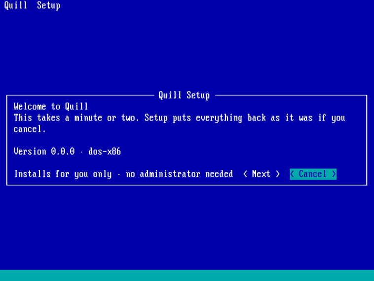
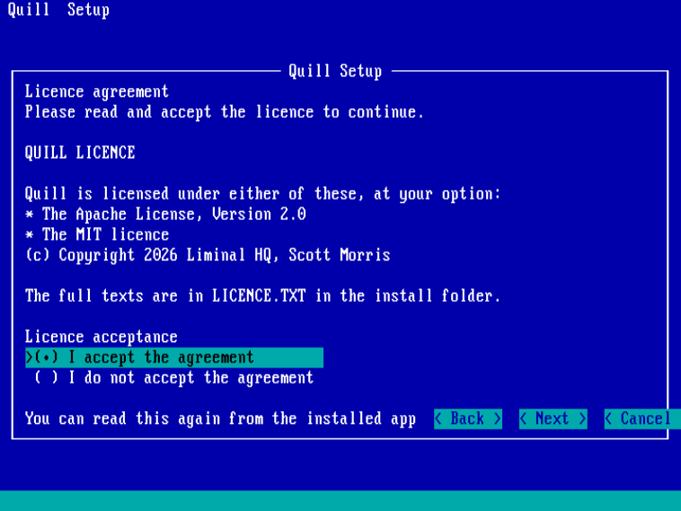
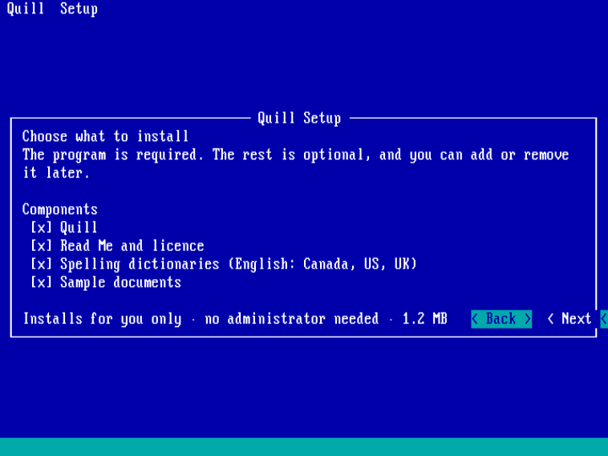
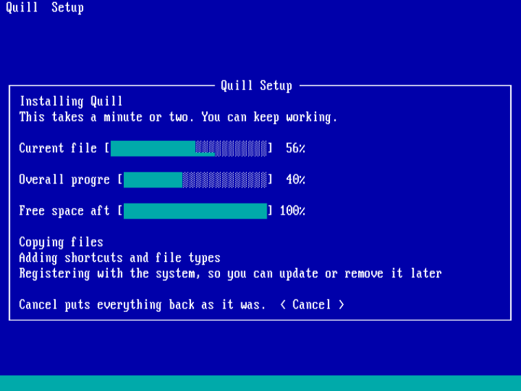
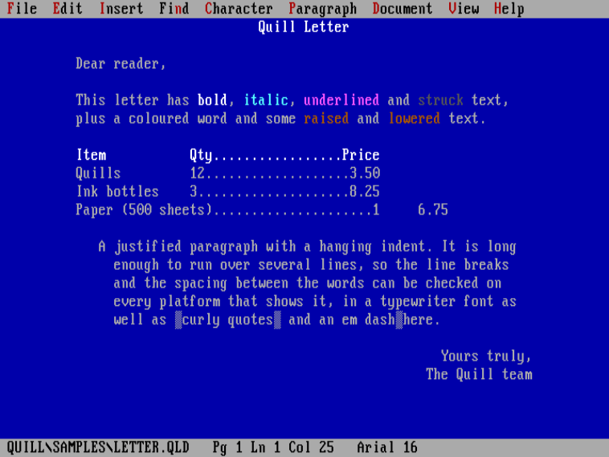
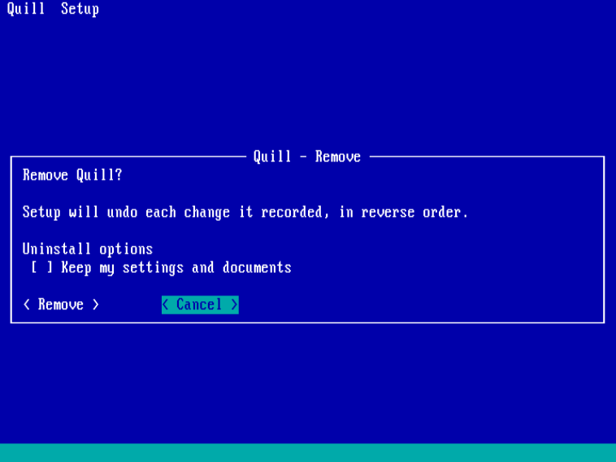
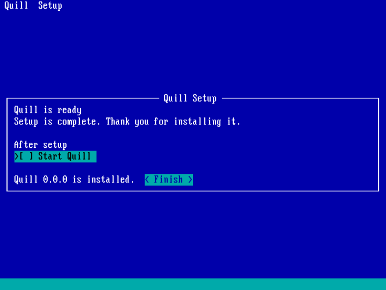

# The installer, installed

What `installer/` makes and how each disk is checked in an emulator. The project is described by [INS-1 to INS-3](decisions.md); this page is the evidence and the commands. The disks are built with `installer/tools/build-disks.sh` and checked with `installer/tools/verify-disks.sh`; the tests below install from those images.

Optional components are not yet optional: RTF and TXT start ticked, because the installer has no unticked-component field yet (INS-2). The wizard shows them ticked in every screenshot below.

## DOS

`installer/tools/e2e-dos.sh` copies the floppy's files to a folder DOSBox Staging mounts as `C:`, runs `SETUP.EXE` with keys typed through the emulated keyboard, checks every installed file against `installer/dist/`, runs Quill on a sample, then removes it with `SETUP /U`. The text of each screen the installer drew is also read back (`LI_DUMP`).

The screenshots come from `SHOTS=docs/media installer/tools/e2e-dos.sh`. The script starts its own virtual X server and DOSBox is a window on it, so it never reads or types into the desktop. It saves every distinct frame of a run and picks the pages by their order, which the keys fix.

| | |
|---|---|
|  |  |
|  |  |
|  |  |
|  |  |
|  |  |
|  |  |

The uninstall's last page is the install's "done" page with its wording, because the retro runtimes share one done layout. The copy itself takes under a second and is not on a frame.

To run it again:

```sh
bash dos/tools/fetch-tools.sh        # once
bash installer/tools/stage.sh --build && bash installer/tools/build-disks.sh
SHOTS=docs/media bash installer/tools/e2e-dos.sh    # leave SHOTS out to run without screenshots
```
