# The installer, installed

What `installer/` makes and how each disk is checked in an emulator. The project is described by [INS-1 to INS-3](decisions.md); this page is the evidence and the commands. The disks are built with `installer/tools/build-disks.sh` and checked with `installer/tools/verify-disks.sh`; the tests below install from those images.

Optional components are not yet optional: RTF and TXT start ticked, because the installer has no unticked-component field yet (INS-2). The wizard shows them ticked in every screenshot below.

## DOS

`installer/tools/e2e-dos.sh` copies the floppy's files to a folder DOSBox Staging mounts as `C:`, runs `SETUP.EXE` with keys typed through the emulated keyboard, checks every installed file against `installer/dist/`, runs Quill on a sample, then removes it with `SETUP /U`. The text of each screen the installer drew is also read back (`LI_DUMP`).

The screenshots come from `SHOTS=docs/media installer/tools/e2e-dos.sh`. The script starts its own virtual X server and DOSBox is a window on it, so it never reads or types into the desktop. It saves every distinct frame of a run and picks the pages by their order, which the keys fix.

| | |
|---|---|
|  | 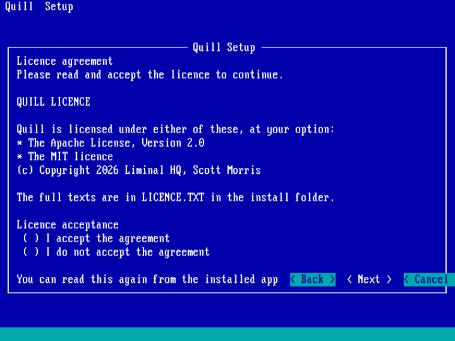 |
|  | 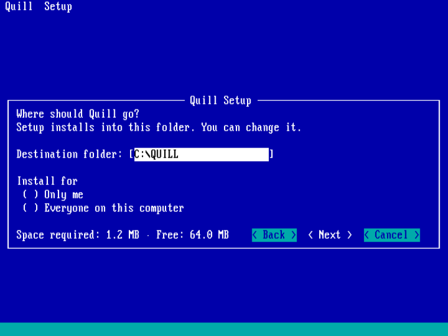 |
|  | 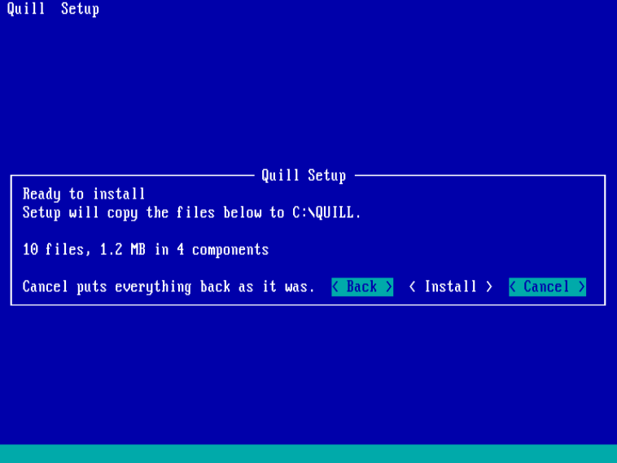 |
|  | 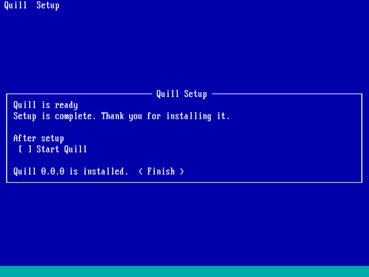 |
|  | 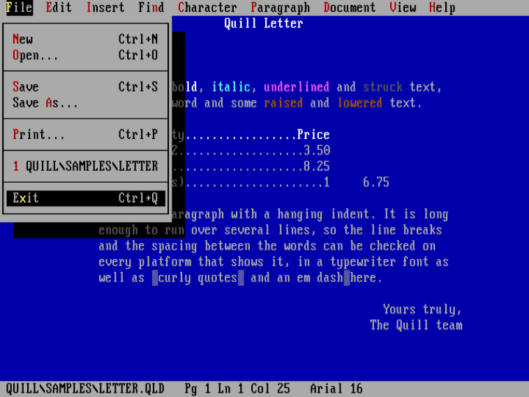 |
|  |  |

The uninstall's last page is the install's "done" page with its wording, because the retro runtimes share one done layout. The copy itself takes under a second and is not on a frame.

To run it again:

```sh
bash dos/tools/fetch-tools.sh        # once
bash installer/tools/stage.sh --build && bash installer/tools/build-disks.sh
SHOTS=docs/media bash installer/tools/e2e-dos.sh    # leave SHOTS out to run without screenshots
```

## Windows 3.x

`installer/tools/e2e-w31.sh` installs from `QUILL-W31.IMG` onto Windows for Workgroups 3.11 in DOSBox-X, starts Quill from Program Manager and removes it again. It needs the owner's Windows 3.11 tree (never committed): `W31_TREE`, by default the play harness's `~/.cache/quill16-play/w31-base`, which is only read, because the script copies it first. DOSBox-X runs in a container of its own on a private virtual X server, so the desktop is never read or typed into. The disk's files are on `D:`, and two Windows sessions run over the same `C:`:

1. `SETUP.EXE /PLAY ... /PAUSE=2500` steps through the wizard (each page is held for 2.5 s and the script takes its picture then), then Program Manager is brought up from its icon with Ctrl+Esc and Return, with the new group open. Return on the group's "Quill" item starts Quill.
2. `SETUP.EXE /U C:\QUILL` steps through the uninstall, and Program Manager is shown again.

The host checks every installed file against `installer/dist/` and the receipt, `QUILL.GRP` and `PROGMAN.INI`, the `qld=C:\QUILL\QUILL.EXE ^.qld` line in WIN.INI's `[Extensions]`, and after the uninstall that the files, the group, `QUILL.GRP` and the `qld=` association are gone and every other `[Extensions]` line is as it was.

| | |
|---|---|
| 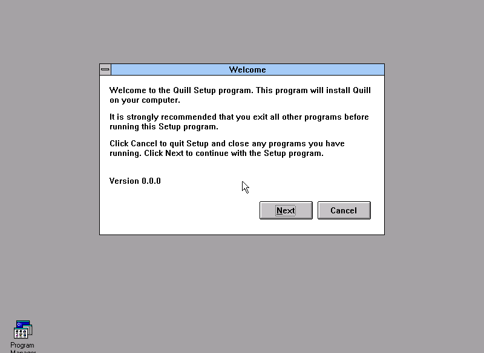 | 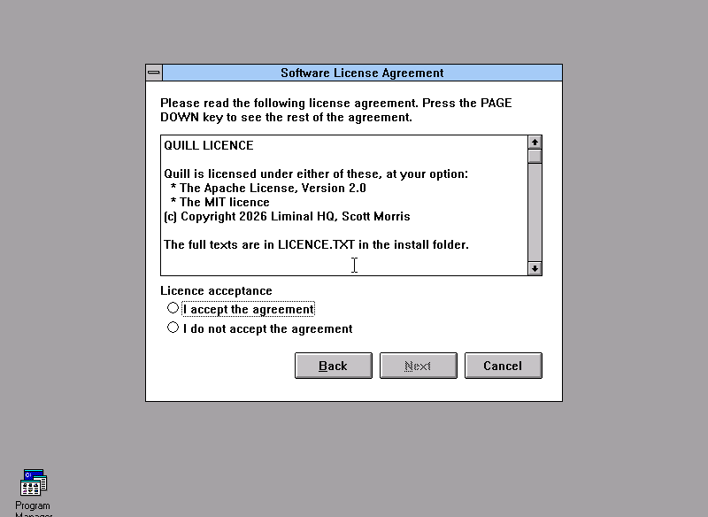 |
| 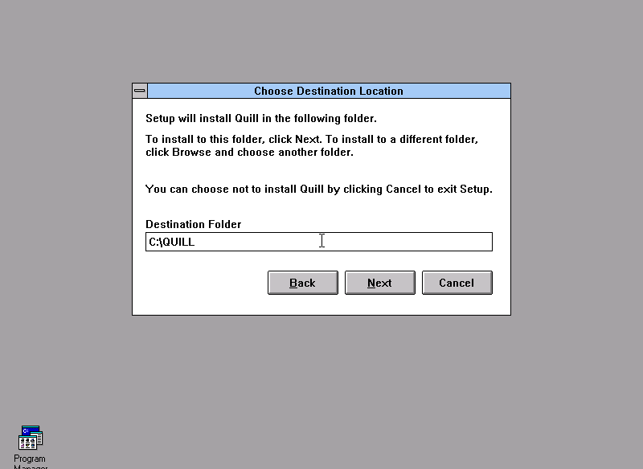 | 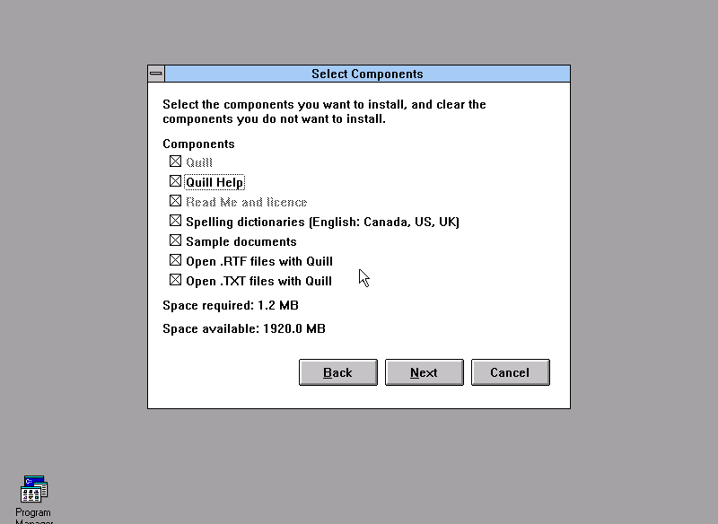 |
| 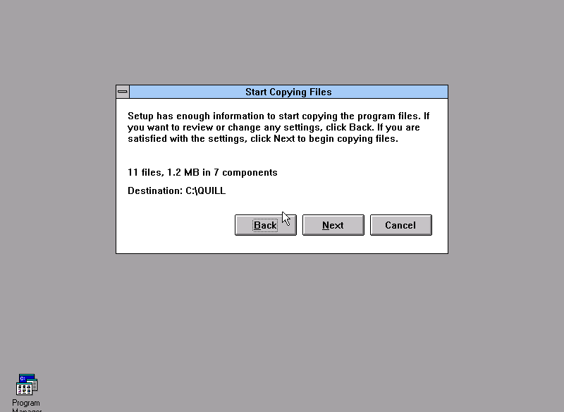 |  |
| 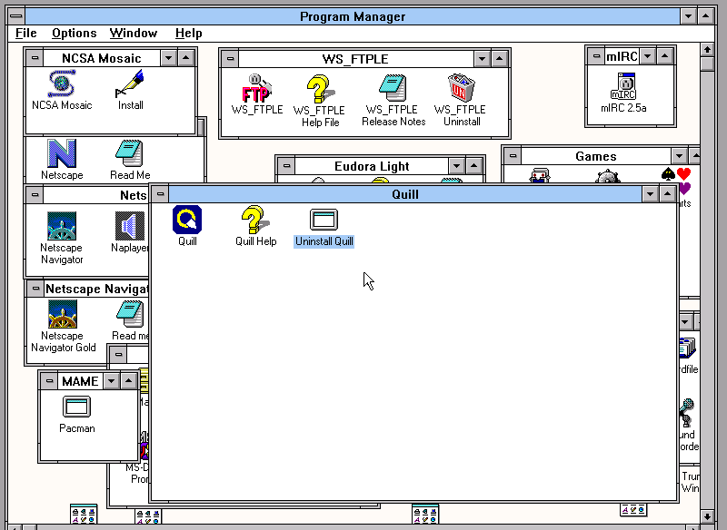 | 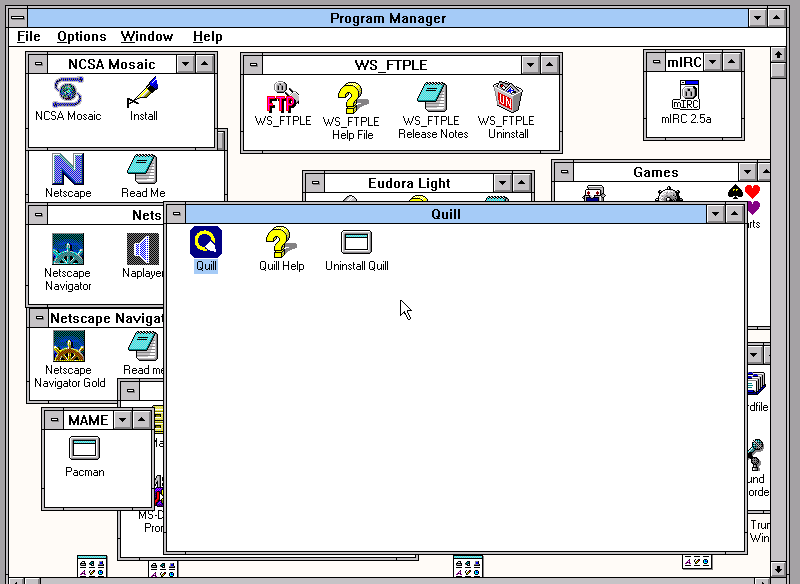 |
| 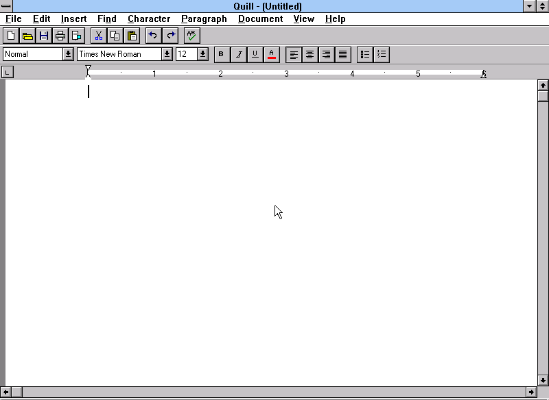 | 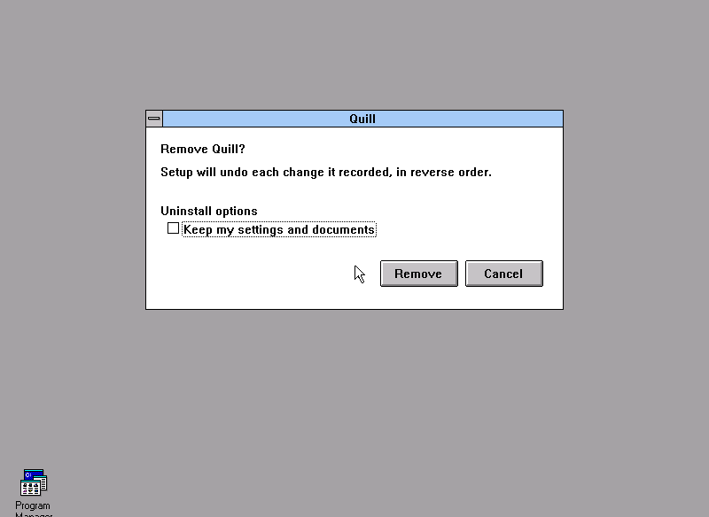 |
| 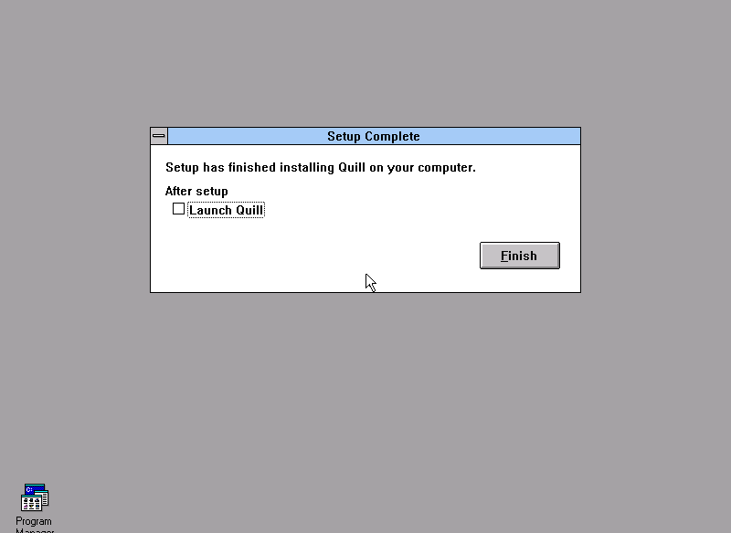 | 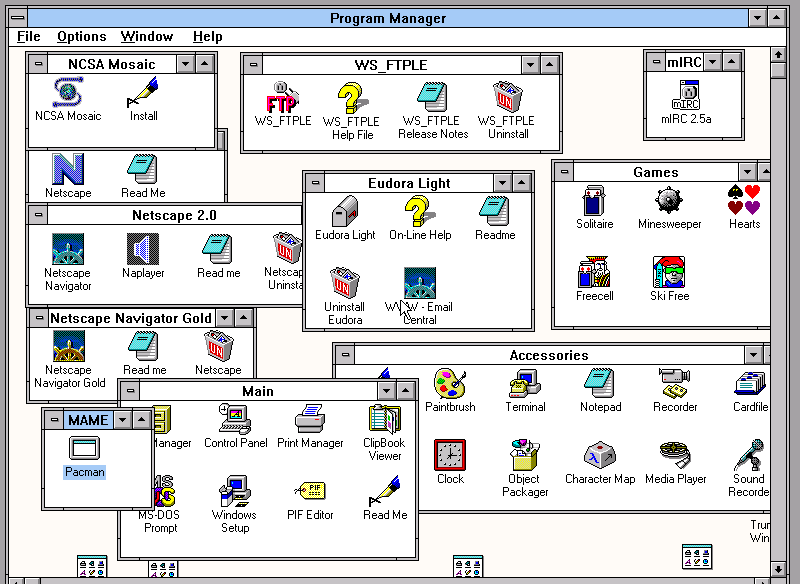 |

What the run showed, beyond passing:

- The group holds three items: Quill, Quill Help and Uninstall Quill (the install keeps `UNINST.EXE`).
- The optional components (`.RTF` and `.TXT` files with Quill) start ticked, so WIN.INI also gives `rtf=` and `txt=` to Quill, and the uninstall gives `txt=notepad.exe ^.txt` back. When the optional-components field lands, the ticked state in the screenshot changes and the script's note goes quiet.
- The uninstall leaves empty `qld=` and `rtf=` lines in `[Extensions]` for the types that had no owner. Windows reads an empty value as no association, so the check accepts them and the script says so. Removing the key is the installer's to fix.
- `C:\QUILL` is not removed when Quill has run from it: this Win16 build writes `QUILL.INI`, `STACK.LOG` and `PICS.LOG` beside the program, and the uninstall removes only what the receipt lists (INS-2). The script allows exactly those names and says so.
- The Win16 `QUILL.EXE` built from this branch opens its window and closes it about a second later when started under `win /3`, from `D:` as well as from `C:\QUILL`; the screenshot catches the window while it is up on most runs (on one run in five it came and went between two pictures, and the script then falls back on `STACK.LOG`, which Quill writes as it ends). The earlier Win16 build the play harness staged (349,072 bytes) stays open. This is for Quill, not the installer.
- The uninstall's last page repeats the install's wording ("Setup has finished installing Quill"), because the Windows 3.x runtime shares one done layout.

To run it again:

```sh
bash installer/tools/stage.sh --build && bash installer/tools/build-disks.sh
SHOTS=docs/media bash installer/tools/e2e-w31.sh    # leave SHOTS out to run without screenshots
```
