# Quill on Linux

What exists for Linux, what is planned, and why. The behaviour of each client is in [SPEC.md](../SPEC.md); the decisions made here are numbered D180 to D199 below and move into [decisions.md](decisions.md) when the open branches that also append to it have merged.

## Table of contents

- [Where things stand](#where-things-stand)
- [The terminal client](#the-terminal-client)
- [The command line](#the-command-line)
- [Fonts and measuring](#fonts-and-measuring)
- [The GTK4 client](#the-gtk4-client)
- [The GTK4 viewer (G1)](#the-gtk4-viewer-g1)
- [Desktop integration and packaging](#desktop-integration-and-packaging)
- [Wine as a stopgap](#wine-as-a-stopgap)
- [Work list](#work-list)
- [Modern conveniences](#modern-conveniences)
- [Decisions](#decisions)
- [Risks and what is not proven](#risks-and-what-is-not-proven)

## Where things stand

| Piece | Crate | State |
|---|---|---|
| Terminal client | `linux/quill-tty` | Built. Edits, saves and prints through the same `App` as DOS |
| Command line (`quill cat`, `convert`, `info`) | `crates/quill-cli` | Built |
| Outline-font measure, glyph source and test fonts | `crates/quill-fonts` | Built. The GTK4 viewer draws with it through `quill_paint::pixel` |
| Page renderer, thumbnailer, PDF | `crates/quill-raster`, `quill-thumbnailer` | Planned |
| GTK4 client | `linux/quill-gtk` | G1 built: a read-only viewer with scrolling, zoom, drag and drop, settings and a dark desk. Editing is G2 (D181, LNX-1 to LNX-6) |

The editor core needs nothing Linux-specific. Every client links the same `quill-core`, `quill-formats` and `quill-app`, so a `.QLD` or RTF file written on Linux is byte for byte what the other builds write.

What the open branches change, and what that means here:

- **There is no `Gui` or `Surface` trait.** The page painter that draws with real fonts belongs to the Windows 95 build (`gdi.rs`). `Surface` is still a plan (D31, D79), and the GTK client is the second user that D79 waits for.
- **Shared view geometry assumes 96 dpi** (`view.rs`, D95). The GTK client lays out at 1440 units to the inch, so that module takes its resolution from `Measure::resolution()` first.
- **There is no system clipboard.** `App` keeps its own 2 KB text clipboard. The GTK client needs `copy_rtf`, `copy_text`, `paste_rtf` and `paste_text` in `quill-app` (work item C1).

## The terminal client

`quill-tty [--mono] [--no-kitty] [FILE]` draws the DOS text screen in a terminal. The screen is `quill-grid`'s `Grid`: 80 columns by 25 rows, or 50 on a terminal 50 rows or more tall, centred across a wider window. Each CP437 cell is sent as its Unicode character with the VGA attribute as colours, so a screen here equals the DOS and host screens cell for cell (D182).

- **Colour.** The sixteen terminal colours by default, so the terminal's theme shows through. When `COLORTERM` is `truecolor` or `24bit` the VGA palette is sent as 24-bit colour. The monochrome scheme (`--mono`) draws the MDA underline attribute as an underline.
- **Redraw.** Only the cells that changed since the last frame are sent. A resize redraws everything. A terminal smaller than 80 by 25 shows a message instead.
- **Cursor.** A blinking underline in insert mode and a block in overtype, as on DOS, and hidden while a menu is open.
- **Paste** (bracketed paste) types the text: line ends are Enter, tabs are Tab, and characters Windows-1252 lacks are skipped.

### Keys

The mapper turns a terminal key event into a `Key`. Printable characters are converted from Unicode to Windows-1252, and anything with Alt or Super is ignored. F10 opens the menus. Some terminals keep F10 for their own menu (GNOME Terminal does until the shortcut is turned off in its preferences); Esc and the arrow keys work the same once a menu is open.

| Terminal sends | Editor key |
|---|---|
| Ctrl with a letter | `Ctrl(letter)`, so Ctrl+S saves and Ctrl+B is Bold |
| Shift with an arrow, Home, End, Page Up or Page Down | `Select`, which extends the selection |
| Ctrl+Home, Ctrl+End | `CtrlHome`, `CtrlEnd` |
| Ctrl with an arrow | Nothing (no such key in the editor) |
| F1 to F12, Insert, Delete, Esc, Tab, Enter, Backspace | The same keys |

**Ctrl+I is the Tab byte (0x09) in a legacy terminal**, and Ctrl+M is the Enter byte (0x0D). A terminal that speaks the kitty keyboard protocol reports each key as pressed. `quill-tty` asks the terminal whether it does and, if so, requests disambiguated keys (flag 1, the least that separates Ctrl+I from Tab). Then Ctrl+I is Italic. In a legacy terminal Tab stays Tab and **Italic is on the Character menu** (F10, Character, Italic). `--no-kitty` turns the request off. Ctrl+H (Replace) and Ctrl+J (Justify) are not affected, because a raw-mode terminal reports bytes 0x08 and 0x0A as those chords and sends 0x7F for Backspace; a terminal that sends 0x08 for Backspace will open Replace instead, and the kitty protocol fixes it.

### Files

The editor names files by Windows-1252 bytes. `LinuxFiles` turns a name into UTF-8 and resolves it (D183):

- `QUILL.INI` and `QUILL.UDC` live in `$XDG_CONFIG_HOME/quill` (`~/.config/quill`), in the same formats as on Windows.
- A bare dictionary name (`EN_CA.DIC`) is searched for in the current folder, beside the program, in `$XDG_DATA_HOME/quill` and in `quill` under each folder of `$XDG_DATA_DIRS`.
- Any other name is a path relative to the current folder. A name that does not exist is retried without regard to case, so a DOS-style `LETTER.RTF` finds `letter.rtf`, and a save goes over the file that is there.
- A command-line name must be representable in Windows-1252; otherwise `quill-tty` says so and exits.
- **Safe save.** `create` writes `.name.~tmp` next to the target; `close` flushes, syncs and renames it over the target and syncs the folder. A failed or abandoned save removes the temporary file and leaves the old one whole. A save through a symbolic link replaces the file it points to.

### What is not there yet

- **Mouse.** `quill-app` has no pointer entry on `main`; the pointer work is on an open branch.
- **System clipboard.** Copy and paste stay inside Quill, as on DOS. Pasting from the terminal works through bracketed paste.
- **Alt+letter menus.** The editor takes F10 only.
- **UTF-8 text files.** Plain text is read as Windows-1252 until the text option in `quill-formats` lands.

## The command line

`quill` (crate `quill-cli`) works on documents without a screen:

- `quill cat [--ansi] FILE` writes the text, one line to a paragraph, as UTF-8. Bullets and numbers are written before their paragraphs, a picture is `[Picture W x H]`, and a field is its name in brackets. `--ansi` shows bold, italic, underline and strikethrough as escape sequences, reset at the end of each line.
- `quill convert [--to qld|rtf|txt] IN OUT` reads by content and writes by the extension of OUT (`.rtf`, `.txt`, otherwise `.qld`). It writes the same bytes as `quill-convert`, which stays in `quill-host` for the LibreOffice check script.
- `quill info FILE...` prints the format, size, character, word and paragraph counts, pictures, fonts, paper, margins, headers and the pages of the DOS text layout.

A file of `-` is standard input and an OUT of `-` is standard output. Failures use the editor's words (`... is not a document Quill can read`) and exit 1; a usage error exits 2 (D184).

The name `quill` is the command-line tool for now. The GTK client wants the same name (D185).

## Fonts and measuring

The Windows 95 failure was widths measured through a scaled mapping mode that no longer agreed with the glyphs drawn. The Linux answer is one engine for both: the widths and the outlines come from the same font file, with no hinting, and the same mapping places the glyphs, the caret and the hit tests.

`quill-fonts` provides `OutlineMeasure`, a `quill_core::layout::Measure` over font files read with `skrifa` (D186):

- **Resolution.** 1440 units to the inch, so a layout unit is a twip. Screen, PDF and print then break lines in the same places. Another resolution can be asked for; 96 is used for the Windows comparison.
- **Advances.** The `hmtx` advance in font units, times the size in half points and the resolution, divided by 144 times the units per em, rounded once. A 144-point glyph still fits in `u16`.
- **Vertical metrics.** Ascent and descent are `usWinAscent` and `usWinDescent`, which GDI takes for `tmAscent` and `tmDescent`. External leading is the `hhea` line (ascender, descender and gap) beyond that extent.
- **Never hinted.** An advance depends on the font and the size in points, never on a pixel size, a zoom or a screen's scale. The tests check that skrifa's unhinted metrics are the `hmtx` advances scaled, at eleven pixel sizes.
- **Missing styles.** A face without a bold of its own is widened by 1/64 em in the advance, and the drawn outline gets the same emboldening; a missing italic keeps its advances and is slanted when drawn (D187).
- **Fallback.** The face asked for; then Times New Roman, Liberation Serif and the Quill test serif for a serif face (Arial, Liberation Sans and the test sans for a sans face; Courier New, Liberation Mono and the test mono for a monospaced one). A name the tables do not know uses the font table's family code. Faces are found by reading the usual font folders directly (`/usr/share/fonts`, `~/.fonts`, the XDG data folders); fontconfig is not needed, which keeps layout the same on every machine.

### The test fonts and their licence

The crate carries a Windows-1252 subset of Liberation 2.1.5 (Serif, Sans and Mono in four styles, about 215 KB, unhinted) so that goldens are the same everywhere. Liberation is licensed under the SIL Open Font License 1.1, which allows bundling, modifying and redistributing the fonts with software as long as they are not sold by themselves and the licence and copyright notices go with them.

**The licence does reserve font names.** The licence file that ships with `ttf-liberation` 2.1.5 says "with Reserved Font Arimo, Tinos and Cousine" for Google's digitized data and "with Reserved Font Name Liberation" for Red Hat. A subset is a Modified Version under the OFL, and a Modified Version may not use a Reserved Font Name. So the subsets are renamed Quill Test Serif, Quill Test Sans and Quill Test Mono, and the trademark and description entries of the name table, which name the reserved fonts, are dropped. The copyright, licence, designer and version entries stay, the licence text is in `crates/quill-fonts/fonts/LICENSE-LIBERATION.txt`, and the recipe and source checksums are beside the fonts. This is a reading of the licence, not legal advice.

Times New Roman, Arial and Courier New are never committed. They are used when installed, and nothing in a test depends on them.

### Comparison with Windows ME

`tests/golden/layout/letter.outline96-vs-windows-me.report.txt` compares the measure, at 96 dpi, with the widths and vertical metrics `QUILL32.EXE /CAPTURE` read on Windows ME, and lists the lines of the letter that start in a different place. It is a report, not a pass mark: GDI hints advances to whole pixels, and the outline measure does not. Today, 5,399 of 26,880 glyph widths differ by at least a pixel (most of them in Times New Roman and Arial; Courier New matches exactly from 9 point up), and the letter's 14 lines break the same way except in two paragraphs. On this machine the installed Times New Roman gives the same report as the Liberation subset, so the Liberation advances equal Times New Roman's for the 224 characters measured. Ascent is usually a pixel more on Windows at small sizes (11 against 10 at 8 point), which suggests GDI rounds the cell up; that is a guess the report does not settle.

## The GTK4 client

The client is GTK4 with libadwaita, in its own workspace under `linux/quill-gtk` so root CI never needs GTK headers (D181). The reasons, from what was checked on an Arch machine with GNOME on Wayland at a scale of 1.5:

- **GTK3's Rust bindings are unmaintained**, and GTK3 draws at the next whole scale and lets the compositor shrink it. GTK4's bindings (`gtk4` 0.11, `v4_24` feature) are current, and `libgtk-4.so` carries `wp_fractional_scale_v1`.
- **Qt via `cxx-qt`** has the best fractional scaling and accessibility, but needs a C++ build, is foreign on GNOME, and `QPainter`'s shaping would be bypassed anyway. **iced and egui** are pure Rust but lack native menus and portal dialogs, and egui has a weaker IME; egui is the fallback if GTK4 fails its first spike. **Tauri with a canvas** pushes pixels or text through WebKitGTK every frame.

### Architecture

| Crate | Holds |
|---|---|
| `crates/quill-fonts` | Built. Font loading, `OutlineMeasure`, the fallback table. Later: glyph rasterizing (skrifa outlines into tiny-skia paths, cached by font, size and quarter-pixel offset) |
| `crates/quill-raster` | Superseded for drawing by `quill_paint::pixel` (LNX-1). `Mapping` (layout units to device pixels) and `render_page(app, store, mapping, rect) -> Pixmap`, following `gdi.rs::draw_line`: runs, bold, italic, underline, strikethrough, super and subscript, colours, tab leaders, `line_label`, selection, caret, sheets, pictures, headers and footers in preview. It becomes the shared `Surface` painter |
| `crates/quill-cli` | Built, plus the `quill-thumbnailer` binary (no GTK, so it starts fast in the thumbnailer sandbox) |
| `linux/quill-gtk` | gtk4-rs and libadwaita: window, the `QuillPage` widget, menus, dialogs, IME, clipboard, printing |
| `linux/data` | `.desktop`, `.thumbnailer`, AppStream metainfo, icon install map, Flatpak manifest, PKGBUILD |

**Mapping.** `Mapping { zoom_pct, scale_120 }` turns layout units into device pixels as x × zoom × 96 × scale_120 ÷ (1440 × 100 × 120), in `i64`. Wayland reports scales in 120ths, so GTK's `f64` scale becomes an integer in the shell; the float ban covers only the portable crates. Glyphs, the caret, the selection, hit tests and the ruler all go through `Mapping`, and its reverse feeds `pos_at_point`.

**Drawing the page.** `QuillPage` (a GTK4 widget subclass) takes its device width as logical width times scale. `quill-raster` renders the visible strip in 512-pixel tiles cached by layout revision, and typing re-renders only the lines that changed. The result is a `gdk::MemoryTexture` appended to the snapshot at logical bounds. If spike G0 shows GTK resampling the texture, the fallback is cairo with a FreeType face from the same file, drawing glyphs at `Mapping` positions with measurement still in skrifa. **The page never uses Pango layout;** Pango is for GTK's own chrome.

**A Windows check mode.** `[Quill] Metrics=windows` would lay out with `CapturedMeasure` and place glyphs at its positions: slightly uneven, but the same line breaks as Windows ME.

### The shell

`QuillShell` is the GTK equivalent of the Win32 `Shell`:

- **Files** over `std::fs` with the same safe save as the terminal client. The app sees the base name in Windows-1252; the shell keeps the real `PathBuf`. Recent files go in `[RecentLinux]` of `$XDG_CONFIG_HOME/quill/QUILL.INI` and in GTK's recent-files list.
- **Keys** go through the IME filter first, then `quill_app::accel`. An IME commit is UTF-8 converted to Windows-1252, and a character with no such form is refused with a status message (D188). The candidate window is placed from the caret rectangle given by `Mapping`.
- **Mouse** uses `pointer.rs`.
- **Menus** are a `GMenuModel` from `menu_items` and `menu_title`, one action per `Command`, refreshed after each command. They are popovers, not a classic menu bar.
- **Dialogs:** `set_native_dialogs(true)` then `take_dialog()`. Open and Save As use `GtkFileDialog`, the save prompt `AdwAlertDialog`, About `AdwAboutDialog`, and Find, Replace, Fonts, Tabs and Spelling a generic builder from `assets/dialogs/dialogs.json` (D86).
- **Clipboard:** `GdkClipboard` offering `text/rtf`, `application/rtf`, `text/plain;charset=utf-8` and `image/png` for a lone picture.
- **Printing** writes a PDF from `quill-raster`'s page and hands it to the print portal (D189).
- **Text files** on Linux are usually UTF-8, so `quill-formats` gains a UTF-8 option: read UTF-8 when valid, and offer "Text Files (UTF-8)" on Save As, as DOS does with CP437 (D190).

### Spike G0

The first GTK work is a spike that answers what is not known: whether GTK4 shows a texture of exactly device size one to one at a scale of 1.5 without resampling; whether a cairo drawing area is sharp at fractional scales; whether IBus compose and preedit work in a custom widget; and whether `GtkFileDialog` uses the portal outside Flatpak. The result is written back into this file.

## The GTK4 viewer (G1)

`linux/quill-gtk` builds `quill`, a read-only viewer, in its own Cargo workspace (it needs the GTK4 development files; `make gtk` runs its format check, clippy and tests). The app id is `io.github.liminal_hq_labs.Quill`, and the application handles files itself (`HANDLES_OPEN`), so a second `quill FILE` is meant to open the file in the first window.

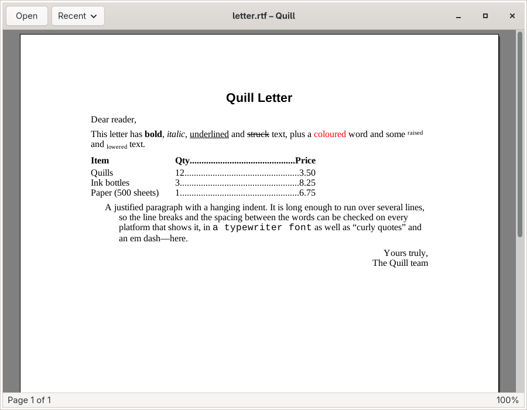

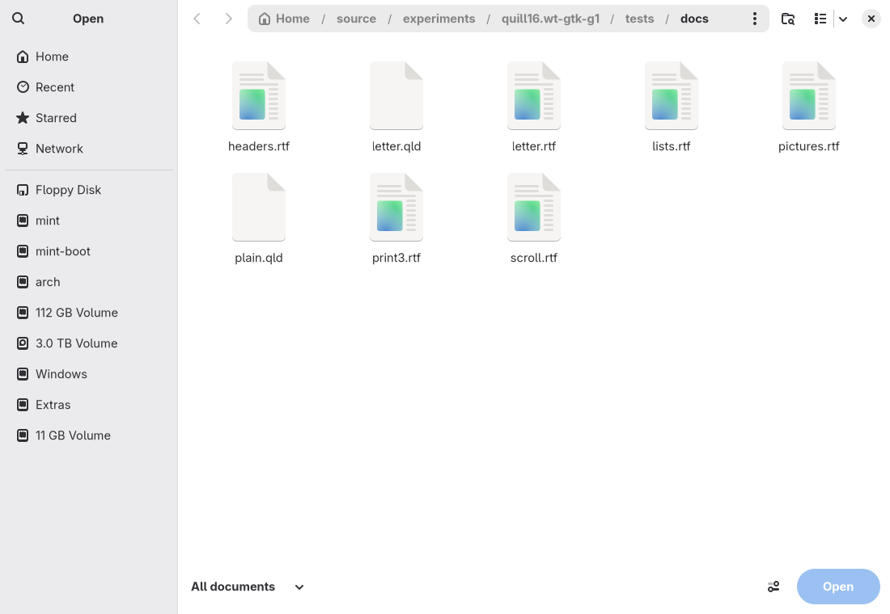

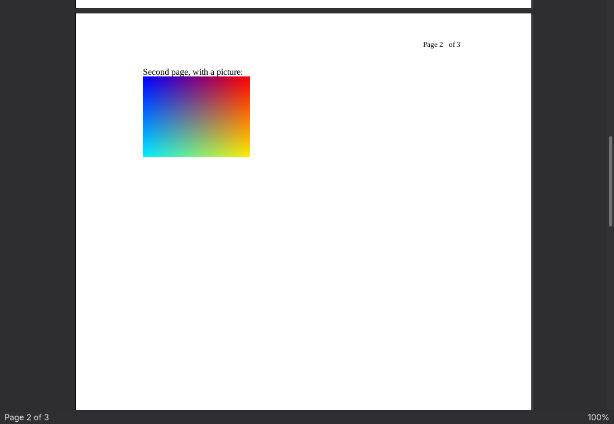

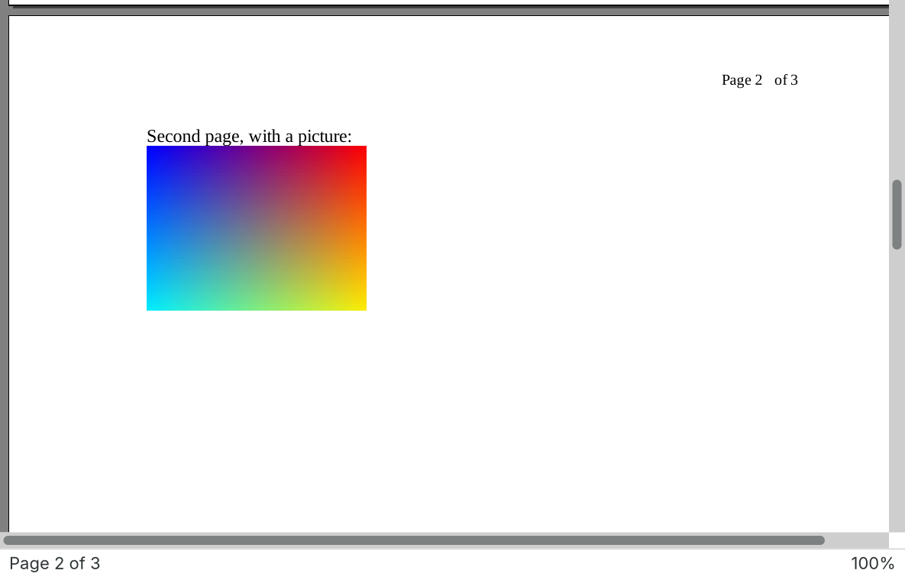

### What it does

- **Open.** From the command line (`quill letter.rtf`), from Ctrl+O or the Open button (`GtkFileDialog`, filters for `.qld`, `.rtf` and `.txt` matched without regard to case), from the Recent button (the editor's own four-name list), and by dropping a file on the window. A file that will not open leaves the open document alone and says why in an alert.
- **Scrolling.** The wheel (48 document pixels a notch, Shift for sideways) and two scroll bars; the bars follow the view in both directions. (G1 also scrolled with the arrow keys, Page Up and Page Down, Space and Home and End; since G2 those keys move the caret and the view follows it.)
- **Zoom.** Ctrl+wheel, Ctrl+plus, Ctrl+minus and Ctrl+0 (100 %), and Ctrl+9 for page width, over the editor's own range of 25 to 200 % (page width never goes above 100 %). The point under the pointer stays under it. The status line shows `Page X of N` and the zoom.
- **Title.** `Name – Quill`, and `*Name – Quill` when there are unsaved changes (D194). The viewer never has any, but the title function is `quill_gtk::names::title` and is tested.
- **Names.** The editor names a file by Windows-1252 bytes. A build with long names (the same `long-names` feature the Windows 95 build uses) keeps an absolute path up to 260 bytes, so the recent list opens it again next session. A path with a character Windows-1252 lacks gets a stand-in name for the session; it opens, but it cannot be reopened from the recent list in a later session. The title and the recent menu show the long UTF-8 name.
- **Settings.** The window's size and whether it was maximized are in `$XDG_CONFIG_HOME/quill/gtk.ini`. The recent files (`[Recent32]`) and the zoom (`Zoom=`, `Width` for page width, which is the default) are in the editor's own `QUILL.INI` in the same folder, written through `App::save_settings`, so every client reads them.
- **Full screen** with F11, and **Quit** with Ctrl+Q.
- **Dark mode.** The desk follows GTK's colour scheme (`gtk-interface-color-scheme`, else the older dark-theme setting) and changes when it does. The paper is white in both. Since G2a the scheme comes from libadwaita's `StyleManager` (see below).

### How it is built

- **`quill_gtk` (the library, no display needed).** `view` is the view model: `Mapping { zoom_pct, scale_120 }`, the page `Geometry`, scroll, zoom, the visible sheets, the current page and the scroll bar ranges. `doc` holds the shared `App`, its store and files and draws the visible sheets. `files` is `quill-tty`'s `LinuxFiles` plus the stand-in names. `names` and `settings` are small and tested.
- **`QuillPage` (the widget).** On a snapshot it asks the view for the sheets on screen, has the document paint them into an RGBA buffer of (widget size × display scale) device pixels, and appends it as a `gdk::MemoryTexture` after the spike's pixel-grid shift. The texture is kept until the document, the scroll, the zoom, the size, the scale or the theme changes, so a repaint with nothing new does no layout and no drawing. The scale is `gdk::Surface::scale()` in 1/120 and is re-read on `notify::scale`.
- **Layout and drawing.** The layout is the app's own at 96 pixels to the inch, laid out into checkpoints when a file opens (`App::open`), so a paint walks only the lines of the sheets on screen through `quill_paint::page::paint_sheet`, the print-preview painter, which also draws headers, footers and page-number fields. `Mapping::scale()` is `zoom × scale_120 ÷ 12000` as a `quill_paint::pixel::Scale` (1/256), so each edge is rounded once whatever the zoom and the display (LNX-1).
- **The window** (`window.rs`) only connects GTK's events to those parts.

### Command line

`quill [FILE]`, `--help` and `--version`. For tests and screenshots: `--scale-120 N` draws at N/120 whatever the display says, `--zoom`, `--scroll`, `--size WxH`, `--dark` and `--light`, `--vendored-fonts` (the test fonts only, so a render is the same on every machine), `--no-settings`, `--open-dialog`, `--dialog NAME` (find, replace, fonts, tabs, spelling or about), `--self-test-dialogs`, `--dump FILE` (write the page texture and say where it sits), `--screenshot FILE` (render the window's content with GTK's own renderer, then quit) and `--new-instance`.

### What was proved

- **Opens every document.** `tests/viewer.rs` opens every `.rtf` and `.qld` in `tests/docs` and in `samples` (the demo document that ships included), checks the title, draws it at scales of 1.0, 1.25 and 1.5, and checks the buffer's size, the white sheet and the ink on it.
- **The layout equals the goldens.** `Document::dump_layout` lays the open document out again at 1440 units to the inch with the vendored fonts and writes `dump_story`'s text; for `letter`, `lists`, `headers`, `pictures` and `plain` it equals `tests/golden/layout/*.outline-1440.txt` byte for byte. What the window shows is the same document laid out at 96, as the Windows and DOS graphics builds do; the 1440 dump proves the viewer reads the same document through the same code, not that the screen's line breaks are the dump's.
- **Pixel goldens.** `tests/golden/gtk/letter.1.00.png`, `letter.1.50.png` and `lists.1.25.zoom125.dark.png` are the viewer's buffers at a display scale of 1.0, 1.5 and 1.25 with a zoom of 100, 100 and 125 %, compared byte for byte (the surface is deterministic software drawing, so no tolerance is needed; `QUILL_UPDATE_GOLDEN=1` rewrites them). `docs/media` shows what GTK does with them.
- **The view model.** 23 unit tests cover the mapping, the device size, scroll limits, centring, sideways scroll, visible sheets, the status page, page keys, the zoom steps and limits, zooming around a point, page-width zoom, scroll bar ranges, the title, names, the stand-in names and settings. Two more tests check that recent files and zoom come back in the next session.
- **The page is pixel-exact in a real frame.** `linux/quill-gtk/tools/frames.sh` (its own Xvfb; stops only that process) compares each frame with the texture the client says it drew, pixel for pixel: an X capture at scale 1 (876 × 619 pixels, 6,213 dark text pixels for `letter.rtf`; the same run on `samples/demo.rtf` gave 8,182, with its pictures), an X capture at `GDK_SCALE=2` (1,752 × 1,238), and a capture from a headless Weston at scale 2 (3,576 × 2,350, run by hand). Every one is 100.000 % equal with a largest channel difference of 0.
- **And at fractional scales,** from GTK's own renderer drawing the window's content at 1.25, 1.5 and 1.75 (and 1.0 and 2.0): 100.000 % equal in each, text included. This is what the spike measured on GNOME, now with the real page.
- **Input.** Under Xvfb with `xdotool` (no window manager): Ctrl+plus, Ctrl+minus (100 % to 90 % to 75 %), Ctrl+0 (100 %), Ctrl+9 (81 % in a 700-pixel window), Page Down, End, the wheel and Ctrl+Q act as described, and a Ctrl+Q after zooming leaves `Zoom=125`, the window size and the recent file in the settings. The Open dialog opens, lists the folder of the open file and filters by type (`docs/media/gtk-viewer-open-dialog.png`).

### Not proved

- **Fractional scales on a real compositor.** Weston has no fractional-scale protocol, and X11 has only whole scales, so 1.25, 1.5 and 1.75 are shown through GTK's offscreen renderer, not a compositor's output. The spike did show a 1.5 compositor frame on GNOME, with the same shift.
- **A choice in the Open dialog.** The dialog was shown and the file filters checked, but picking a file in it was not driven (the portal and a window manager were absent, so it ran in GTK's own dialog under Weston and a private session bus).
- **Drag and drop** from a file manager, **the recent menu**, **F11** (there was no window manager to honour it) and **the hand-off to a running window** (the tests ran with `--new-instance`) were not driven. Drop, recent and the command line share `Ui::open_path`.
- **Moving the window between monitors of different scales,** maximize and full screen at a fractional scale.
- **IME and Orca:** G2 added the input method (below); Orca is G7. G1 took no text input.
- **The chrome around the page** (menus, bars, dialogs) arrived in G2a, below; the viewer sections above describe the page and the view as G1 built them.
- **Smooth scrolling is in whole document pixels,** so at 200 % on a 2× display a notch of the wheel moves 4 device pixels at least.
- **A page-width zoom while the window is resized** redraws on each size change; its cost on a very long document was not measured.
- **Pictures are scaled by repetition** (D213), so a picture at 1.5 is blocky when it has hard edges.

## The libadwaita shell and the chrome (G2a)

The window now looks and behaves like a GNOME application, and carries the Windows build's information architecture: a menu bar, a toolbar, a formatting bar, a ruler, a status bar and the dialogs. It is built with libadwaita 1.10 (the `libadwaita` crate 0.9; the host has `libadwaita-1` 1.10 and GTK 4.24), `adw::Application`, `adw::ApplicationWindow`, `adw::ToolbarView`, `adw::HeaderBar`, `adw::StyleManager`, `adw::AlertDialog`, `adw::AboutDialog`, `adw::Dialog` and `adw::ToastOverlay`. The symbolic icons are Adwaita's own; none is bundled. Every command that the chrome runs goes through the shared `App`. G2a had no keys, caret or pointer yet, so only the commands that need none worked (Select All, a format applied to a selection, Undo and Redo, the bars, zoom, Open, Save, New, Find, the Fonts, Tabs and Spelling dialogs); editing arrived with G2, below.

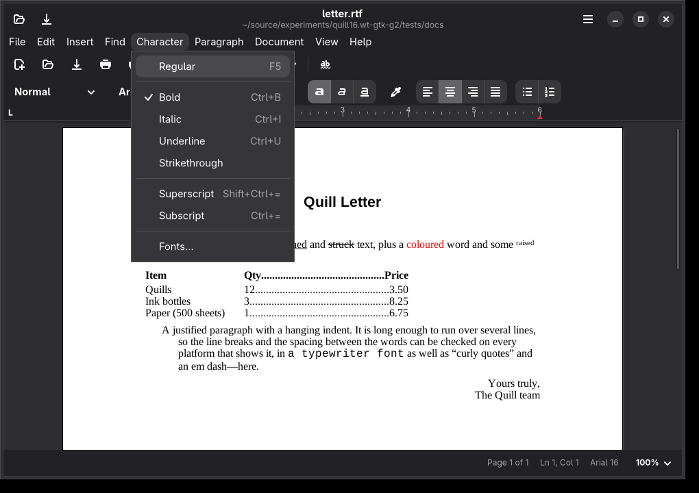

### The parts

- **Header bar.** The document's name with a `*` before it when it has unsaved changes (D194), its folder under it (the home folder as `~`), Open and Save buttons, and a primary menu (New, Open, Save As, Zoom, Menu Bar, Full Screen, About).
- **Menu bar.** A `gtk::PopoverMenuBar` under the header bar with File, Edit, Insert, Find, Character, Paragraph, Document, View and Help. Its tree, order, labels, mnemonics, groups and accelerators are read from the one table the DOS, Win16 and Win32 menus are made from (`quill_app::menu_items`), so a change there reaches this bar; the recent files sit before Exit, as on Windows. Check marks and greyed items come from `App::menu_mark`: each command is a stateful or plain `win.NAME` action, and `Ui::sync_actions` sets its state and sensitivity after every change. View > Menu Bar (Ctrl+Shift+M, and the primary menu) shows or hides the bar; it is on by default and remembered in `gtk.ini`.
- **Toolbar.** The Windows toolbar's first row, in its order and groups: New, Open, Save, Print, Print Preview; Cut, Copy, Paste; Undo, Redo; Spelling. Flat buttons with Adwaita's symbolic icons and the tips of the shared `command_tip` table (with the accelerator).
- **Formatting bar.** The paragraph style, font and size boxes (`gtk::DropDown`; the font box lists the families the renderer can draw and the document's own face when this machine lacks it), Bold, Italic and Underline, a text colour list (Automatic and the sixteen colours), the four alignments, and bullets and numbering, as toggle buttons on the same actions the menus use, so they follow the caret through the shared state.
- **Ruler.** A custom widget (`QuillRuler`) drawn with `GtkSnapshot` in the widget's own foreground colour and the system accent, so it follows the scheme. It shares the Windows ruler's scale, markers, hit tests and drags from `quill_chrome::view`: the text area between the margins, a tick every eighth of an inch with the inches numbered, the first-line and left indent markers, the right indent and the tab stops. Dragging a marker sets the indents; clicking the scale sets a tab stop of the kind the button at the left chooses (L, C, R, D); clicking a stop removes it. It follows the sheet when the page scrolls sideways and the zoom.
- **Status bar.** The editor's message, `Page X of N`, `Ln L, Col C`, the face and size at the caret, a `Mod` mark when there are unsaved changes, and the zoom as a menu button.
- **Bars.** View > Toolbar, Formatting Bar, Ruler and Status Bar show or hide each bar; they are the editor's own `Toolbar`, `FormattingBar`, `Ruler` and `StatusBar` settings in `QUILL.INI`, so every client shares them and they come back next session.
- **Dialogs.** `quill_dialogs` (the description in `assets/dialogs/dialogs.json` that the Windows resources are built from) is turned into rows by `dialogs::spec_of`, and `DialogView` builds `adw::Dialog` widgets from them and keeps each control by its control ID. Find and Replace, Fonts, Tabs and Spelling are wired to `App` (`find_text`, `set_font`, `set_tab` and `clear_tabs`, `spell_begin` and the spelling calls). About is an `adw::AboutDialog` with the Quill icon, filled from the description's texts. The unsaved-changes question is an `adw::AlertDialog` (Save, Don't Save, Cancel) whose verdict is `quill_app::session::end_session_allowed`, as on the Windows shells; it is asked on New, Open, Exit and closing the window, and when a file is dropped on or handed to a window that has changes. Insert Picture and Save As use `GtkFileDialog`; a Save As name with no extension gets `.qld` from `quill_app::savename::complete_name`.
- **Toasts.** `Saved`, a failed save and the editor's other short messages show in an `adw::ToastOverlay`.
- **Scroll bars** float over the page's edges and thin to an indicator until the pointer is near them, as a scrolled window's do. This is the one thing that overlaps the page texture, so `frames.sh` leaves out the 16 pixels at the right and bottom when it compares a frame with the texture.
- **Icon and desktop entry.** `linux/data/icons/hicolor/scalable/apps/io.github.liminal_hq_labs.Quill.svg` (the Q-and-nib app icon, `assets/icon/quill.svg`), the document icons `application-x-quill-document` (scalable, and symbolic under `symbolic/mimetypes`) and `linux/data/io.github.liminal_hq_labs.Quill.desktop`. A build run from the source tree adds `linux/data/icons` to the icon search path, so the window, the About dialog and the task switcher show the icon before it is installed.

### How it is built

Each part is a module of `quill_gtk` with a plain-data half that needs no display and a widget half: `actions` (command to action name, accelerator and label conversion, and the `Commands` trait the chrome calls through), `menu` (the tree, `tree`, and its `gio::Menu`), `toolbar` (the buttons from `view::TOOLBAR`), `format_bar` (`FormatState`, `FormatEdit`, `apply`), `ruler` (`layout` from a `RulerState` and the sheet's place, `RulerEdit`, `apply`), `status` (`StatusInfo`) and `dialogs` (`spec_of`, `DialogView`, the controllers). `window.rs` only wires them: one action for every command of the tree, `Ui::run_command` routing (zoom and the bars here; Save, Open and New through the file dialogs; everything else to `Document::command` and the dialog it returns), and `Ui::refresh` bringing every bar up to date after a change.

### Keys

The menu tree's accelerators are registered as they are written (`Ctrl+N`, `Ctrl+Shift+=`, `F3`). Where GTK's habit and the Windows tree meet, the tree wins and the zoom moves: Ctrl+= is Subscript and Ctrl+Shift+= Superscript, so zoom in is Ctrl+numpad plus (and Ctrl+wheel); Ctrl+minus, Ctrl+0 and Ctrl+9 stay as G1 had them. Save As is also Ctrl+Shift+S. While a text field of a dialog has the focus, Ctrl+C, Ctrl+V, Ctrl+X, Ctrl+A, Ctrl+Z and Ctrl+Y are handed back to the field.

### What was proved

- **Tests** (`cargo test`, 61 in all): the action names round-trip for every command and none repeats; the Windows accelerators become GTK ones; the tree has the nine menus in order with the Windows items and groups, the recent files before Exit, and the View menu's bars; no accelerator is bound twice; the toolbar is the Windows toolbar's row 0; every dialog description lands in a spec (find, fonts, tabs and spelling checked by shape); the ruler's layout follows the sheet and the zoom; and over a real document: the check marks and greyed state of the commands, the bars' settings coming back in the next session, the dialogs the menus ask for, the formatting bar's state and its edits, the ruler's indent and tab edits, the status bar, Save As with the default extension, New and a recent file.
- **Screenshots** (`linux/quill-gtk/tools/chrome-shots.sh`, a private Xvfb, X captures that were looked at): `gtk-chrome-light.png`, `gtk-chrome-dark.png`, the Character menu in dark (`gtk-chrome-menu-character-dark.png`) and the View menu in light (`gtk-chrome-menu-view-light.png`) with their check marks and accelerators, the font box open (`gtk-chrome-font-dropdown-dark.png`), the ruler with a centre and a decimal tab stop (`gtk-chrome-ruler-tabs-light.png`), the window with the bars hidden (`gtk-chrome-bars-hidden-light.png`), the Fonts, Tabs, Find and Spelling dialogs, About, and the unsaved-changes question after a change (`gtk-chrome-unsaved-alert-light.png`), which also shows the title's `*`, the `Mod` mark and the formatting bar following the selection.
- **The page is still pixel-exact.** `frames.sh` gives 100.000 % equal and a largest channel difference of 0 in an X capture at scale 1 and at `GDK_SCALE=2` and in GTK's render at 1.0, 1.25, 1.5, 1.75 and 2.0, outside the 16 pixels the floating scroll bars may cover. The G1 pixel goldens and tests pass unchanged.
- **A test hook for the dialogs.** `quill --self-test-dialogs` shows each of Find, Replace, Fonts, Tabs, Spelling and About, presses every button that does not close it and says what happened; `quill --dialog NAME` shows one. With a dictionary in `$XDG_DATA_HOME/quill` the Spelling dialog found a misspelling, listed suggestions and answered all five of its buttons.

### Not proved

- **A real GNOME session.** Everything was seen under Xvfb with Adwaita's default look and no window manager, so the header bar's window controls are libadwaita's own drawing, not the compositor's; the system accent colour, the `prefer-dark` setting from the desktop and a different icon theme were not tried (the accent in the shots is libadwaita's default). Weston and the portal dialogs were not rerun for this step.
- **Mnemonics** were first run in G3 (see Dialogs and keyboard); the accelerators were exercised through Ctrl+A, Ctrl+F and Ctrl+Q; the rest of the table is tested as data.
- **The ruler's drags** and the tab-kind button were checked by clicking the scale and the button, not by dragging a marker.
- **Print, Print Preview, Print Setup and Help** show a toast that says they are not in this client yet (G6).
- **Orca and keyboard navigation** of the new bars are G7.

## Editing in the GTK client (G2)

The page is now an editor: keys, an input method, the caret and its blink, the selection, the pointer, and Save. The commands the chrome already routed (cut, copy, paste, undo, redo, the character and paragraph formats, lists, fonts, find and replace, spelling, tabs, the ruler) work on a real caret and selection, and the status bar, formatting bar and ruler follow the caret. Recovery autosave is not part of it (the autosave plan covers that).

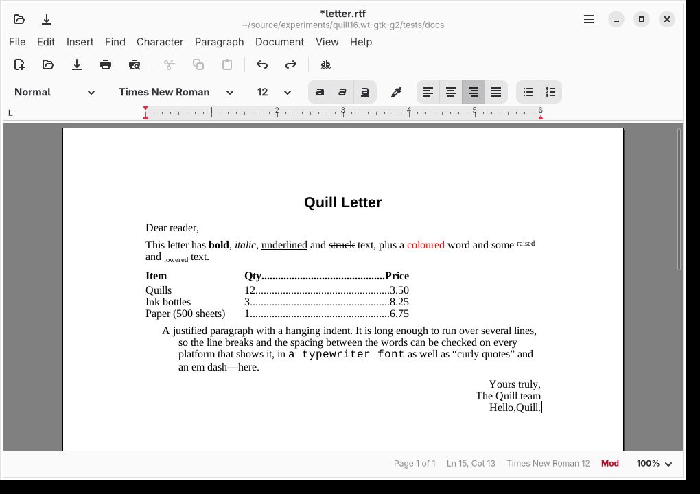

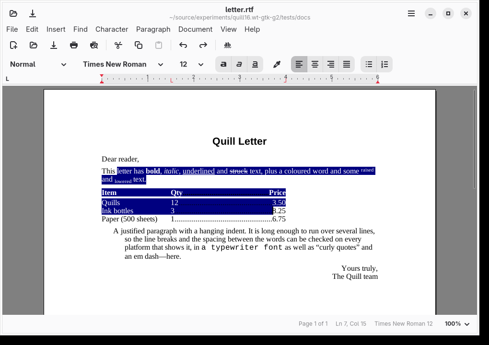

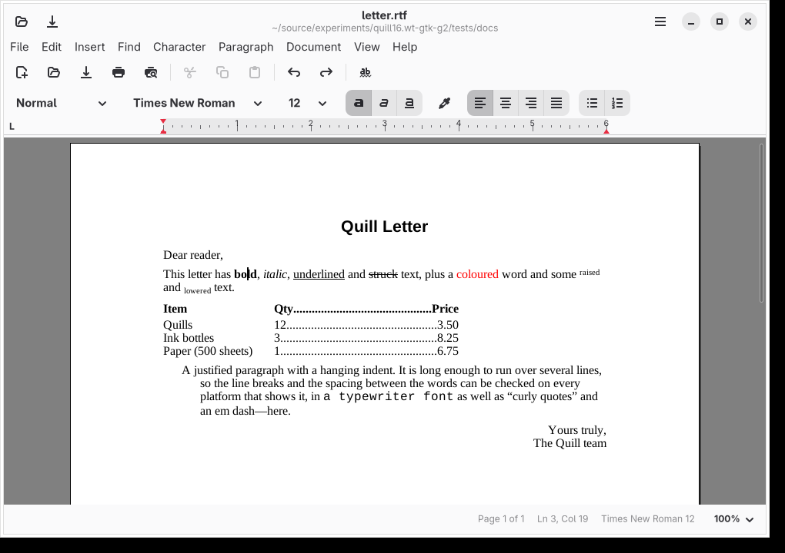

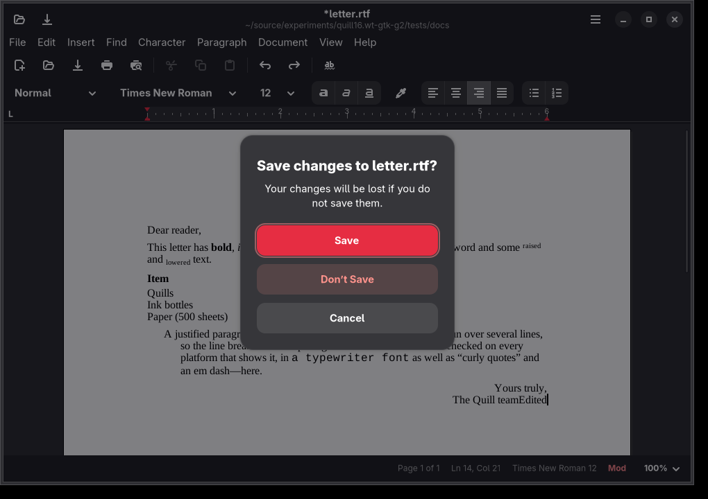

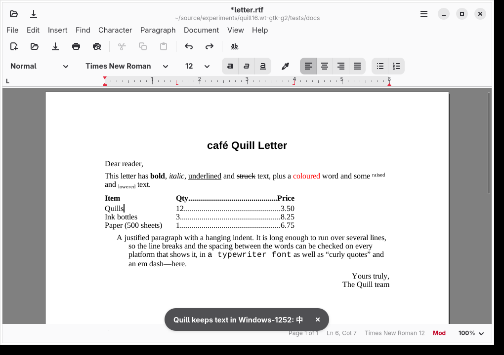

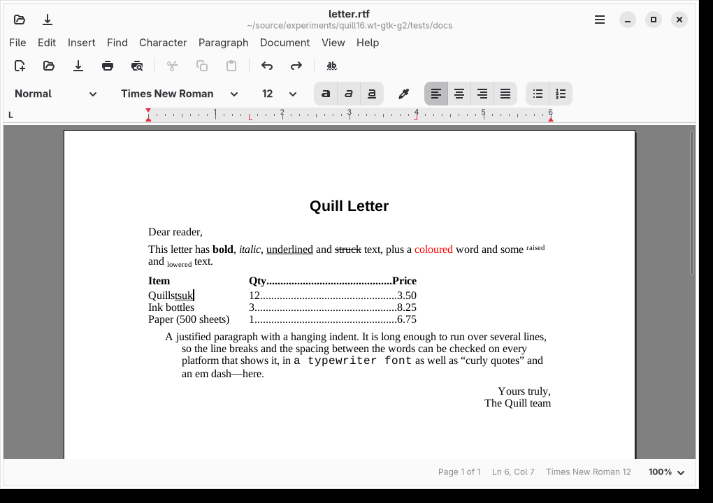

### The key map

`quill_gtk::keys::map_key` turns a keyval and the modifiers into what the editor does. The editor's own `Key` is used wherever the other shells use it; the two rows marked *GTK layer* are movements the editor has no key for, done in `quill_gtk::command` over the editor's own caret calls.

| Key | Does |
|---|---|
| Arrows, Home, End, Page Up, Page Down (and the keypad ones) | `Key::Left` and the rest: move the caret |
| Shift with any of those | `Key::Select(dir)`: the same movement, extending the selection |
| Ctrl+Home, Ctrl+End | `Key::CtrlHome`, `Key::CtrlEnd` |
| Ctrl+Left, Ctrl+Right (with Shift: extend) | *GTK layer:* a word left or right (a word is what a double click takes, its letters and the spaces after) |
| Ctrl+Shift+Home, Ctrl+Shift+End | *GTK layer:* select to the start or the end of the document |
| Enter, Tab, Backspace, Delete, Esc, Insert | `Key::Enter`, `Tab`, `Backspace`, `Delete`, `Esc` (drops the selection), `Insert` (overtype) |
| F1 to F12 | `Key::F(n)`: F1 Help, F3 Find Next, F5 Regular, F7 Spelling, F8 extend mode (F10 does nothing: the menus are the window's) |
| Ctrl+B, Ctrl+I, Ctrl+U, Ctrl+L, Ctrl+E, Ctrl+R, Ctrl+J | the menu tree's accelerators run Bold, Italic, Underline and the alignments (LNX-8) |
| Ctrl+X, Ctrl+C, Ctrl+V, Ctrl+A, Ctrl+Z, Ctrl+Y (Ctrl+Shift+Z) | Cut, Copy, Paste, Select All, Undo, Redo; the clipboard is the editor's own (below) |
| Ctrl+S, Ctrl+Shift+S, Ctrl+N, Ctrl+O, Ctrl+Q | Save, Save As, New, Open, Exit |
| A printable key | the input method commits it as text; if it does not filter the key, the key's character is typed |
| Alt with anything | left to the menu bar's mnemonics |

Key repeat is GTK's: each repeat is another key press through the same path.

### Text, the input method and Windows-1252

The page owns a `GtkIMMulticontext` (`EventControllerKey::set_im_context`), so a printable key reaches the document as the input method's `commit`, and dead keys and the compose key work through it. `commit` goes to `Document::type_text`: each character Windows-1252 has a form for is typed as the key for that byte, a line break is Enter, a tab is Tab, other control characters are dropped, and any other character is refused with a toast and a status line saying `Quill keeps text in Windows-1252:` and the character (D188). The rest of the string still goes in.

While an engine composes, `preedit-changed` gives the text, which is drawn under the caret in the page's own painter with an underline, on white, over the text that follows it on the line (it is not in the document, and a character Windows-1252 cannot draw shows as `?`). `set_cursor_location` is given the caret's rectangle in the page's coordinates after every change, so a candidate window sits beside it; `retrieve-surrounding` gives the paragraph and the caret's byte offset; `delete-surrounding` is honoured for the two shapes a Backspace and a Delete make. `quill --commit TEXT` commits a string through the real `commit` signal and `quill --preedit TEXT` shows composing text, for tests and shots.

**To try a real engine** (not proved here): in a session with IBus or Fcitx, run `GTK_IM_MODULE=ibus quill` (or `fcitx`; on GNOME under Wayland the text-input protocol is used and the variable can be left unset), switch to an engine such as Pinyin or Anthy and type: the underlined text should appear at the caret and the candidate window beside it, and committing a Chinese character should show the refusal toast. For dead keys, choose a layout such as "English (US, intl., with dead keys)" and type an apostrophe and `e`; an `é` should come in.

### The caret

The caret and the selection are drawn by the shared painter (`quill_paint::page::paint_sheet_editing` with an `Editing` value: the caret is two document pixels of black, the selection navy behind white text as on Windows), so they are in the texture, pixel-exact at every scale. The caret blinks on `gtk-cursor-blink` and `gtk-cursor-blink-time` (`quill_gtk::blink`, a clock-driven state machine): solid for one blink time after any key or pointer use (it stops blinking while typing), solid while the window is inactive, and solid always when `QUILL_NO_BLINK` is set (the tests and shots set it). Each phase redraws the visible sheets, which is cheap at window size and was not measured on a very large page. After a key, an edit or a pointer event the view scrolls the least that shows the caret (`View::reveal`, with a margin of a line; near the top of the first sheet it goes all the way up).

### The pointer

A press, move and release in the page become the editor's `quill_app::mouse::Ev` in device pixels of the view, through the editor's own `Pointer` and a `PixelTarget` that maps a device pixel back through the view's `Mapping` to a point on the sheet and asks `pos_at_point`. So a click places the caret, a drag selects (and the page scrolls on a timer while the pointer is past its edge), Shift extends, a double click takes a word, a triple click a paragraph, and a click in the white space left of the text takes a line. The double-click time is GTK's `gtk-double-click-time`. The pointer is an I-beam over a sheet and an arrow over the desk. The wheel still scrolls and Ctrl+wheel zooms.

### Saving, closing and opening

Ctrl+S saves under the document's name, or asks for one in a `GtkFileDialog` Save As (Ctrl+Shift+S always asks); a name with no extension gets `.qld` from `quill_app::savename::complete_name`; a save shows a `Saved` toast. The title and the header bar show `*` before the name while there are unsaved changes (D194). Closing the window, Exit, New and Open ask Save, Don't Save or Cancel when `App::unsaved_work` is true, with the verdict from `quill_app::session::end_session_allowed`, as on the Windows shells. Open goes into the same window (LNX-11): the Open dialog, a recent file, a drop and a file handed to a running window all ask first when there are changes.

### The clipboard

Cut, Copy and Paste use the editor's own clipboard (its 2,048-byte text buffer, shared by the commands), not the system one: that is G5 and needs the clipboard crate's `copy_rtf` and `paste_rtf`. Nothing is wired to GTK's clipboard.

### What was proved

- **The host's editing scenarios save identical bytes.** `tests/replay.rs` sends every key of `m1-edit`, `m2-letter`, `m7-picture`, `m2-lists`, `m2-find` and `m12-confirm` through the GTK key press that gives it (`keys::events_for`), the mapping the window's key controller uses (`keys::map_key`) and the command layer the window calls (`command::apply`), with the shell's own dialogs off as the Windows golden runs have them, and compares the files saved (`plain.qld`, `out.rtf`, `out.qld`) with `tests/golden/files` byte for byte. They are played over the editor's text grid, because the bytes depend on where Down and Page Down go (`m2-letter` differs when the window's own pixel layout is used); `m1-edit`, `m7-picture` and the rest, which do not depend on it, are also replayed through a `Document`, the window's real layout, and give the same bytes.
- **A display-driven smoke test.** `linux/quill-gtk/tools/smoke-edit.sh` (a private Xvfb, xdotool) opens a copy of `plain.qld` in the real window, clicks, presses Ctrl+End and Enter, types `Hello, Quill.`, Enter, `Caf`, the key `eacute` and `au lait` after a space, saves with Ctrl+S, and compares the file the window wrote (890 bytes) with the one a headless `Document` writes for the same keys: equal. A bare Xvfb does not show GTK's Save As dialog, so the smoke test saves under the document's own name.
- **Tests** (`cargo test`, 83 in all): the key map (every key the scripts hold survives it, and every printable Windows-1252 character comes back as itself), the blink, `View::reveal` and the device-to-document mapping, typing and the refusal with its notice, a click, a Shift click, a drag, a double and a triple click (found through device pixels), the I-beam test, word movement and the document ends, the view following the caret, the input method's surrounding text and delete, the caret, selection and composing text in the drawn page, and Save As, New and the changed mark from G2a. The pixel goldens and the frames check of G1 are unchanged: with the editing overlay off a page is the same bytes.
- **Input checks.** `linux/quill-gtk/tools/input-checks.sh` (own Xvfb) runs `quill --self-test-input` on a 159-paragraph document and asserts that the pointer is an I-beam over a sheet and an arrow over the desk (`gdk::Cursor::name` of the page), and that a drag that goes past the bottom of the page scrolled the view 562 pixels and grew the selection to 2,723 characters; then it holds a key for a second and a half under xdotool and asserts that the saved file grew by 24 bytes (key repeat is the server's and GTK's).
- **The Save As dialog shows.** `quill --save-as-dialog` under a headless Weston (`--backend=headless --renderer=pixman`, `weston-screenshooter`) with a private session bus and `GTK_USE_PORTAL=0` showed GTK's own Save As chooser with the name `Untitled.qld` selected. (The shot lists the machine's home folder, so it is not kept.)
- **In the real window** (Xvfb, xdotool, looked at): typing with a caret and the `*` and `Mod` marks, a drag selection, a double click on a word, a triple click on a paragraph and a Shift click, Ctrl+A and Ctrl+I, the format bar and ruler following the caret into the bold text, the title and the tabbed table, the Windows-1252 toast (through `--commit`), composing text (through `--preedit`) and the unsaved-changes question after an edit.

### Not proved

- **A real input method.** IBus, Fcitx, the compose key and dead keys were not run (no engine in the test sessions): the `GtkIMMulticontext` wiring, the preedit drawing and the cursor rectangle were exercised only through GTK's simple context (the typed keys, `é` by keysym) and the test hooks. The steps above are the manual check.
- **Caret blink timing** was tested as a state machine, not watched.
- **Answering the Save As dialog.** The dialog was shown (below) but not answered: a headless Weston has no input device and a bare Xvfb does not show it. The save itself is tested through `Document::save_as` and the smoke test.
- **The system clipboard, Orca and a real compositor** are G5, G7 and later.
- **Not yet live from the chrome** (they answer with a toast or have no effect on the page): Print, Print Preview, Print Setup and Help (toasts, G6); Check Spelling as You Type (the setting toggles and is saved, but the page draws no marks); Document > Header, Footer, First Page Header and Footer (the editor switches story, but the page paints the body, so the header's text is not shown while it is edited and no caret is drawn); Find Next with no search (opens Find).
- **Text with a selection typed over, undo of typing, and every format command** run through the editor's own code, which the host tests; they were not each repeated here.

## Dialogs and keyboard (G3)

Every `quill_app::native::Dialog` except `Print` (a toast until G6) is reached from the menu and from the keyboard in the real window, answered through it, and checked against the document.

### The dialogs

- **Find and Replace** are one box built from `quill-dialogs`: Find Next, Replace and Replace All call `App::find_text`; Match case and Whole word are the check boxes. Replace opens the same box with the focus on Replace with.
- **Fonts** sets the face, size and style of the selection on OK; **Tabs** sets, clears and clears all; **Spelling** walks the misspellings with Ignore, Ignore All, Change, Change All and Add (it needs `EN_CA.DIC` in the current folder, beside the program or in `$XDG_DATA_HOME/quill`).
- **About** is `adw::AboutDialog`. **Open**, **Save As** and **Insert Picture** are GTK's file chooser; **the unsaved-changes question** is an `adw::AlertDialog` with Cancel, Don't Save and Save.
- The question is asked by New, Open, a recent file, a drop, a file handed to a running window, Exit and closing the window. Save with no name goes to Save As first, and Cancel there stops the command (LNX-11). After the question, Open goes on to the file chooser and does not ask again.

### The seam (LNX-25)

`quill_gtk::choose` holds a `Chooser` (Open, Save As, Insert Picture: the start folder, the suggested name, the types) and an `Asker` (the question). `GtkChooser` and `AlertAsker` are the real ones; `ScriptChooser` answers both from a queue, one answer per line (`open PATH`, `save-as PATH [N]`, `picture PATH`, `cancel`, `fail MESSAGE`, `save`, `discard`, `stay`). `quill --script-chooser FILE` runs the window on a script and prints a line for each dialog, answer and effect; `quill --self-test-dialogs` runs every dialog and every asking command through one and prints what each did.

### Types and names (LNX-26, LNX-27)

Open lists Quill documents (`*.qld`), Rich Text (`*.rtf`), Text (`*.txt`) and All files, and starts on the first. Save As lists the first three; Insert Picture lists pictures, bitmaps and PNG. `gtk::FileDialog` cannot say which type was chosen (it has `filters` and `default-filter` and no way to read the choice back), so the typed extension decides, and a bare name takes the type listed first, which is the one that matches the document's own extension (`.qld` for a new document). `quill_app::savename` adds it.

### Keys (LNX-28)

- The menu bar takes Alt and the letter of each menu (Alt+F, then O for Open); the labels' `&` is a GTK mnemonic everywhere.
- In a dialog the `&` of each label is a mnemonic on the control it labels (Alt+N is Find what, Alt+C Match case, Alt+B Bold); a list's label focuses the list.
- Enter runs the dialog's default button, also from a choice or a list. Esc closes the dialog and counts as Cancel (a Spelling check ends). The focus starts in the first control and Tab follows the description's order.

### What was proved

- **Tests** (`cargo test`): `src/choose.rs` (the types, name completion, the script) and `tests/dialogs.rs`, which starts its own Xvfb and runs the window. `--self-test-dialogs` answers About, Find (every button, match case, whole word, not found), Replace, Fonts (OK and Cancel), Tabs, Spelling, Open (a file, Cancel, a missing file), Save As (each type, a typed extension, no type, Cancel, and Save with no name), Insert Picture (a picture, a file that is not one, Cancel) and the question for each asking command with Save, Don't Save and Cancel; the test checks the lines and compares every saved file with the bytes a headless `Document` writes.
- **Keys under xdotool** in the same Xvfb: Alt+F then O runs Open; in Find, Alt+C, Alt+W, Alt+P and Alt+N toggle and focus, Tab goes on, Enter presses Find Next and Esc closes; in Fonts, Alt+C then F opens it, Alt+B and Alt+I tick, Enter is OK and Esc cancels.
- **Shots** (`tools/dialog-shots.sh`; `docs/media/gtk-dialog-replace-light.png`, `gtk-dialog-mnemonics-light.png`, `gtk-dialog-open-weston.png`): every dialog in light and dark at scale 1 and 2, the File menu opened with Alt+F, the mnemonics shown with Alt held, and the real Open and Save As choosers under a headless Weston.

### Not proved

- **The real choosers were shown, not answered.** A headless Weston has no input device, so a choice in GTK's own dialog was not made; the answer path is tested through the seam.
- **A real drop and a real hand-off** (a second `quill FILE` reaching a running window) were tested through `open_path`, which both call, not through the drag or the D-Bus call.
- **A real GNOME session**, the portal's chooser, and mnemonic display under a window manager.

## Desktop integration and packaging

- **Desktop entry:** `Type=Application`, `Name=Quill`, `GenericName=Word Processor`, `Exec=quill %F`, `MimeType=application/x-quill-document;application/rtf;text/rtf;text/plain;`, `Categories=Office;WordProcessor;`.
- **Thumbnailer:** `/usr/share/thumbnailers/quill.thumbnailer` with `Exec=quill-thumbnailer -s %s %i %o` and `MimeType=application/x-quill-document;` only, so LibreOffice keeps RTF thumbnails (D191).
- **MIME:** install `assets/mime/quill.xml` from the magic branch as is, plus `<generic-icon name="x-office-document"/>`. `quill.magic` stays a documented per-user `~/.magic`, since a package should not edit `/etc/magic`.
- **App id:** `io.github.liminal_hq_labs.Quill` unless Liminal HQ owns a domain for it (D192).
- **Packaging:** the AUR package `quill-git` (depends on `gtk4` and `libadwaita`, optionally `ttf-liberation`) and a Flatpak on `org.gnome.Platform//51` with `--socket=wayland --socket=fallback-x11 --share=ipc --device=dri` and no network or filesystem access, so files come through the portals, which matches the SPEC's never-opens-a-socket rule. No AppImage: bundling GTK4 is fragile (D193).
- **Releases.** There is no release workflow yet; one that builds a tarball and a Flatpak bundle on a tag needs a CI image with GTK4 development files.

## Wine as a stopgap

The Windows 95 build runs under Wine, but Quill hard-codes 96 dpi, so it cannot be made crisp at a fractional scale. Leaving the DPI at 96 and letting the compositor scale the window gives the right size and a blurry page; that is the recommended stopgap. Raising the DPI to 144 in `winecfg` with the Wayland driver makes menus and dialogs grow while the page and toolbar stay at 96 dpi, so pair it with View > Zoom 150 %. Neither was verified on a running prefix.

## Work list

The GTK items still open (G3, G5, G6, G7, G8 and the page's spelling marks and header editing) are ordered as work packages `WP-GTK-1` to `WP-GTK-9` in [ui-track.md](ui-track.md), with their dependencies and builder briefs (LNX-21). The table below is the original plan.

Items marked *new files* touch only new files and one line of the root `Cargo.toml`, so they can land beside the open branches.

| Item | Contents | Acceptance | Needs |
|---|---|---|---|
| P1 | This page; Linux rows in the SPEC's Platforms and Components tables | markdownlint passes | New files |
| P2 | `linux/quill-tty` | Frame scripts match; letter bytes match the host | New files. **Built** |
| P3 | `crates/quill-cli` | Golden stdout; `convert` equals `quill-convert` | New files. **Built** |
| P4 | `crates/quill-fonts` | Layout dump goldens; the Windows ME report; no hinting dependence | New files. **Built** |
| C4 | `quill-formats`: the Windows-1252 table made public; a UTF-8 text option | Round-trip property test; invalid UTF-8 falls back to ANSI | Nothing open touches `quill-formats` |
| Q1a | `quill-core` `text.rs`: a step serial and `clean` mark, so `is_clean()` is true after undoing back to a save | Property test of save, edit, undo, redo | Nothing open touches `quill-core` |
| P5 | `crates/quill-raster` | Pixel goldens (within 2, at most 0.1 % of pixels differ); caret and glyph property tests | `line_label` and `walk_chars` from the Windows 95 branches |
| P6 | `quill-thumbnailer` and `linux/data` | `desktop-file-validate` and `appstreamcli validate`; Nautilus shows a page-1 thumbnail | P5 and the magic branch |
| P7a | HTML writer in `quill-formats` and `quill to-html` | Golden HTML; LibreOffice opens it with the same counts | New code in `quill-formats` |
| P7b | `quill to-pdf` on `quill-pdf` and `quill-pdfdoc` (the writer and the document walk the Windows 95 Print to PDF already has, W9X-91; `Std14Measure` lays out with no font files), then subset fonts for the faces the standard 14 do not look like (W9X-92) | `pdftotext` gives the text; the page count matches | P5 |
| G0 | The GTK4 spike | A 1.5× screenshot shows a one-pixel checkerboard with no blur | P5. **Built**, see [linux-spike.md](linux-spike.md) |
| G1 | Read-only viewer | Opens every file in `tests/docs`; layout equals the goldens | G0. **Built**, see [The GTK4 viewer (G1)](#the-gtk4-viewer-g1) |
| G2 | Editing: keys, IME, caret, mouse | The host's editing scenarios replayed through the GTK command layer save identical bytes | G1 and the pointer work |
| G3 | Menus and native dialogs | Every `Dialog` variant is shown and answered | G2. **Built**, see [Dialogs and keyboard (G3)](#dialogs-and-keyboard-g3) |
| G4 | Toolbar, formatting bar, ruler, status bar | The same commands as the host chrome tests | G3 and the shared view |
| C1 | `quill-app` clipboard: `copy_rtf`, `copy_text`, `paste_rtf`, `paste_text` | Round trip into LibreOffice; unblocks the Win32 clipboard the SPEC describes | After the open `quill-app` branches merge |
| G5 | GTK clipboard | Copy from Quill and paste into LibreOffice keeps bold, and back | C1 |
| C2 | `view.rs` geometry from `Measure::resolution()` instead of 96 | Win16 golden still 12 of 12; Wine screenshots unchanged | The shared view |
| G6 | Print preview; print by PDF through the portal | Preview equals the raster goldens; a PDF reaches the print dialog | P7b |
| C3 | `Surface` and one shared painter extracted from `gdi.rs`, Win16's painter and `quill-raster` | All Windows and raster goldens unchanged | The open branches and G1 |
| G2a | The libadwaita shell and the chrome: menu bar, toolbar, formatting bar, ruler, status bar, dialogs | Every bar and dialog shown and answered; the page still pixel-exact | G1. **Built**, see [The libadwaita shell and the chrome (G2a)](#the-libadwaita-shell-and-the-chrome-g2a) |
| G2 | Editing: keys, input method, caret, pointer, Save | The host's editing scenarios replayed through the GTK command layer save identical bytes | G2a. **Built**, see [Editing in the GTK client (G2)](#editing-in-the-gtk-client-g2) |
| G7 | Accessibility (libadwaita itself moved to G2a) | Orca reads the line at the caret (manual) | G4 |
| G8 | PKGBUILD, Flatpak manifest, a `linux` CI job, release workflow | `makepkg` and `flatpak-builder` succeed; Nautilus opens a `.QLD` | G3 |

**Milestones.** L0, readable now: P2 and P3. L1, desktop integration: P4, P5, P6. L2, viewer: G0, G1. L3, editor: G2, G3, G4, C1, G5. L4, print and finish: P7, G6, G7, G8, C3.

### Tests the later items carry

- **Property tests** at scales 1.0, 1.25, 1.5, 1.75 and 2.0 and zooms 50 to 200 %: the caret's x at every character boundary equals the next glyph's drawn x; `pos_at_point` of that position returns the same character; `Mapping` round trips stay within a pixel.
- **Pixel goldens** render `letter`, `lists`, `headers` and `pictures` with the test fonts, update with `QUILL_UPDATE_GOLDEN`.
- **The GTK client** gets a headless smoke test that opens a file, saves it and compares bytes, and screenshots for `docs/media/`. Whether a headless compositor supports fractional scale is not verified.

## Modern conveniences

Ideas that apply to every build, with what each costs on old hardware, in priority order. Each needs a SPEC change before it is built. Safe save is already specified (D66) and the terminal client has it.

1. **Safe save**: a temporary file, then replace. A prerequisite for autosave. One extra directory write; on a full floppy it needs room for two copies and fails with the existing "disk is full" message.
2. **Unsaved marker**, from Q1a's clean mark: an asterisk after the name on the DOS status line, an asterisk after the name (and a space) on the Windows title, and an asterisk before the name on Linux (D194).
3. **A "Saved" flash**: `Saved LETTER.QLD.` until the next key, and `Saving LETTER.QLD...` before a slow write. A toast on Linux.
4. **Word count** (Document > Word Count...: words, characters, paragraphs and pages, for the selection or the whole document, with the same word rules as the spelling scanner). A whole-document pass is about 1 to 2 seconds on a 386 for 1 MB, so it runs on demand only on DOS and Win16.
5. **Autosave and recovery** to a recovery folder, as a `.QLD` with an optional `RCOV` chunk naming the original path, offered at the next start and deleted on a clean save or exit. DOS, Win16 and Win95 every 5 minutes when idle for 2 seconds (CORE-150), Linux every 2 and when the window loses focus; Win95 and Linux also as you work, a few seconds after each pause (CORE-161); off on floppies (D195). A 50 KB file to a 386's hard disk takes 0.2 to 0.5 seconds and stalls, since there are no threads.
6. **Emergency save on panic** to the same slot, with the same prompt. Fixed buffer; may fail if the heap is damaged.
7. **Spelling as you type** (queued): on with a wavy line and a context menu on Win95 and Linux, off by default on Win16 (a 300 KB dictionary on a 4 MB machine).
8. **Dropping a file onto the window** opens it, with `DragAcceptFiles` on Windows and a drop target on GTK.
9. **Colours:** dark chrome by default on Linux, and an optional dark paper for display only (Automatic text follows the window text colour; explicit colours are lightened on screen and never saved).
10. **Smart quotes**, optional: off on DOS (CP437 has no curly quotes), on in the GTK client.

**Too costly on old machines:** a live word count on Win16 or DOS; autosaving to a floppy or while typing; background saving on DOS or Win16; version snapshots; spelling as you type by default on Win16; Unicode documents (D11); anything networked.

## Decisions

Decisions made since the work moved to the area numbering are `LNX-1` and up in [decisions.md](decisions.md); G1 made LNX-1 to LNX-6 (the pixel surface in place of `quill-raster`, scrolling and the texture, zoom, settings and names, the dark desk, the binary name and the test hooks).

Numbers D180 to D199 are reserved for the Linux work, so they cannot collide with the other numbering blocks (D100 to D105 are the Windows 9x decisions). **Assumed** means chosen without the owner's confirmation and standing until confirmed.

| # | Decision | Choice | Why |
|---|---|---|---|
| D180 | A terminal client | **Decided.** `linux/quill-tty` draws `quill-grid`'s `Grid` with crossterm, the same screen as DOS text mode | Proves `App` and `Grid` on a third host; exact comparison with the goldens |
| D181 | Toolkit | **Decided by the owner.** GTK4 with libadwaita for the GUI, in its own workspace. egui is the fallback if the first spike fails | Maintained bindings, fractional scaling, portal dialogs, IME |
| D182 | Terminal screen | **Assumed.** 80 × 25, or 80 × 50 when the terminal is 50 rows tall; 16 ANSI colours, 24-bit when `COLORTERM` says so | Keeps the theme by default and the VGA palette on request |
| D183 | Linux file names and places | **Assumed.** Names are Windows-1252 in the editor and UTF-8 on disk; settings in `$XDG_CONFIG_HOME/quill`; dictionaries searched in the XDG data folders; case-insensitive retry; save through a temporary file | One rule for every Linux client, and DOS-style names keep working |
| D184 | The `quill` command | **Assumed.** `cat`, `convert` and `info` over the core; `convert` equals `quill-convert`; exit 1 for a failure and 2 for usage | Documents are readable without a screen |
| D185 | The name `quill` | **To decide.** The command-line tool takes it now; the plan was for the GTK client to be `quill` too, with the tool as its subcommands | One name for the user, but two binaries cannot share it |
| D186 | Measuring with outline fonts | **Assumed.** `OutlineMeasure` at 1440 units to the inch from `hmtx`, `usWinAscent`, `usWinDescent` and `hhea`, never hinted | Screen, PDF and print agree, and the Windows 95 mismatch cannot happen |
| D187 | Missing bold and italic | **Assumed.** A missing bold widens the advance by 1/64 em; a missing italic keeps its advances | The measured width matches the emboldened glyph |
| D188 | Characters with no Windows-1252 form | **Assumed.** Refused with a status message when typed or composed; `?` with a count when read from a file | The document stays ANSI (D11) |
| D189 | Printing | **Assumed.** A PDF handed to the print portal | No printer driver code in Quill |
| D190 | Plain text on Linux | **Assumed.** Read UTF-8 when valid; Save As offers UTF-8 as well as ANSI | Linux text files are UTF-8 |
| D191 | Thumbnails | **Assumed.** `.QLD` only, so LibreOffice keeps RTF thumbnails | Not displacing the user's other tools |
| D192 | App id | **Assumed.** `io.github.liminal_hq_labs.Quill` | Needed by Flatpak and AppStream; change it if a domain exists |
| D193 | Packaging | **Assumed.** AUR and Flatpak; no AppImage | Bundling GTK4 is fragile |
| D194 | Unsaved marker | **Assumed.** An asterisk before the name on Linux, and after it (with a space) on Windows and DOS | Each platform's convention |
| D195 | Autosave intervals | **Assumed.** DOS, Win16 and Win95 5 minutes (CORE-150, which moved DOS and Win16 from 10), Linux 2, and As you work on Linux and Win95 (CORE-161); off on floppies | A stall costs more the slower the machine |
| D196 | Test fonts | **Decided.** A renamed Windows-1252 subset of Liberation 2.1.5, with its licence, never Times New Roman | The OFL reserves the names Liberation, Arimo, Tinos and Cousine, and a subset is a Modified Version |
| D197 | The page is a device-size texture | **Decided by measurement.** The GTK4 client draws the page as a texture of exactly device size and shifts it onto the pixel grid; the full entry is in [decisions.md](decisions.md) | The G0 spike showed no blur at 1.5× |
| D198–D199 | Reserved | | |

## Risks and what is not proven

- **GTK4 resampling at a fractional scale** is settled for the page: the texture path is exact with the pixel-grid shift (spike G0 and G1). A compositor's own output at 1.25 and 1.75 was not seen.
- **Layout at 1440 is not yet exercised by the editor.** `view.rs` and parts of the painter assume 96, so 1440 may expose integer assumptions in `quill-app`. C2 and the property tests cover it.
- **Two painters until C3.** The GDI painter and `quill-raster` will drift until `Surface` merges them.
- **Font metric policy.** If the `OS/2` and `hhea` handling differs from GDI, line heights will not match Windows. The report above is the measure of that.
- **IME preedit** in a custom GTK4 widget is untested (G2).
- **Terminal keys.** The kitty protocol was checked in two ways: against a pseudo-terminal that answers the query and sends Ctrl+I as `CSI 105;5u` (Italic is applied, the document is not modified), and in tmux 3.8, a legacy terminal, where Ctrl+I is Tab (the status line shows `Mod` and the cursor moves a tab). It was not run in kitty, foot, WezTerm or a VTE terminal, so whether each of them answers the query is unproven; VTE's support in particular is unknown.
- **Inside Flatpak,** recent files depend on the document portal keeping access across restarts.
- **CI** needs an image with GTK4 development files; whether `tauri-ci-desktop` has them is not known.
- **Autosave on DOS and Win16** is a visible pause by design.
- **Unverified claims in this page:** the Wine recipes; the GTK items under the spike; `GtkAccessibleText` and how `gtk4-rs` exposes it; whether the GNOME runtimes still include GTK3; mnemonic maturity in `PopoverMenuBar`.
