I have enough to answer, including the parity and pictures work the coordinator added. The plan follows.

# Quill architecture review: four layers, crate splits and migration plan

All findings are from reading `origin/main` at cd4d013 and the open PR branches with `git show`. The only binaries I looked at were existing build outputs in the worktrees. I built and ran nothing. **[V]** means I checked it in code or a file; **[U]** means I did not.

## 0. The model, refined and named

The user's four layers hold up, but the code forces three refinements.

1. **The "core" is not the bottom.** `quill-formats`, `quill-spell` and `quill-image` all sit above `quill-core` today:
   - `quill-image` reaches `quill-core` only through `quill-formats`, for `Source` (`crates/quill-image/src/bmp.rs:6`, `png.rs:6`).
   - `quill-spell` uses `quill_core::store` and `quill_formats::io::Source` (`crates/quill-spell/src/lib.rs:17-18`).
   - `quill-dlg` uses `quill_core::store` (`#28` `filedlg.rs:23`).

   So the shared-core layer can only sit below the core if the memory and byte-stream traits (`Store`, `ChunkId`, `FarVec`, `Source`, `Sink`) move down into it.
2. **Several "shell" vocabularies must sit below the editor**, because `App` consumes them:
   - `Key` and `Dir`;
   - `Command` (needed by the menu tree, accelerators and hints);
   - the recent list and the INI code;
   - the file-name rules.

   So `quill-input`, `quill-menu` and `quill-settings` are shared core, not shared renderer. The duplicate `DlgKey` in #27 says this outright: "`Key` lives in `quill-app`, which depends on this crate" (`crates/quill-dlg/src/key.rs:5`).
3. **The core has two strata with a fixed order:** the model (`quill-core`, then `quill-formats`, then `quill-clip`), then the editor (`quill-app`, then `quill-flow`).

Proposed names, numbered bottom-up (the user listed them top-down):

| # | Name | User's term | Rule |
|---|---|---|---|
| L1 | **base** | shared core code | Knows no document. `no_std`, no `alloc` by default, no floats, no panics. |
| L2 | **editor** | the core | The document model, formats, clipboard conversion, `App` and flows. `no_std`, no `alloc`, no floats, no panics. |
| L3 | **kit** | shared renderer code | Reused by two or more shells. Draws or describes UI. `no_std` unless a crate's metadata says `std` (only `quill-fonts` and `quill-raster`). |
| L4 | **shells** | the renderers (one per OS) | OS calls only. May use `alloc` and `std`. |
| — | **tools** | — | Host tools (`quill-host`, `quill-help`, `quill-dict`, `quill-fntgen`, `emit-resources`). They may depend on anything. Only dev-dependencies may point at them. |

```mermaid
flowchart TB
	subgraph L4["L4 shells (one per OS)"]
		dos["dos/quill-dos + rt + hal"]
		w16["win16/examples/quill"]
		w9x["win9x/quill-win9x"]
		tty["linux/quill-tty"]
		cli["crates/quill-cli"]
		gtk["linux/quill-gtk"]
		winui["winui/quill-winui"]
	end
	subgraph L3["L3 kit"]
		paint["quill-paint"]
		raster["quill-raster (std)"]
		fonts["quill-fonts (std)"]
		strike["quill-strike"]
		picture["quill-picture"]
		chrome["quill-chrome"]
		grid["quill-grid"]
		tui["quill-tui"]
		dialogs["quill-dialogs"]
	end
	subgraph L2["L2 editor"]
		flow["quill-flow"]
		app["quill-app"]
		clip["quill-clip"]
		formats["quill-formats"]
		core["quill-core"]
	end
	subgraph L1["L1 base"]
		dlg["quill-dlg"]
		input["quill-input"]
		menu["quill-menu"]
		settings["quill-settings"]
		sysfmt["quill-sysfmt"]
		spell["quill-spell"]
		image["quill-image"]
		inflate["quill-inflate"]
		text["quill-text"]
		basec["quill-base"]
		heap["quill-heap (alloc)"]
	end
	L4 --> L3 --> L2 --> L1
```



## 1. What exists today

### 1a. The crate graph [V from manifests]

| Crate | Branch | Kind | Depends on | Win16 code16 (bytes) [V] |
|---|---|---|---|---|
| `quill-core` | main | `no_std`, no `alloc`, float-banned | — | 30,078 |
| `quill-formats` | main | `no_std`, float-banned | core | 25,777 (`rtf` 21,073; `qld` 4,704) |
| `quill-inflate` | main | `no_std`, no `unsafe` | — | ~0 (not yet linked by Win16) |
| `quill-image` | main | `no_std` | formats (for `Source` only), inflate | 207 |
| `quill-spell` | main | `no_std` | core (for `Store`), formats (for `Source`) | 2,794 |
| `quill-grid` | main | `no_std` | core (`Measure`) | 821 |
| `quill-app` | main | `no_std`, no `alloc`; feature `long-names` | core, formats, **grid**, image, **inflate** (to re-export `WINDOW`), spell | **108,044** (of which inherent `App` methods 79,582; `paint` 21,497; `view` 5,862) |
| `quill-heap` | main | `alloc` [U, from its description] | core | — |
| `quill-help`, `quill-dict` | main | `std` tools | — | — |
| `quill-host` | main | `std` tools | heap, grid, app, core, formats, dict | — |
| `quill-dlg` | #26–#28 | `no_std`, float-banned; feature `fake` | core (for `Store`) | — |
| `quill-strike` | #40 | `no_std`; feature `builder` | core | — |
| `quill-paint` | #41 | `no_std` | core, **app**, strike, image | — |
| `quill-fonts` | #25 | `std`, skrifa | core | — |
| `quill-fntgen` | #32 | `std`, floats | core, formats, **host**, skrifa, tiny-skia | — |
| `quill-cli` | #24 | `std` | core, formats, **host** | — |
| `quill-tty` | #23 | `std`, crossterm | app, grid, formats, **host** | — |
| GTK spike | #36 | gtk4, adw, skrifa, tiny-skia | no Quill crate | — |
| WinUI spikes | #38, #43 | windows-reactor, accesskit, **encoding_rs** | no Quill crate | — |

How the Win16 figures were taken:

- **Source:** I added up `quill16.wt-polish/win16/out/QUILL.MAP` (#21's worktree, built 01:52).
- **Segments:** 1 MAIN 39,458 (budget 40,000); 6 auto 49,783 (budget 50,000); 8 auto 49,750; 7 34,133; 3 FILE 26,106; 5 VIEW 21,619; 9 18,785; 4 EDIT 3,431.
- **Total code:** 243,065 bytes. `QUILL.EXE` is 349,072 bytes.
- **Data segment:** 65,216 of 65,536 bytes (#21 `docs/progress.md:196`).
- **Stack:** 3,674 bytes to spare (`progress.md:186`).

Other executables (sizes from files in the worktrees):

- `QUILL32.EXE`: 378,880 bytes (`wt-polish`).
- `QUILLDOS.EXE`: 212,480 bytes (`wt-polish`), 228,864 bytes (`wt-dos-80x50`).

**Floats:** no `f32` or `f64` in any `no_std` crate on any branch. The only hits are `quill-fonts/tests` and `quill-fntgen`. [V]

### 1b. Violations

| # | Violation | Evidence [V] |
|---|---|---|
| V1 | The editor depends on a kit crate. `quill-app` uses `quill-grid` for `GridMeasure` (the default type of `App<M>`), the text painter and `ansi_to_cp437` | `lib.rs:38`, `paint.rs` imports, `print.rs` imports |
| V2 | A kit crate (`quill-paint`) reaches into `quill-app` internals: `picture`, `view::PageGeom`, `line_label` | #41 `page.rs:9-11` |
| V3 | Low crates pull in the document model just for a trait | image → formats → core; spell → core and formats |
| V4 | Shells depend on the test harness (`quill-host`) for `HostStore` and `VecSink` | tty `session.rs:11`; cli `lib.rs:14-15`; fntgen `Cargo.toml` |
| V5 | Five copies of the code-page tables | grid `cp437` and `ansi_to_cp437` (`lib.rs:199,256`); tty `cp1252.rs`; fonts `cp1252.rs`; WinUI `encoding_rs`; GTK still to come |
| V6 | Two `Key` vocabularies | `quill-dlg` `DlgKey`, and `quill_app::Key` |
| V7 | Unsaved-changes wording copied in each shell | Win16 `main.rs:531-549` `confirm_text`; Win9x `dialogs.rs:482-503` `confirm_save` |
| V8 | `parse_inches` written twice, differently | Win16 `dialogs.rs:226-253`; Win9x `dialogs.rs:373-385` |
| V9 | `save_current` copied | Win16 `dialogs.rs:559`; Win9x `main.rs:911` |
| V10 | Menu building and command-ID numbering copied | Win16 `main.rs:1163-1205` keeps `CMDS: [Command; 64]` as a data-segment static (`main.rs:64`); Win9x `main.rs:566-640` keeps a `Vec`; `emit-resources` numbers from 100 a third time |
| V11 | Win9x has its own toolbar and view geometry, never moved onto `quill_app::view` | D95's note; `win9x/.../chrome.rs:293-360,755-820`; `view.rs` (96 lines) |
| V12 | Two GDI page painters plus `quill-paint` | Win16 `gdi.rs:243-397`; Win9x `gdi.rs:372-866`; #41 `page.rs` (560 lines) |
| V13 | INI code split across places | `App::load_settings` and `save_settings` (`lib.rs:759-800`, file-based); Win9x `ui.rs:907-953` (profile calls per key) |
| V14 | Field date wiring done per shell | Win9x `ui.rs:954` `refresh_clock`; Win16 `set_today` (#21); DOS missing |
| V15 | Win16 segment placement by module does not work for `App` methods. Their symbols are `<quill_app::App<…>>::method`, so `quill_app::spelling::*` and similar rules match nothing | `segments.json` EDIT segment holds only 3,431 bytes; `App` methods (79.6 KB) all go to the auto segments |
| V16 | Each new-crate PR edits the same hard-coded crate lists, so they conflict | `scripts/check-no-floats.sh:10` (#26, #40, #41); the AGENTS.md "Core first" line; architecture.md table; root `Cargo.toml` members |
| V17 | Docs drift | architecture.md shows `formats → image` (the code is `image → formats`) and `grid → app` (the code is `app → grid`); `quill-pack` does not exist |
| V18 | Decision numbers clash | D170 is used on main (#30), so the requested D170–D189 range is taken at its start; #33 and #34 use D150 and D151, inside WinUI's reserved D150–D169 |

### 1c. `quill-app` as a monolith (main, bytes and lines; additions from #21 and #33)

| Module | Size | Holds | Goes to |
|---|---|---|---|
| `lib.rs` | 53,017 B / 2,026 L (+67 L #21, +32 L #33) | `App`, editing, open and save, `Mode` text dialogs, `key_menu`, `key_prompt`, `Key`, `Dir`, `Command`, `Scheme`, `Files`, the INI parse and write | `App` and editing stay (L2). `Key`/`Dir` → `quill-input`. `Command` → `quill-menu`. `Files` → `quill-base`. INI → `quill-settings`. `Scheme` and the `Mode` dialogs → `quill-grid`/`quill-tui` (flow plan F4–F8) |
| `paint.rs` | 30,354 B / 1,043 L (#21 rewrites 400 L) | Menu tables and mnemonics (~260 L), text painter (~660 L), `line_label`, tips and hints (~130 L, 2,148 B of strings) | Menus, tips and hints → `quill-menu`. Painter → `quill-grid`. `line_label` → stays in L2 as `quill_app::labels` (public) |
| `view.rs` | 17,445 B / 579 L (+43 #21) | 96 dpi window geometry | `quill-chrome` |
| `spelling.rs` | 12,444 B / 440 L | Spelling engine glue; `SpellDlg` | Glue stays; `SpellDlg` → `quill-tui` (F6) |
| `form.rs` | 10,519 B / 459 L | Fonts and Tabs text forms, the 2 KB clipboard | Forms → `quill-tui` (F7); clipboard → `quill-clip` |
| `chrome.rs` | 9,845 B / 355 L | `char_state`, setters | Stays (editor queries) |
| `platform.rs` | 8,050 B / 275 L (+78 #21) | About lines | `quill-sysfmt` |
| `pointer.rs` | 8,093 B / 249 L | Layout-unit hit testing | Stays |
| `find.rs` | 7,958 B / 358 L | Search | Search stays; `FindState` box → `quill-tui` (F5) |
| `print.rs` | 7,454 B / 277 L | Plain-text print | Stays (uses `quill-text`) |
| `native.rs` | 6,620 B / 219 L | `Dialog` requests | Stays |
| `recent.rs` | 5,061 B / 175 L | `RecentList`, `shorten_path` | `quill-settings` |
| `picture.rs` | 2,788 B / 97 L | Decode one picture to rows | `quill-picture` |
| `accel.rs` | 2,782 B / 69 L | `from_vk` | `quill-input` |
| `script.rs` | 1,036 B / 37 L | AUTOTYPE token names | `quill-input` |
| `bios.rs` (#21) | 59 L | INT 16h decode | `quill-input` |
| `datefmt.rs` (#21) | 73 L | `sShortDate` patterns | `quill-sysfmt` |
| `flow.rs` (#33) | 14,502 B / 520 L | `Ask`, `Notice`, entry points | `quill-flow` |

## 2. Target architecture

### 2a. Rules

- **Direction:** a crate may depend only on its own layer or lower ones.
- **Sideways order inside a layer** (left may be used by right):
  - L1: `base` < `text` < `inflate` < `image` < `settings` < `menu` < `input` < `dlg` < `spell` < `sysfmt`; `heap` sits on `base`.
  - L2: `core` < `formats` < `clip` < `app` < `flow`.
  - L3: `dialogs` < `strike` < `fonts` < `picture` < `chrome` < `grid` < `paint` < `raster` < `tui`.
- **Features:** `std` (off by default; adds `impl Source for std::fs::File` and similar), `alloc` (`VecSink`, `HeapStore`), `long-names` (`NAME_MAX` 260; defined in `quill-base` and forwarded by `quill-app`). Only shells and the host test feature may turn on `long-names`.
- **Strict set:** L1, L2 and the `no_std` L3 crates must be `no_std`, no `alloc` (unless their metadata says so), no float and no panic. They keep the existing `#![deny(clippy::unwrap_used, expect_used, panic, indexing_slicing)]` block.

**Enforcement.** Each `Cargo.toml` gets:

```toml
[package.metadata.quill]
layer = "base"      # base | editor | kit | shell | tool
no_std = true
alloc = false
float = false
```

`scripts/check-layers.py`, run with `python3 -I`, reads `cargo metadata --no-deps` for the root workspace and each of `win16/`, `win9x/`, `dos/`, `linux/quill-gtk`, `winui/`, and fails when:

- an edge points upward, or sideways against the order;
- a normal dependency points at a tool;
- a `no_std` crate lacks `#![no_std]` or the deny block;
- `extern crate alloc` appears without `alloc = true` or behind a feature;
- a platform crate (`windows*`, `gtk*`, `crossterm`, `rt`) appears outside L4;
- `long-names` is turned on in a root-workspace normal dependency.

`check-no-floats.sh` then builds its path list from `float = false` instead of a hard-coded line, which ends the V16 conflicts. A CI job also builds every `no_std` crate for `x86_64-unknown-none`, so `no_std` is proven by the compiler and not only by a grep. cargo-deny is optional and only useful for banning third-party crates from the strict set; the script covers more.

### 2b. Crates (✱ marks a new crate)

**L1 base**:

- **`quill-base` ✱** — the memory and byte-stream vocabulary.
  - Holds `io::{Source, Sink, SliceSource}`, `store::{Store, ChunkId, MAX_CHUNK}`, `farvec::FarVec`, `bytes`, `crc32` (moved out of `quill-strike`), `NAME_MAX`, and the `Files` trait.
  - Moves from `quill-core/src/{store,farvec,bytes}.rs` (~450 L), `quill-formats/src/io.rs` (51 L) and `quill-strike`'s crc32. `quill-core` and `quill-formats` re-export it, so no call site changes.
  - Users: everything. Size effect: zero.
- **`quill-text` ✱** — the one home of the character tables.
  - API: `cp1252::{to_char, from_char}`, `cp437::{to_char, from_ansi, to_ansi}`, `utf8::{decode_1252, encode_1252, Refused{count}}`, and the C4 rule: read UTF-8 when it is valid, fall back to ANSI.
  - Moves from grid `lib.rs:199-318`, tty `cp1252.rs`, fonts `cp1252.rs`. WinUI drops `encoding_rs`.
  - Users: grid, print, formats (C4), clip, tty, cli, GTK, WinUI, fonts. About 1 KB of `rodata`, already in Win16.
- **`quill-inflate`, `quill-image`** — stay. `quill-image` depends on `quill-base` instead of `quill-formats`. Two changes:
  - the dither takes a palette argument (the Windows 16, the 6 × 6 × 6 cube, or the halftone palette);
  - working memory (the 32 KB inflate window and the `Scaler`'s `acc: [u32; MAX_OUT*3]`, 12 KB, `scale.rs:19`) becomes caller-owned behind a small `Work` trait. Section 7 explains why Win16 needs this.
- **`quill-settings` ✱** — settings and the recent list.
  - Holds `ini::{parse<R: Source>(r, |sec, key, val|), Writer<K: Sink>}`, `trait Profile { fn get(&mut self, sec, key, out) -> Option<usize>; fn set(&mut self, sec, key, Option<&[u8]>) -> bool; }`, `IniFile<F: Files>` (whole-file, for DOS, tty and GTK), `recent::{RecentList, RECENT_MAX, shorten_path}`, and `keys` (the section and key names).
  - `App::save_settings_to<P: Profile>` and `load_settings_from` replace `load_settings`/`save_settings`. `each_setting` and `apply_setting` stay in `App`.
  - Win9x `ui.rs:907-953` becomes `impl Profile` over the profile calls; Win16 the same; WinUI over a file.
- **`quill-menu` ✱** — the command vocabulary and the menu tree.
  - Holds `Command` (data only: u8 and u16 payloads [V]), `Item`, the menu tables, `MENU_COUNT`, `menu_title`, `mnemonic`, `menu_for_mnemonic`, `item_for_mnemonic`, `slot`, `menu_items_for`, `command_tip`, `command_hint`, `combo_tip`, `combo_hint`, and the undo `label` constants.
  - New: `command_id(Command) -> u16` and `command_for_id(u16)`, a `const` table that replaces Win16's `CMDS` static, Win9x's `Vec` and `emit-resources`' counter.
  - Later: `ACCELS: [(Chord, Command)]`, from which the `Item.accel` text, `App::key_edit`, the Win16 and Win32 accelerator resources and the GTK and WinUI accelerators all come.
  - Feature `text` (on by default): Win16 can turn it off and get hint and tip IDs instead, loading the 2,148 bytes of strings from `RT_STRING` resources that `emit-resources` writes.
  - `menu_box` (text-screen columns) goes to `quill-grid`, not here.
- **`quill-input` ✱** — keys.
  - Holds `Key`, `Dir`, `accel::{Accel, from_vk, is_ctrl_character}`, `bios::decode` (#21), `script::parse_token`, and `Chord`.
  - Users: App, `quill-dlg` (`DlgKey` becomes `From<Key>` or goes), Win16, Win9x, WinUI (`VirtualKey` codes are Win32 VK codes [U for every key]), DOS, the host player.
  - GDK keyvals and crossterm events stay in their shells until a second user appears.
- **`quill-dlg`** — stays one crate in L1. It draws nothing (D121): 8.3 names, file types, Save As naming, widgets, focus, the file dialog. Change: it uses `quill-base` for `Store` and `quill-input` for keys. Splitting out a `quill-names` crate is not needed once the layering allows `App` to use `quill-dlg`.
- **`quill-spell`** — stays; depends on `quill-base`.
- **`quill-sysfmt` ✱** — system text.
  - Holds `about::{os_name, platform_line, memory_line, VERSION}` and `datefmt::format`, plus DOS country formats (INT 21h 38h fields in, text out).
  - Moves from `platform.rs`, `datefmt.rs`, and `native.rs`'s `VERSION`.
  - Users: Win9x, Win16, DOS, WinUI (Windows 11 line).
- **`quill-heap`** — stays as the `alloc` `HeapStore`, depending on `quill-base`. tty, cli and fntgen use it instead of `quill-host`.

**L2 editor**:

- **`quill-core`** — the document, piece table, undo, layout, `Measure`, and `GridMeasure` (moved here from `quill-grid`: it is pure 10 × 6 arithmetic). This fixes V1's type default without touching callers.
- **`quill-formats`** — QLD, RTF, text, C4 UTF-8, and later HTML.
- **`quill-clip` ✱** — selection to and from clipboard formats, plus the transport trait each shell implements:

  ```rust
  pub enum Flavour { Native, Rtf, Text1252, Utf8, Utf16, Dib }
  pub trait Clipboard {
  	type W: Sink;
  	type R: Source;
  	fn offers(&mut self) -> Flavours;
  	fn put(&mut self, f: Flavour) -> Option<Self::W>;
  	fn commit(&mut self, w: Self::W) -> bool;
  	fn get(&mut self, f: Flavour) -> Option<Self::R>;
  }
  pub fn copy<S: Store + ?Sized, C: Clipboard>(doc: &Doc, s: &mut S, range: Range<u32>, want: Flavours, cb: &mut C) -> Result<(), ClipError>;
  pub fn paste_fragment<S: Store + ?Sized, C: Clipboard>(cb: &mut C, prefer: &[Flavour], s: &mut S, out: &mut Doc) -> Result<Flavour, ClipError>;
  pub struct StoreClipboard; // in Store chunks: DOS, tty, host and the fallback
  ```

  - The selection is copied into a scratch `Doc` and written with `quill_formats::rtf` and `text`. The DIB flavour is behind feature `dib` (uses `quill-image`).
  - In `App`, `Copy`, `Cut` and `Paste` leave a request (`take_clip_request()`, the D86 pattern), and the shell calls `app.copy_to(s, &mut cb)` or `app.paste_from(s, &mut cb)`. That way `key()` and `command()` keep their signatures. `App` keeps undo grouping and selection replacement.
  - Each shell implements the transport:
    - Win16: `OpenClipboard`, `GMEM_DDESHARE`, `CF_TEXT`, registered "Rich Text Format", `CF_DIB` with `__AHINCR` tiling;
    - Win9x: the same in 32 bits;
    - GTK: `GdkClipboard`, which is asynchronous, so the shell prefetches into a `SliceSource`;
    - WinUI: `CF_UNICODETEXT` and RTF.
  - Removes `App.clip: [u8; 2048]` (`lib.rs:379`), which is **−2,050 bytes of Win16 data segment**. Code cost is about +3–6 KB in Win16's FILE segment [U, estimate].
- **`quill-app`** — the editor. After the moves it keeps `App`, editing, `chrome.rs`, `pointer.rs`, `find`, `spelling` glue, `print`, `native`, `labels` and `status_text`, at about 120 KB of source. It no longer depends on grid or inflate.
- **`quill-flow` ✱** — #33's layer as free functions:

  ```rust
  pub fn confirm_question<M, S>(app: &App<M>, c: Command) -> Ask;
  pub fn confirm_answered<M, S, F>(app: &mut App<M>, s: &mut S, f: &mut F, c: Command, a: Answer);
  pub fn save_as_start<M>(app: &App<M>) -> SaveAsStart<'_>;
  // also save_as_chosen, open_chosen, picture_chosen, print_chosen, find_pressed,
  // spell_started, spell_pressed, tab_pressed, dialog_cancelled, parse_inches, words, Ask, Notice, Answer, Text
  ```

  - **The price:** about six `#[doc(hidden)] pub` items on `App`. #33's code touches `msg`, `pending`, `name`, `dialog`, `take_notice`, `scroll`, `run_confirmed` and `do_save` [V, counted in `flow.rs:251-520`].
  - **The gain:** the Win16 packer can place `quill_flow::*` by name (fixes V15 for flows), and shells and `quill-tui` import from the final home once.
  - **Fallback:** if the exposure grows past about 10 items, keep `quill_app::flow` as a module of free functions, which gives the same placement gain.

**L3 kit**:

- **`quill-dialogs` ✱** — generated from `assets/dialogs/dialogs.json` by `emit-resources --dialogs`:
  - holds a `const` description per dialog (id, caption, items, labels with `&`, default button, dialog units) and the control ID constants;
  - a test fails when the JSON and the generated file disagree;
  - replaces the hard-coded IDs in both Windows `dialogs.rs` files;
  - users: Win16, Win9x, `quill-tui` (labels and mnemonics), GTK (G3), WinUI (W5);
  - cost on Win16: `rodata` only for what is referenced.
- **`quill-strike`** (#40) and **`quill-fonts`** (#25, `std`) — stay.
- **`quill-picture` ✱** — the display cache (section 7).
- **`quill-chrome` ✱** — window geometry.
  - Holds `quill_app::view` (toolbar description, buttons, ruler, `PageGeom`, `Drag`, `COLOURS`, `SIZES`), Win9x `view.rs` (zoom and page-stack arithmetic) and the Win9x chrome hit-testing (`button_rect`, `button_at`, `ruler_hit`, `snap`, `drag_to`).
  - C2 lands here: geometry scales from `Measure::resolution()` and a device scale, so 96 dpi is one case.
  - Later: picture handle geometry and the drag-to-size arithmetic.
  - Users: Win16, Win9x (finishing D95), DOS graphics, GTK, WinUI.
- **`quill-grid`** — cells plus the text painter from `paint.rs`, `Scheme`, `menu_box`, and the overlay (`draw_overlay` for DOS graphics G7). Depends on app, menu, text. This removes V1.
- **`quill-paint`** (#41) — `Surface` plus the page painter, and later the chrome painter.
  - `Planar4` and `Linear8` go behind feature `strike`, so GTK and WinUI do not pull in `quill-strike`.
  - `crc32` comes from `quill-base`.
  - It reads pictures from `quill-picture` instead of decoding on every paint (`page.rs:338-359` decodes on every paint today [V]).
- **`quill-raster` ✱** (`std`, PX1) — an RGBA `Surface` whose glyphs `quill-fonts` rasterizes, plus `Mapping`. It is the Linux plan's `quill-raster`, now as a surface under `quill-paint`, not a second painter. Users: GTK, WinUI, `quill-cli to-pdf` and the thumbnailer.
- **`quill-tui` ✱** — `TextShell` and the text-cell dialogs, as in the flow plan. Depends on flow, dlg, dialogs, grid. Users: DOS, tty, the host player, Win16 `/PLAY` (subject to the segment budget).

## 3. What stays in each shell

Line counts are from main unless a PR is named.

| Shell | Code | OS calls | Window, menu, toolbar creation | Clipboard transport | File dialogs | Printing | IME and a11y | Resources and installer | Moves out |
|---|---|---|---|---|---|---|---|---|---|
| Win16 `win16/examples/quill` | `main.rs` 1,437, `gdi.rs` 520, `chrome.rs` 501, `dialogs.rs` 825, `store.rs` 174, `tips.rs` (#21); runtime `src/` 6,537 (`imports.rs` 5,067) | KERNEL, USER, GDI stubs, far `Store` | `CreateWindow`, `AppendMenu` from `quill-menu`, combo children | — (`impl Clipboard`, new) | COMMDLG | `PrintDlg` (printing itself is a stub) | Neither in scope | `ne_pack.py`, `resources.json`, `dialogs.json` | `confirm_text`, `parse_inches`, `save_current` → flow; `map_vk` → input; `build_menu` labels and `CMDS` → menu; `draw_line` → paint (size-gated); `glyph`, `bevel`, `tab_mark` → paint chrome |
| Win9x `win9x/quill-win9x` | `main.rs` 1,983, `ui.rs` 1,105, `gdi.rs` 1,020, `chrome.rs` 820, `dialogs.rs` 600, `sys.rs` 453, `tips.rs` 171, `rt.rs` 135, `view.rs` 96 | Win32 A APIs (`sys.rs`) | Window, status bar, tooltips, scroll bars, combos | — (new) | comdlg32, `save_hook` | `print_job` (`main.rs:704`), banded DIB | — | `res_pack.py`, `quill.json`, `check-imports.sh` | `confirm_save`, `parse_inches`, `save_current`, `with_extension` (`main.rs:775`) → flow/dlg; `PicCache` (`gdi.rs:151-215`) → picture; geometry and `view.rs` → chrome; `ini_load` → settings; `hint_text`/`tip_text` → menu; `add_items` → menu |
| DOS `dos/` | `quill-dos` 307 (+#19, #21); `rt` ~1,739; `hal` (#31) ~9,350 with tests | INT 10h/16h/21h/33h, DPMI, VGA and VBE | Text grid to B800h; graphics presenter (G5+) | `StoreClipboard`; WinOldAp later | `quill-dlg` `FileSystem` over `rt` (F4c) | LPT or file | — | `elf2go32.py`, CWSDSTUB | Nothing large; `keys.rs` uses `quill-input::bios` |
| tty `linux/quill-tty` (#23) | 1,191 src | crossterm | Terminal modes | `StoreClipboard` (OSC 52 optional) | Through `quill-tui` | — | Terminal's | — | `cp1252.rs` → text; `HostStore` → heap |
| cli `crates/quill-cli` (#24) | ~840 with tests | `std::fs` | — | — | — | `to-pdf` later | — | — | `quill-host` → heap and base |
| GTK `linux/quill-gtk` (#36) | 863 spike | gtk4, adw | `QuillPage`, GMenu, headerbar | `GdkClipboard` | Portals | PDF to the portal | `GtkIMMulticontext`, AT-SPI | `.desktop`, metainfo, AUR, Flatpak | — |
| WinUI `winui/` (#38, #43) | ~2,390 spike | windows-rs, Reactor | `MenuBar`, `CommandBar`, `SwapChainPanel` | Win32 clipboard | Pickers | `PrintDlgEx` | TSF or IMM, UIA text pattern (AccessKit) | MSIX, winget, zip | — |

## 4. Migration plan

Each item is one stacked PR, sized for one Sonnet implementer.

**Rule for pure moves:** no behaviour change, `git diff tests/golden` is empty, and all of these pass: `make validate`, `check-layers.py`, the size report (below), and the platform builds the PR touches.

**Win16 gate** (any PR that changes code Win16 links):

- `win16/build.sh` with `check_segments.py`;
- `segments.json` updated for the new crate paths;
- data segment Δ ≤ 0 for a pure move, and ≤ the stated budget otherwise;
- `check_stack_log.py` ≥ 2 KB to spare;
- the `m1-edit` `/PLAY` golden on Windows 3.11 in DOSBox-X.

**DOS gate:** `dos/tools/e2e.sh` all scenarios byte-equal, exe Δ ≤ +1 KB for a pure move (budget 360 KB).

**Win9x gate:** `wine-e2e.sh`, `check-imports.sh`, `scan-pentium.sh`.

**Win9x adoption PRs (S-series):** add `wine-dialogs.sh` and the flow scripts (#34).

| PR | Scope | Acceptance | When |
|---|---|---|---|
| **X0** Win16 data-segment experiment (the Sonnet agent already planned) | See section 7 | A report file plus a size script | **Now** |
| **X1** `scripts/size-report.sh` | Code per crate per segment from the `.MAP` (the aggregation used above); data segment by symbol from the ELF (`llvm-nm -S`); DOS and Win9x sizes. Writes `tests/sizes/*.txt` budgets | It reproduces the figures in 1a | **Now** (can come out of X0) |
| **A0** `check-layers.py` in report mode, plus metadata in every existing crate | Script and metadata only | Report lists V1–V4 | **Now** (touches only `Cargo.toml` `[package.metadata]`) |
| **A1** `quill-text` | New crate and tables with property tests (1252 ↔ Unicode round trip, CP437 matches grid's tables byte for byte) | No adopters yet | **Now** |
| **A2** `quill-dialogs` generator | `emit-resources --dialogs`, the generated crate, a sync test | Generated IDs equal those in both `dialogs.rs` | **Now** |
| **A3** `quill-clip` conversions | `copy`/`paste_fragment` and `StoreClipboard`, with no `App` changes | Property test: copy then paste of a random range gives the same text and formats; LibreOffice reads the RTF (`check-rtf-libreoffice.sh`) | **Now** |
| **B0** Workspace glob `members = ["crates/*", "linux/quill-tty"]`; float check from metadata; strict layer check (allow-list for V1–V4) | — | CI green | After the merge wave (#19, #22–#34, #40/#41) |
| **B1** `quill-base` move with re-exports; image and spell re-pointed; `crc32` out of strike | Pure move | All gates; Win16 data Δ 0 | After B0 |
| **B2** tty, cli and fntgen off `quill-host` | Uses heap and base | V4 removed from the allow-list | After B1 |
| **B3** Adopt `quill-text` (grid, print, tty, fonts); `GridMeasure` into core | Pure move | Goldens unchanged | After B1 |
| **C1** `quill-input` (`Key`, `accel`, `bios`, `script`); `quill-dlg` uses it | Pure move | All gates | After #21 |
| **C2** `quill-menu` (`Command`, tree, mnemonics, hints, `command_id`); emit-resources, Win16 and Win9x use `command_id` | Win16 drops `CMDS` (−~260 B data) | `quill.json` byte-identical; `tests/menus.rs` | After #21, C1 |
| **C3** `quill-sysfmt` | Pure move | — | After #21 |
| **C4** `quill-settings` (INI, `Profile`, recent) | Win9x `ini_load` → `impl Profile` | INI round trip; `m11-recent` golden | After #21, #33 |
| **C5** `quill-chrome` (`view.rs` move) | Pure move | `tests/view.rs` | After #21 |
| **C6** `quill-flow` (from #33) | Free functions | `tests/native.rs` and #34 flows unchanged | After #33, #34; **before** F1w, F1x, F4a |
| **S1** = flow plan F1w | Win95 uses flow, dialogs, input and menu | Wine dialogs | After C6 |
| **S2** Win9x onto `quill-chrome` (D95) | Geometry and `view.rs` | Wine layout screenshots unchanged | After C5 |
| **S3** = F1x | Win16 uses flow. **Data budget:** flow words add +383 B of `rodata` against 320 B free, so it needs C2's hint relief, C7, or X0's outcome first | Win16 gate | After C6 and C7 (or X0) |
| **C7** `App` clipboard requests plus `StoreClipboard`; DOS and tty adopt | Data −2,050 B on Win16 | `m2` clipboard scenarios; new copy and paste flows | After A3, C1 |
| **S4** Win9x `impl Clipboard` (`CF_TEXT`, RTF, DIB) | — | Wine clipboard round trip with `xclip`-style checks | After C7 |
| **S5** Win16 `impl Clipboard` | — | Windows 3.11 Write pastes bold | After C7, S3 |
| **P1** = PX1 `quill-raster` | Pixel goldens at scales 1.0–3.0 | — | After #25, #41 |
| **P2** `quill-picture` cache; `quill-paint` reads it; Win9x `PicCache` replaced | Same pictures | `pictures.qld` goldens; Wine screenshot | After B1, #41 |
| **P3** GDI `Surface`; Win9x painter onto `quill-paint` (C3 of the Linux plan) | — | Wine and ME screenshots equal pixel for pixel or within the stated tolerance | After P2 |
| **P4** Win16 painter onto `quill-paint` | Size-gated: code Δ ≤ 0 in MAIN | Win16 gate | After P3, X0 |
| **T1–T8** = flow plan F3 and F4a–F8, now in `quill-tui` | `paint.rs`'s remaining text painter moves to `quill-grid` piece by piece; the last PR deletes `quill-app → quill-grid` | Goldens regenerated where the flow plan says, reviewed | After C6 and #28 |
| **D0** docs and decisions (section 6) | — | markdownlint | With B0 |

**Can start now:** X0, X1, A0, A1, A2, A3, and the flow plan's F0 and F3. None of them edits `quill-app/src/{lib,paint,view,native,form}.rs` or the shells.

**Must wait:**

- for #21: C1–C5;
- for #33 and #34: C4 and C6;
- for #25 and #41: P1 and P2;
- for #26–#28: T-series;
- for the merge wave: B-series.

**How shells adopt:** new-crate PRs ship with re-export shims inside `quill-app` (for example `pub use quill_menu::Command;`). Each shell switches imports in its own S-PR, and the shims are deleted last, in D0's follow-up.

## 5. Effect on the other plans

**GTK4.** Each step starts after the shared pieces it needs:

- G1 viewer: `quill-base`, `quill-text`, `quill-heap`, P1 `quill-raster`, C5 with C2 inside it, C4 `quill-settings` (XDG INI).
- G2 editing and IME: C1 `quill-input` and `quill-text` (UTF-8 to 1252 refusal).
- G3 menus and dialogs: C2 `quill-menu`, C6 `quill-flow`, A2 `quill-dialogs`, `quill-dlg` types (`GtkFileFilter`).
- G4 chrome: `quill-chrome`'s toolbar description.
- G5: C7 `quill-clip`.
- G6 print: P1 plus PDF.

**WinUI 3.** The same order:

- W3: like G1, plus `quill-sysfmt`.
- W4: `quill-input` (`from_vk`).
- W5: menu, flow, dialogs.
- W6: chrome.
- W7: clip.
- W10: `quill-raster`.

The open question in #37 (`quill-paint` or `quill-raster`) is answered: the painter is `quill-paint`, and `quill-raster` is its RGBA surface.

**DOS flow parity.** It is unchanged in substance.

- F1w and F1x import from `quill-flow` (C6 comes first).
- `quill-tui` takes its labels and mnemonics from `quill-dialogs` instead of reading JSON.
- `DlgKey` goes in C1.
- F9's date uses `quill-sysfmt`.
- The text-mode painter leaves `quill-app` during F4a–F8.

**DOS graphics.**

- G5 and later use `quill-chrome` and `quill-menu`.
- G7's `draw_overlay` goes in `quill-grid`, not `quill_app::paint` as the graphics plan said.
- G9 pictures come from `quill-picture`, with the palette argument added to `quill-image`.
- `ScreenMeasure` stays in `dos/quill-dos`, and `hal` stays in L4.

## 6. Naming and documentation

**`docs/architecture.md` rewrite outline:**

1. The shape: the four layers and the Mermaid diagram above.
2. The layer rules and the sideways order.
3. A crate table: layer, kind, responsibility, depends on, users.
4. Platform workspaces and the lockfiles that change when a crate is added.
5. Win16 placement by crate path (segment map per crate).
6. The size budgets and how `size-report` checks them.
7. Then the existing sections on the core, Win16, Win32 and DOS. Delete the `quill-pack` row until that crate exists, and fix the V17 arrows.

**AGENTS.md:** replace the crate list in "Core first" with "every crate declares `[package.metadata.quill]`; `scripts/check-layers.py` enforces direction and the `no_std`/no-float/no-panic set". Add:

- the pure-move rule;
- "report Win16 data, segment and stack figures and the DOS exe size in every PR that changes linked code";
- "a shell may not copy a string, a table or a rule that another shell has; move it down".

Update CLAUDE.md to match.

**Decisions:** D170 is taken (#30), so I recommend **D171–D189**:

- D171 the layers and their names;
- D172 the dependency rule and its check;
- D173 `quill-base` holds `Store` and I/O;
- D174 `Command` lives in `quill-menu` and `Key` in `quill-input`;
- D175 `quill-dlg` stays one crate in base;
- D176 `quill-flow` as free functions;
- D177 the clipboard request pattern and the `Clipboard` trait;
- D178 one source for text tables;
- D179 the picture cache and where pictures live on Win16;
- D180 `quill-paint` as the painter and `quill-raster` as its std surface;
- D181 the text painter moves to `quill-grid` and `GridMeasure` to core;
- D182 settings through `Profile`;
- ARCH-5 dialog descriptions generated from `dialogs.json`;
- D184 size budgets per PR;
- D185 segment placement by crate path;
- D186 hints in `RT_STRING` on Win16;
- D187–D189 reserved.

Also renumber #33 and #34's D150 and D151 away from WinUI's reserved range.

## 7. Parity and placeholders, pictures, and the Win16 data segment

This re-checks the gap analysis against main and the PR branches. Win9x means Windows 95.

| Feature | DOS | Win16 | Win9x | tty | GTK / WinUI |
|---|---|---|---|---|---|
| Show pictures | Placeholder: `░` box labelled `[Picture W × H]` (`paint.rs:482-494`) | **Placeholder:** grey box with a dark edge (`gdi.rs:328-333`; #21 `:329-334`) | **Done:** 24-bit DIB, 3-entry cache (`gdi.rs:151-215`), banded print (`:264`) | Same as DOS | Missing (spikes have no document) |
| DOS graphics pictures | #41 decodes on every paint, no cache (`page.rs:338-359`) | — | — | — | — |
| Select a picture, handles, Size Picture | Missing | Missing | Missing | Missing | Missing |
| System clipboard | Missing; internal 2,048-byte text-only buffer (`lib.rs:379`) | Missing | Missing (0 `OpenClipboard`) | Internal only | Missing |
| Print | Text to LPT or a file | **Placeholder:** "Printing is not in the Windows 3.1 build yet." (`dialogs.rs:789`) | Done | [U] | Missing |
| Preview, Setup | Core message "That is not available in this version." (`lib.rs:1475`; #21 `:1489`); #21 hides them on DOS | Preview gets the same message; Setup works through COMMDLG | Done | As DOS | Missing |
| Help | **Placeholder:** "Help is in the Windows builds for now" (`lib.rs:1463`) | WinHelp | WinHelp | As DOS | Missing |
| Recent files | Text menu | Missing (0 hits in `win16/examples/quill` on main and #21) | Done | As DOS | Missing |
| Zoom | Hidden (flow plan) | Missing (0 hits) | Done | — | Missing |
| Date and Time fields | Missing (no `set_print_date` in `dos/`, #21 included) | #21 (1 call) | Done (`ui.rs:954`) | Missing | Missing |
| Edit menu greying, Undo names | Missing | Missing (0 `EnableMenuItem`) | Missing | Missing | — |
| Mouse | Missing; INT 33h driver in #31, not wired | Done | Done | Terminal mouse [U] | — |
| Page Break, Page Layout, Indents and Spacing, Numbering dialog | Missing (no `Command` variant [V]); Numbering is a style-0 toggle | Same | Same | Same | — |
| File dialog | One-line prompt; `quill-dlg` (#28) not wired | COMMDLG | comdlg32 | Prompt | — |
| Safe save (temp then replace) | Missing | Missing | Missing | Done (`files.rs`) | — |
| UTF-8 text (C4), clean mark (Q1a) | Missing everywhere | — | — | — | — |
| About | "Host test run" (`main.rs:52`); #21 adds the DOS lines | #21 | Done (#30) | — | — |

**Where pictures live in the layers (the user's priority):**

- **L1 `quill-image`:** decoding by rows, scaling, dithering with a palette argument, and DIB row packing at 4, 8 and 24 bits. Working memory (the inflate window and `Scaler` state) comes from the caller.
- **L2 `quill-app`:** the editor side.
  - The selection gets an object kind.
  - New `Command::SizePicture` and `set_picture_size` (undoable, stored in the picture table, keeping the aspect ratio).
  - Picture hit-testing goes in `pointer.rs`.
  - The Size Picture flow goes in `quill-flow` (`size_picture_pressed`), its description in `quill-dialogs`, and its text-cell box in `quill-tui`.
- **L3 `quill-picture` ✱:** the display cache.
  - Keys: picture index, fingerprint, shown size and depth or palette. Eviction is least recently used, within `[Quill] PictureMemory`.
  - The bits live in `Store` chunks of at most 32 KB, organized in bands. API: `ensure(idx, w, h, Depth) -> Option<Entry>`, `band(entry, y0, rows) -> (ChunkId, offset, stride)`.
  - It holds the current `quill_app::picture` and replaces Win9x's `PicCache`.
- **L3 `quill-chrome`:** handle geometry and the drag-to-size arithmetic.
- **L3 `quill-paint`:** draws from the cache.
- **L4 shells:** blit only (`SetDIBitsToDevice` or `StretchDIBits`, the planar present, a GDK texture).

**What the Win16 memory budget means for pictures:**

- The data segment has 320 bytes free, and the stack 3.6–6.5 KB.
- The inflate window (32 KB) and the `Scaler` accumulator (12 KB at `MAX_OUT` 1024, `scale.rs:9,19`) fit in neither.
- **Display bits are easy:** they sit in far `Store` chunks, and Win16 GDI takes `lpBits` as a FAR pointer, so a band blits straight from its chunk with no near copy [U until tried].
- **Decoding is the hard part.** Recommended order:
  1. BMP first on Win16 (one row buffer, no inflate);
  2. a `Work` trait that lets inflate and the scaler work over far-backed memory in runs (slow, but it runs once per picture into the cache);
  3. or whatever X0 shows is reachable through the DPMI alias.
- The cache table in the data segment is limited to 16 entries (~200 B), which needs the clipboard relief from C7 first.

**What the data-segment experiment (X0) should find out:**

1. A symbol-level map of the 65,216 bytes:
   - `.rodata` by crate (from source I estimate menus at 887 B, hints and tips 2,148 B, platform text 1,142 B, flow words 383 B; it should measure the real figures);
   - `.data` and `.bss` by static: `APP` (the `App` struct's size), `STORE`'s chunk table, `CMDS`, `HERE` (100 B), the play staging buffer, the 1,024-byte log, font caches.
2. Real peaks for the 28,672-byte stack and the 4,096-byte local heap, per scenario, including every dialog, to see whether either can shrink.
3. Whether the runtime's 32-bit DPMI alias can widen Rust's data reach past 64 KB:
   - Is DS the stack alias, and can its limit and base cover a GlobalAlloc extension?
   - Which API arguments would then need 16:16 copies?
   - Does `IsDialogMessage` and edit-control local memory still work?

   The answer decides whether `App` moves to far memory or only the large buffers do.
4. A ranked list of what can move:
   - the clipboard (−2,050 B, C7);
   - hints into `RT_STRING` (−~2.1 KB, the C2 feature);
   - `CMDS` (−~260 B, C2);
   - search and spelling buffers into `Store`.
5. A reusable script (X1) whose output every later PR quotes.

My plan assumes only items 1, 2 and 4. Item 3 changes P4 and Win16 picture decoding, not the order of the other PRs.

## 8. Decisions for the user (recommended default in bold)

1. Layer names: **base, editor, kit, shells, plus tools.**
2. **Move `Store` and I/O into `quill-base`** (re-exported, no call site changes).
3. **`Command` in `quill-menu`, `Key` in `quill-input`**, both in base.
4. **Keep `quill-dlg` whole, in base.**
5. **`quill-flow` as a crate of free functions**; fall back to a module if `App` needs more than about 10 newly exposed items.
6. Clipboard through **an `App` request plus a shell-side `Clipboard`**, not a new parameter on `key()`.
7. Win16 hints: **move them to `RT_STRING` if X0 confirms the size.**
8. **Keep the grid view in Win16 `/PLAY`** (21.6 KB in its own segment) until the flow plan's decision 7 measures `quill-tui`.
9. Decision range: **D171–D189.**
10. Enforcement: **a metadata script plus a `no_std` target build**; cargo-deny only for third-party bans.

## Risks

- **Win16 size.** Pure moves should be byte-neutral under fat LTO with one codegen unit, but auto-placement can shift code between segments (segments 6 and 8 are within 250 bytes of their 50,000 budget). Every PR runs the Win16 gate. S3 (flow) cannot fit without data relief.
- **Churn against open PRs.** Everything that touches `lib.rs`, `paint.rs` or `view.rs` waits for #21 and #33. Re-export shims keep adopters building.
- **Lockfiles.** Each new crate changes `win16/`, `win9x/` and `dos/` `Cargo.lock` (their builds use `--locked`).
- **Compile times.** Roughly 10 more small crates on the host. Negligible next to skrifa and gtk.
- **Over-splitting.** I dropped `quill-names` and a separate `quill-store`. `quill-sysfmt` and `quill-dialogs` each have three or more users. Each new crate must have two users the day it lands (D79's rule).

## Verified and not verified

**Verified by reading code and files:**

- all manifests and dependency edges on main and the PR branches;
- the module sizes;
- the duplicated functions and their line numbers;
- the Win16 code-size breakdown, from `quill16.wt-polish/win16/out/QUILL.MAP`;
- that `.rodata` is linked into the data segment (`win16/link.ld:14-18`);
- `segments.json`, and that `App` methods escape its module rules;
- the float scan;
- the decision numbers in use;
- the picture code paths in each build.

**Not verified:**

- nothing was built, run or emulated, and no tests were run;
- the DOS and Win9x per-crate sizes;
- the actual data-segment symbol sizes (that is X0's job);
- GDI taking far DIB pointers in practice;
- WinUI VK parity for every key;
- `quill-heap`'s use of `alloc`;
- tty printing;
- branches as they are after the merge agents' rebases. The line numbers will move.

### Critical files for implementation

- /home/scott/source/experiments/quill16/crates/quill-app/src/lib.rs (on origin/main and the `feat/win16-polish` and `feat/app-flow` branches)
- /home/scott/source/experiments/quill16/crates/quill-app/src/paint.rs (`feat/win16-polish`)
- /home/scott/source/experiments/quill16/crates/quill-app/src/view.rs and /home/scott/source/experiments/quill16/win9x/quill-win9x/src/chrome.rs
- /home/scott/source/experiments/quill16/win16/examples/quill/segments.json and /home/scott/source/experiments/quill16.wt-polish/win16/out/QUILL.MAP
- /home/scott/source/experiments/quill16/scripts/check-no-floats.sh (to be replaced by the new `scripts/check-layers.py`)
