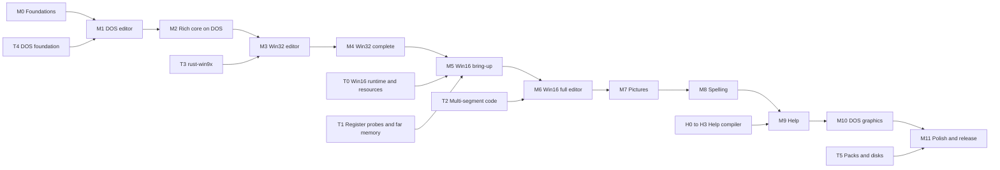

# Roadmap

The order Quill is built in, and how each step is shown to work. Behaviour is in [SPEC.md](../SPEC.md), the reasons for the order in [decisions.md](decisions.md) (D37, D40), and the tools each step needs in [toolchain-needs.md](toolchain-needs.md).

Every milestone ends with something you can look at: a screenshot, a golden file that matches, or a file that opens in another program. No milestone is done because the code is written.

## Table of contents

- [Three tracks](#three-tracks)
- [Milestones](#milestones)
- [Toolchain track](#toolchain-track)
- [Help compiler track](#help-compiler-track)
- [If time runs out](#if-time-runs-out)
- [Material for the blog series](#material-for-the-blog-series)
- [Release disks](#release-disks)
- [Where to start](#where-to-start)

## Three tracks

The main track builds Quill on the cheapest platform first and the hardest last: host, DOS text mode, Win32, Win16. Two tracks run beside it so that nothing waits on them: the **toolchain track** (T) prepares each platform before the main track arrives, and starts with the riskiest Win16 questions; the **help compiler track** (H) is a separate tool with its own tests that joins at M9.

Figure 1. Milestones and the tracks that feed them.

## Milestones

| # | Milestone | Platforms | Acceptance (what is shown) | Needs | Feeds the series |
|---|---|---|---|---|---|
| M0 | Foundations | Host | `cargo test` green on the workspace; piece table property tests against a `String` model; `quill-render` writes a golden text dump and a golden PNG of `tests/docs/plain.qld` with `GridMeasure`; CI runs lint, headers, tests and a 60 s fuzz smoke | — | Part 4 (the shared core) |
| M1 | DOS text editor | DOS text | `QUILLDOS.EXE` under headless DOSBox: typed keys (`DOS_AUTOTYPE`) open, edit and save a plain document; the screen dump equals the host's golden screen to the character; the saved `.QLD` is byte-identical to the host's | T4 | Part 1 follow-up |
| M2 | Rich core on DOS | Host, DOS text | Every formatting feature of the spec except pictures (character and paragraph formats, colour, lists, tabs, headers and footers), undo and redo, overtype, find and replace, `.QLD` and RTF (no pictures); golden screens of `tests/docs/letter.rtf` in both attribute schemes; RTF written by Quill opens in LibreOffice headless with the same text and formats (converted to PDF and checked) | T4 | Part 1 follow-up |
| M3 | Win32 editor | Win32 | `QUILL32.EXE` on the Windows ME VM and under Wine: menus, toolbar, ruler, status bar, fonts, mouse selection, drag and drop, clipboard. A screenshot of `letter.rtf` matches the host's PNG made with `CapturedMeasure` (same line breaks; pixel tolerance for anti-aliasing) | T3 | Part 3 |
| M4 | Win32 complete | Win32 | Common dialogs, printing and preview, header view, recent files, settings, About. A self-test script gives the same saved file as on DOS; a printed page (Wine's PDF printer) matches the host's page render; the ME VM prints to a PostScript file that Ghostscript renders to the same page | T3 | Part 3 |
| M5 | Win16 bring-up | Win16 | `QUILL.EXE` in Windows 3.11 under DOSBox-X: window, menus, accelerators, icon and About box from the same `quill.json`; plain-text editing through the far-memory `Store`; the M1 self-test script saves a byte-identical file; the register probe log is clean | T0, T1 | Part 2 |
| M6 | Win16 full editor | Win16 | Everything M2 to M4 showed, on Windows 3.11: the `letter.rtf` screenshot matches Win32's line for line; print preview with headers and footers; a print to file through a Windows 3.1 printer driver matches the host render. The executable has several code segments, each under its budget, and the cross-segment call report has no calls from segment 1's hot paths | T2 | Part 2 |
| M7 | Pictures | All | BMP and PNG insert, size, copy and print; RTF `\pict` round trip; `CF_DIB`. Picture corpus goldens (decoded and dithered rows hashed on the host); a DOSBox-X screenshot of a dithered photo at 16 colours; under a 4 MB DOSBox-X configuration, an oversized picture shows the placeholder and the document still saves unchanged | — | Part 2 (far memory under pressure), Part 4 |
| M8 | Spelling | All | `quill-dict` builds `EN_CA.DIC` under 300 KB; F7 finds and fixes the planted errors in `tests/docs/speling.qld` on every build; suggestions arrive within 0.5 s at 386SX-class DOSBox-X cycles; the text-mode spelling dialog matches its golden screen | — | Part 4 |
| M9 | Help | All | `QUILL.HLP`, compiled by `hlpc`, opens in Windows 3.11's `WINHELP.EXE` with contents, jumps, popups, search and a bitmap (screenshots); F1 opens the right topic from a dialog; Windows ME opens the same file; the DOS viewer shows the same topics (golden screen) | H0–H3 | Bonus post on the help compiler |
| M10 | DOS graphics mode | DOS graphics | `QUILLDOS.EXE /G` shows `letter.rtf` with Desk's faces at 640 × 480 × 16; the screenshot matches the host's PNG made with `DeskMeasure` | T4 | Part 4 |
| M11 | Polish and release | All | Windows 3.1 guideline review (mnemonics, ellipses, greying, keyboard-only use) passed on a checklist; timing and memory checks at 386SX-class cycles in 4 MB; installers built; release disks built and installed from in DOSBox-X and the ME VM; the documentation artifact and the capstone post's screenshots captured | T5 | Part 4 |

Each milestone also keeps every earlier platform green: from M3 on, a change to the core runs the DOS screen goldens and the Win32 self-test, and from M5 on, the Win16 one.

## Toolchain track

What each platform needs before the main track reaches it. [toolchain-needs.md](toolchain-needs.md) has the full list in priority order.

| # | Step | Shown by | Before |
|---|---|---|---|
| T0 | Win16 runtime as a crate, copied from the spike with provenance; resources from JSON (menus, accelerators, icons, cursors, bitmaps, version), generated IDs; size report; a DOSBox-X Windows 3.11 harness that boots, runs a program and takes a screenshot | A Win16 hello with a menu and icon, screenshotted by the harness | M5 |
| T1 | Register and segment-register probes for yielding calls (`GetMessage` with a second task, `DialogBox`, `SendMessage` across tasks, a busy loop under timer interrupts, FS and GS); far-memory helpers; the Win16 `Store` | A probe log in which every pattern survives, run in Windows 3.11 and Wine | M5 |
| T2 | Multi-segment code: `segments.toml`, the generated linker script, `--emit-relocs`, veneers, the indirect-call table, multi-segment NE tables, the branch check, `ne_addr2sym.py` | A test program of three code segments calling each other and back, including through a function pointer, that runs in Windows 3.11 | M6 |
| T3 | `rust-win9x` from `win9x-rust`: target and `build-std`, import tables with a Windows 95 allowlist, the `.res` writer, the instruction scan, runtime shims; Windows ME VM and Wine harnesses | A Win32 hello with a menu, icon and version info on the ME VM, screenshotted by the harness | M3 |
| T4 | DOS foundation copied from Desk with provenance (with keyboard, timer, VGA, and a new INT 33h mouse); the headless DOSBox harness with screen dumps and golden comparison from the Liminal Installer's `dos/tools/e2e.sh` | A DOS hello that draws a `quill-grid` screen, compared with its host golden | M1 |
| T5 | `quill-pack` and the disk image builder (FAT12, from the Liminal Installer's writer) | A test disk image that the installer unpacks in DOSBox | M11 |

T1 starts on day one: it retires the largest unknown (D14 and the register risk) while the main track works on the host.

## Help compiler track

`quill-help` grows one internal file at a time, each step checked in the real `WINHELP.EXE` of Windows 3.11 under DOSBox-X.

| # | Step | Shown by |
|---|---|---|
| H0 | The container: header, internal file system, B+ tree directory, `\|SYSTEM`, one topic of plain text | WinHelp opens it and shows the text |
| H1 | Topics: paragraph records, fonts (`\|FONT`), LZ77 compression, `\|CONTEXT`, `\|CTXOMAP`, `\|TTLBTREE`, jumps and popups | A three-topic file with a jump and a popup, screenshotted |
| H2 | Search and pictures: `\|KWBTREE`, `\|KWDATA`, `\|KWMAP`, bitmaps, browse buttons, the `.CNT` file, the `.HLX` writer | Search finds a keyword; a bitmap shows; Windows ME's Help Topics shows the contents |
| H3 | `hlpdump` and robustness: the reader, round trips, the `.HLP` files in the Windows 3.11 tree read without error, a fuzzed reader | Round-trip tests green; `hlpdump NOTEPAD.HLP` lists its topics |

## If time runs out

Cut in this order (D54), and say so in the README's status line when it happens:

1. Zoom (a stretch goal already).
2. DOS graphics mode (M10). DOS keeps text mode.
3. PostScript printing on DOS.
4. Check spelling as you type on Win16 (the dialog stays).
5. Multi-level lists (keep one level of bullets and numbers).
6. Drag and drop.
7. Two-page print preview (keep one page).
8. The `.CNT` file and phrase compression in the help compiler.
9. PNG on Win16 (keep BMP there; PNG stays on Win32 and DOS).

Nothing on this list touches the file format, so a cut feature can come back in a later release without breaking documents.

## Material for the blog series

Quill is the companion application to *Cross-compiling to the past*. The series explains the toolchains; Quill is what they build. [documentation-plan.md](documentation-plan.md) has the capstone post's needs.

| Post | What Quill gives it | From |
|---|---|---|
| Part 1, `rust-on-dos` | A follow-up: the DOS foundation running a real editor, attribute schemes, headless screen goldens | T4, M1, M2 |
| Part 2, `rust-on-windows-3-1` | The 64 KB segment and far-memory story: the DGROUP budget, the `Store`, the register probes, multi-segment veneers, pictures under memory pressure | T0, T1, T2, M5, M6, M7 |
| Part 3, `rust-on-windows-9x` | The same editor as a native Win32 program: `raw-dylib`, ANSI-only APIs, the Pentium floor, the `.res` writer, the ME VM | T3, M3, M4 |
| Part 4, *Quill: one word processor for DOS, Windows 3.1 and Windows 95* | The capstone: the same document on three platforms, what degrades where, sizes and budgets, the shared-core diagram | M11 |
| Possible bonus | Writing a WinHelp compiler in 2026 | H0–H3, M9 |

## Release disks

After v1, Quill ships as 1.44 MB floppy images (D57). Each target operating system gets its own disk, complete with its installer, so nobody needs a disk they cannot use. An all-in-one disk is made only if everything fits on one; one platform is never split across two disks.

| Disk | Holds | Budget (packed, on the disk) |
|---|---|---|
| `QUILL-DOS.IMG` | `INSTALL.EXE` (Liminal Installer's DOS runtime, with CWSDPMI), `QUILLDOS.EXE`, `QUILL.FNT`, `QUILL.HLX`, three dictionaries, samples, `README.TXT` | 1,300 KB, leaving at least 120 KB free |
| `QUILL-W31.IMG` | `SETUP.EXE` (Liminal Installer's Win16 runtime), `QUILL.EXE`, `QUILL.HLP`, three dictionaries, samples, `README.TXT` | 1,300 KB |
| `QUILL-W95.IMG` | `SETUP.EXE`, `QUILL32.EXE`, `QUILL.HLP`, three dictionaries, samples, `README.TXT` | 1,300 KB |
| `QUILL-ALL.IMG` (only if it fits) | All three builds, one copy of the shared files | 1,400 KB, else not made |

Budgets per file, unpacked and packed (estimates until M11 measures them; the size check fails the build past the unpacked figure):

| File | Unpacked | Packed |
|---|---|---|
| `QUILL.EXE` | 300 KB | 160 KB |
| `QUILL32.EXE` | 260 KB | 130 KB |
| `QUILLDOS.EXE` | 360 KB | 190 KB |
| `QUILL.FNT` | 250 KB | 120 KB |
| `QUILL.HLP` | 200 KB | 190 KB (already compressed) |
| `QUILL.HLX` | 100 KB | 40 KB |
| Each `.DIC` | 300 KB | 160 KB |
| Installer runtime | — | 100 KB |

A rough sum: each single-platform disk comes to about 950 KB to 1,050 KB packed, so it fits with room. All-in-one comes to about 1,500 KB, so it fits only with one dictionary language; if that is the only way, the all-in-one disk is skipped rather than shipped with fewer languages.

The files travel inside a `.QPK` pack on each disk (the Quill variant of Lt. Fizz 2's `.FAP`, see the architecture's [packs](architecture.md#packs)), unpacked by the shared `quill-pack` reader in the installer. Each disk carries a `README.TXT` and a volume label (`QUILL DOS`, `QUILL W31`, `QUILL W95`), and the images are built from the repository with one command so they can be checked in CI by unpacking them on the host.

## Where to start

The first three tasks, in order:

1. **Core skeleton (M0).** The workspace, `Store` and `FarVec` with the 32 KB chunk rule, the piece table with property tests against a `String` model, and `quill-render`'s text dump. Everything else stands on this.
2. **Register probes (T1).** Extend the spike's `probe.rs` to the yielding cases and FS and GS, and run it in Windows 3.11 under DOSBox-X. It answers the largest open question before any Win16 code is written on top of it.
3. **DOS hello on the foundation (T4).** Copy Desk's runtime with provenance, draw a `quill-grid` screen in headless DOSBox and compare it with the host's golden. That gives M1 its harness and the core its first real machine.
