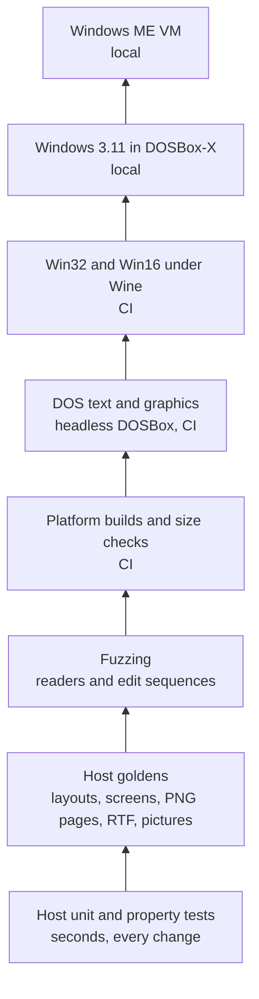

# Testing

How Quill is checked, cheapest first. Most bugs should die on the host in seconds; the emulators and VMs confirm what only a real Windows or DOS can show.

Figure 1. From the cheapest tests at the bottom to the most real at the top.

## Host tests

- **Unit and property tests** in every portable crate. The piece table, `FarVec` and undo are tested against simple models (a `String`, a `Vec`) with random operation sequences: after any sequence, the text matches the model, undoing everything gives the original, and redoing everything gives the end state. `HostStore` keeps the 32 KB chunk cap so chunk-boundary bugs show up here.
- **Layout goldens** in `tests/golden/layout/`: a text dump of every line box (story, paragraph, line, start, length, width, ascent, descent, tab positions) for each document in `tests/docs/`, laid out with each platform's metrics: `GridMeasure` (DOS text), `DeskMeasure` (DOS graphics), `CapturedMeasure` (Windows screen and printer, from width tables captured on Windows 3.11). A change to layout shows as a readable diff. `QUILL_UPDATE_GOLDEN=1` rewrites them; the diff is reviewed like code.
- **Screen goldens** in `tests/golden/screens/`: `quill-grid` screens (80 × 25 and 80 × 50, both attribute schemes) for documents, menus, dialogs, the spelling dialog and help topics, as text with an attribute layer. The DOS end-to-end run compares against these same files.
- **File dialog scenarios** (`tests/scenarios/m16-*.keys`, goldens `tests/golden/screens/m16-*.frames.txt`, `quill-host/tests/file_dialog.rs`): key scripts for the text screen's file dialog on 25 and 50 rows and in monochrome, for Save As, for its errors and for a folder past its cap. They start with `@dialog` (Open, Save As and Insert Picture use the dialog, which the other scenarios do not), put files and folders on the host's fake disk with `@copy NAME DIR\` (a file of `tests/docs` in a folder of `C:`), `@dir PATH`, `@stamp PATH YYYY-MM-DD HH:MM` (the date and time the list shows), `@readonly PATH`, `@many DIR COUNT EXT` (files only the dialog sees, with varied sizes and dates), `@drive A removable notready` (a drive that answers not ready), `@cwd PATH` (where it opens when no folder is remembered) and `@place LABEL PATH` (a place after the drives), and use the keys `alt1` to `alt9` and `altA` to `altZ` (Alt with that character), `backtab`, `backslash`, `colon`, `star` and `pipe`. `file_dialog.rs` also checks what the dialog hands back: each name chosen in it leaves the editor in the state the same name chosen in a native dialog does.
- **Page images** in `tests/golden/pages/`: PNG pages from `quill-render` through the shared painter, for eyeballing and for comparing with emulator screenshots. Deterministic: the rasterizer and fonts are pinned.
- **Formats.** `.QLD` round trips (write, read, compare models; write again, compare bytes); RTF reader goldens (RTF in, model dump out) over a corpus written by WordPad, Word 6, Word 97, Word 2003 and LibreOffice, all created for this project so they can be committed; RTF writer goldens; RTF round trips; plain text in ANSI and CP437; corrupt and truncated files of each kind give `BadFile`, never a panic.
- **Pictures.** A corpus of BMPs (1, 4, 8, 24 bit, top-down and bottom-up, RLE refused cleanly) and PNGs (every colour type and bit depth, interlaced, filtered, with and without palettes and transparency); decoded and dithered rows are hashed and compared with goldens. A large-picture test checks the decoder's peak `Store` use against the budget.
- **Spelling.** `quill-dict` output size and word count; every word in the source list is found and a list of near-misses is not; suggestion goldens for a set of misspellings; the time budget measured as nodes visited, so it is deterministic.
- **Help compiler.** `hlpc` then `hlpdump` gives back the topic tree; byte goldens for small projects; `hlpdump` reads every `.HLP` file in the Windows 3.11 tree without error (local, since the files are not ours to commit).
- **Flow scripts** (below) for the dialogs and what each answer does.
- **Cross-platform agreement.** Self-test scripts (below) run on the host through `quill-app` and save files; the same scripts on each platform must produce byte-identical files.

## Flow scripts

A `.flow` script in `tests/flows/` says what a person does and what the editor must ask back, in terms every build shares, and its transcript in `tests/golden/flows/` records how the dialogs behave: which question, with which words and default button; which file dialog, starting in which folder with which name and type; which notice; and the document, file name, modified flag, recent files, last folder, saved files and status line at the end. `quill_app::flow` produces the questions and notices and applies the answers, so the script tests the flow, not any shell's painting.

`NativeStub` (`quill-host/src/flow.rs`) plays a script as the Windows shells do: it takes each `take_dialog()` request, shows it as an event, and answers through the `flow` entry points. Another shell plays the same script by implementing the `Driver` trait (keys, commands, a reply to a dialog and a state) and must give the same transcript. A text-cell shell turns each reply into keys.

A script is lines of words; `#` starts a comment, a word may be `"quoted"` (with `\"`, `\\`, `\n` and `\t`) and `key=value` gives a field. Directives come first:

| Directive | Meaning |
|---|---|
| `@copy NAME` | A file of `tests/docs` is on the disk under that name, in capitals |
| `@file NAME "text"` | A file with this text is on the disk |
| `@locked NAME` | The name cannot be created (a read-only file) |
| `@full NAME` | Writing the name cannot be finished (a full disk); `*.RCV` stands for every name that ends so |
| `@recovery` | The editor runs the recovery protocol: the launch check, the questions at Open, the lock note and the list |
| `@alive NAME` | Another Quill window has NAME open with changes: its lock note exists and its owner is provably alive |
| `@drive PATH removable\|readonly\|missing` | Names that start with PATH are on that kind of place; anything else is a fixed disk |

| Step | Meaning |
|---|---|
| `type "text"` | Types the characters (`\n` is Enter) |
| `key TOKEN...` | Keys: the `.keys` names, `ctrl-a`, `ctrlhome`, `ctrlend`, `shift-left` and its kin |
| `cmd NAME [N]` | A menu command: `New`, `Open`, `Save`, `SaveAs`, `Exit`, `Print`, `Find`, `FindNext`, `Replace`, `Spelling`, `Fonts`, `Tabs`, `About`, `Picture`, `Undo`, `Redo`, `Recent N` and others |
| `expect KIND ...` | Checks the next question, dialog or notice the editor raised |
| `answer Yes\|No\|Cancel` | Answers a question; a recovery question also takes `recover`, `discard`, `later` and `original` |
| `choose "PATH"` | Presses OK in a file dialog |
| `cancel` | Dismisses the dialog (Esc) |
| `find next\|replace\|all "text" [with="x"] [case] [word]` | A button of Find or Replace; the dialog stays open |
| `spell ignore\|ignoreall\|change "x"\|changeall "x"\|add` | A button of the spelling dialog |
| `tabs set\|clear "1.25" [kind=N] [leader=N]`, `tabs clearall` | A button of Tabs; the dialog stays open |
| `fonts "Face" HALF-POINTS [bold] [italic] [underline] [strike]` | Fonts OK |
| `print "DEST"` | Print OK |
| `close` | Closes Find, Tabs or About |
| `rm NAME` | Removes a file from the disk, as another program might |
| `put NAME "text"` | Writes a file as another program might, stamped with the time now |
| `@clock +Ns` | The clock moves on N seconds (the DOS packed time every recovery copy and stamp carries; a flow starts at 25 November 2026, 14:32) |
| `@quiet Ns` | The keyboard is quiet for N seconds, and the clock moves on with it; idle time then runs what has come due, so a copy is written when the interval and the pause have both passed |
| `@sched seed=N` | (A directive, not a step.) Idle passes of random sizes run after each step, from a generator seeded with N; every transcript must be the one the golden has. `tests/sched.rs` replays every flow and every scenario under three seeds |
| `autosave` | The autosave timer fires: a recovery copy is written |
| `restart` | The program is killed and started again on the same disk; the launch check runs |
| `damage` | A byte of every recovery copy on the disk is flipped |
| `dump` | Writes the state into the transcript |

What `expect` checks, by kind: `ask "text" [default Yes] [buttons=YesNoCancel]`; `file SaveAs|Open|Picture [folder="..."] [name="..."] [type=N]`; `recover "text" [default Yes] [buttons=RecoverDiscardLater]` (the recovery questions and the second window's); `dialog Find|Replace|Tabs|Fonts|About|Print`; `spell "word" [with="..."]`; and `notice "text" [Info|Warn|Status]`. Anything not named is not checked, but it is in the transcript. A question or dialog may be answered without an `expect`; a notice may not, and a script that leaves one unexpected fails with its line number. Keys and commands are refused while a dialog is open. `Status` is a line for the status bar, not a box.

`QUILL_UPDATE_GOLDEN=1 cargo nextest run -p quill-host --test flows` rewrites the transcripts; review the diff like code. `every_script_is_listed` fails when a script has no test.

## Fuzzing

`cargo-fuzz` targets in `fuzz/`, each also run for 60 seconds in CI on every pull request with the committed corpus, and longer locally before a release:

| Target | Input | Checks |
|---|---|---|
| `rtf_read` | Bytes as RTF | No panic, bounded memory, limits enforced, read-write-read is stable |
| `qld_read` | Bytes as `.QLD` | No panic, refusals for bad counts and lengths |
| `text_read` | Bytes as text, both code pages | No panic |
| `bmp_read`, `png_read` | Bytes as pictures | No panic, dimensions checked before memory is reserved, the picture budget holds |
| `inflate` | Bytes as deflate | No panic, never writes past its window or output |
| `dic_read` | Bytes as `.DIC` | No panic, no edge index past the file |
| `hlp_read` | Bytes as `.HLP` | No panic in `hlpdump` |
| `qpk_read` | Bytes as `.QPK` | No panic, checksums refuse damage |
| `edit_ops` | A sequence of commands | Document invariants hold after every command; undo all returns to the start |

## Platform builds in CI

- CI jobs run in the shared Liminal HQ images, pinned by digest: `ci-rust` for the Rust checks and `ci-dos` for the layers check, the Try Quill cache check and the Pages build (CI-1 in [decisions](decisions.md)). The DOS tools (DOSBox Staging, CWSDPMI) come from the image's `/opt/dos-toolchain`; on a developer's machine `dos/tools/fetch-tools.sh` downloads them into `dos/vendor` with pinned SHA-256 sums. To run a job as CI does: `docker run --rm -v "$PWD:/work" -w /work ghcr.io/liminal-hq/ci-dos@sha256:<digest> bash scripts/check-try.sh` (copy the checkout first if the job writes to it).
- Every platform builds in CI with its pinned toolchain; the packer, the `.res` writer and the go32 packer run; `ne_dump.py` and a PE checker read the results back.
- **Size checks** fail the build when a Win16 segment passes its budget, DGROUP statics pass theirs, or any executable passes its unpacked budget in the roadmap's release table; the report is posted as a job summary.
- **Float ban** and **panic-site count** run on every build; the Win32 **instruction scan** fails on anything a Pentium lacks; the Win16 **branch check** fails on any near branch that leaves its segment.

## Results on the pull request

CI runs the host tests with `cargo nextest run --workspace --locked --profile ci`, which retries a failing test once (a test that passes the second time is shown as flaky) and writes JUnit to `target/nextest/ci/junit.xml`. The `Tests` job uploads it as `rust-test-results`, with `event-file`. After CI finishes, `publish-test-results.yml` runs the [pr-results](https://github.com/liminal-hq-labs/pr-results) publisher from `main`, which posts one sticky comment on the pull request and a check run for the suite, with annotations at the failing file and line. It works for fork pull requests too. The publisher runs only from the default branch, so a change to it shows its effect after merge. See SITE-1 in [decisions](decisions.md).

## Self-test scripts

`/SELFTEST SCRIPT` runs a script of commands through `quill-app`, the same commands keys and menus send, and writes results to `QUILL.LOG`: each step, any failure, the hash of the document after named steps, and the saved files' names. On Windows 3.1 the script ends with `ExitWindows`, so DOSBox-X exits by itself. Scripts live in `tests/selftest/` and cover typing, formatting, lists, tabs, headers, pictures, find and replace, spelling, undo all the way back, and saving in every format.

Self-test scripts check behaviour; typed keys check input. Both are used.

## DOS end-to-end (CI)

Headless DOSBox Staging, as Desk and the Liminal Installer run it (`dosrun.sh`, `SDL_VIDEODRIVER=dummy`, `cputype = 486`, which faults on instructions a 486 lacks):

- Keys are typed with `DOS_AUTOTYPE`; `QUILLDOS.EXE` writes each screen it shows to a dump file (`=== screen N ===` frames) when `QUILL_DUMP` is set; `frames.py` picks the frames, and they are compared with the host's screen goldens character for character and attribute for attribute.
- Saved files are copied out of the mounted drive and compared with the host's.
- Graphics mode is checked without screenshots: with `QUILL_DUMP` the shell writes the CRC-32 of each frame it drew and of the video memory read back, and `e2e.sh` requires the first to equal the host's golden (`tests/golden/gfx/g6-gfx.*.sums`; the menus and dialogs have `g7-menus` and `g7-dialogs` in the same way, and `dos/tools/shot.sh` takes the screenshots) and the second to equal the first, in mode 12h, in VBE 256 colours and in the mode 12h fallback of a card with no linear frame buffer. The screenshots in `docs/media/dos-gfx-*.png` are 1:1 captures of the DOSBox window under a private Xvfb (`DOS_X11=1`, `windowresolution = 640x480` in `DOS_CONF`), for the documentation and not for the checks. `QUILL_TIMES` and `QUILL_KEYS` measure a keystroke at fixed cycles (`DOS_CONF=$'[cpu]\ncpu_cycles = 25000'`) with no typist; the numbers are in [dos-graphics.md](dos-graphics.md#measured).

## Wine (CI)

Both Windows builds run under Wine with Xvfb in CI: `QUILL32.EXE` in a prefix set to Windows 98, and `QUILL.EXE` through Wine's Win16 support. Each starts, runs a self-test script, saves, prints to Wine's PDF printer and exits; screenshots are taken with `import -window root` and compared with the host PNG at a pixel tolerance, since Wine's font rendering differs from Windows 3.11's. Wine is a smoke test, not the reference: it is more forgiving than real Windows 3.11 in exactly the places where Win16 bugs hide (register state, segment loading).

`win9x/tools/wine-layout.sh` opens `QUILL32.EXE` on Xvfb screens of 640 by 480, 800 by 600, 1024 by 768 and 1280 by 1024 and checks that the window is no larger than the screen. It then types twenty characters with Wine's call trace on and checks that every paint reaches the window through one `BitBlt`, with no draw call straight onto the window, no full-window invalidation and no background erase. `--shots DIR` keeps a screenshot per size. It is local only: the trace is large and Wine's own pacing makes it slow.

`win9x/tools/wine-editing.sh` starts `QUILL32.EXE` on a 640 by 480 screen and checks by pixels that the page is centred without a horizontal bar, that Ctrl+I switches Italic on, that a drag highlights text, that the wheel scrolls, that print preview shows a tooltip and that Esc leaves the window as it was. It is local only, for the same reason. The Windows 95 checks use the test bed of Liminal Installer's `scripts/win95` with `xdotool` for the keys and the mouse; the guest has no wheel driver, so the wheel is checked under Wine only.

`win9x/tools/wine-blink.sh` starts `QUILL32.EXE` three times on its own display: with `QUILL_NO_BLINK=1` and with `[Quill] Blink=0` six screenshots 0.3 s apart must be byte-identical (and equal to each other), and with blinking on fourteen screenshots 0.15 s apart must hold exactly two pictures, the steady one and one that differs from it only in a box a few pixels wide beside the end of the text, a key must leave the caret solid, and an open prompt must leave it off. A blinking caret makes screenshots unrepeatable, so every other Wine script exports `QUILL_NO_BLINK=1`, the Windows 95 test-bed scripts write `Blink=0` into `QUILL.INI`, and `/PLAY` runs never blink. Local only, like the other Wine scripts.

## Windows 3.11 in DOSBox-X (local)

The real check for the Win16 build, using the pre-installed Windows for Workgroups 3.11 tree in `~/Downloads/win31.zip`. It is not redistributable, so this runs on the developer's machine and its screenshots and logs are committed as evidence, never the tree (D21). To run it by hand in a real window, see [play.md](play.md).

- The harness unzips the tree into a scratch directory, copies `QUILL.EXE`, the test documents and the script into `C:\QUILL`, sets `WIN.INI` `[windows] run=` to the test command, and boots `WIN` from the DOSBox-X `[autoexec]`.
- **Machine profiles:** `cputype = 386`, `cycles = fixed 3000` and `memsize = 4` (a 386SX-class 4 MB machine) for timing and memory; `memsize = 2` for the minimum; a fast profile for everyday runs. The tree's display driver is the S3 Trio at 800 × 600 with 64K colours; a second profile switches `SYSTEM.INI` to `VGA.DRV` for 640 × 480 × 16 so dithering and the 16-colour paths are tested.
- **Input:** self-test scripts for behaviour, and typed keys and mouse moves through `xdotool` into the DOSBox-X window under Xvfb for real input paths (accelerators, menus, dialogs, drag and drop).
- **Screenshots:** DOSBox-X's own capture or `import` of the X window, cropped to the Windows desktop, named by milestone and scene (`m6-letter-preview.png`). These feed the documentation plan.
- **Launch** (`win16/tools/e2e-launch-w31.sh`, W16-3): `QUILL.EXE` is started with no arguments, as a double click does, held open for 12 seconds and ended through File > Exit; `STACK.LOG` (written only when the message loop ends) must not appear before the exit and its margin must be at least 2,048 bytes. Every `/PLAY` run draws the text grid and never starts the tooltip timer, so only this one runs the program a person runs.
- **Scroll** (`win16/tools/e2e-scroll-w31.sh`, CORE-64): on the new empty document it clicks the vertical bar's lower arrow three times and the track below the thumb, then presses Page Down, Ctrl+End, Page Up and Ctrl+Home. `compare_frames.py` finds the thumb in each frame and the foot of the sheet (its shadow and the desk) at the bottom of the page: the thumb must move down at each step, the foot must show at the end and the first frame must come back. The emulator runs with `autolock=true` and `mouse_emulation=locked` and takes the pointer on the first click; from then on it gets only how far the host pointer moved and Windows scales that (twice for four pixels or more), so `find_pointer.py` finds the arrow in a screenshot and the script steers it by looking. (Without the lock the pointer never moved for `xdotool`.) `find_vbar.py` places the bar from the window's frame. On the build from before the fix every step fails; the screenshots are `docs/media/win16-empty-page-scroll-before-w311.png` and `win16-empty-page-scroll-after-w311.png`.
- **Zoom** (`win16/tools/e2e-zoom-w31.sh`, W16-15 and W16-16): two Windows 3.11 sessions. The first opens `tests/docs/scroll.rtf` with `QUILL.INI` at `Zoom=200` and takes a frame at 200 %, after Ctrl+End, after the track has been clicked down to the foot of the sheet, after a click in the fifth line, after Shift+Home, and at 150, 75, Page Width, 100 and 50 % chosen from View > Zoom (Alt+V, Z and the item's mnemonic). `check_zoom.py` reads them from what the layout fixes and Windows' fonts cannot change: the sheet's edges, the caret (a two-pixel bar as tall as its line), the ruler's row and the selection's navy. The text must start `120 * zoom / 100` pixels from the sheet's edge, the sheet must be `816 * zoom / 100` wide where it fits the window and run past it where it does not, the caret must be as tall as the zoom says, a click must put it within a letter of the pointer, the same caret must be on the same character at every zoom, the ruler's scale must start at the text's edge with a half-inch tick `48 * zoom / 100` pixels on (and end with the column where the sheet fits), the selection must be as tall as the line with no gap between its cells, and the foot of the sheet must take more clicks on the track at 200 % than at 50 %. The second session opens `tests/docs/pictures.rtf` at 200 %, clicks the PNG's grey box and reads its frame and eight handles (seven pixels at every zoom, on the frame's corners and sides) at 200, 150, 50 and 100 %, with the box scaling, then drags the bottom right handle at 100 % and the picture must have grown with its proportions kept (it answers No to the question the changed document asks). The frames are read before File > Exit, so a build that did not draw the zoom says that and not what its keys did. The mouse is steered as in the scroll scenario, which now starts from `Zoom=100` so that its page is still wider than the window (the default, Page Width, fits it and takes the horizontal bar away). The paint benchmark likewise takes `ZOOM=100|Width|N` (default 100, which its budget gates). On `origin/main` (where the zoom was kept and never drawn) every comparison of the first session fails, and on the build before the ruler and picture change the ruler checks fail at every zoom but 100 and there are no handles; the screenshots are `docs/media/win16-zoom-200-before-w311.png`, `win16-zoom-200-after-w311.png`, `win16-zoom-50-after-w311.png`, `win16-zoom-ruler-200-after-w311.png`, `win16-zoom-selection-200-after-w311.png` and `win16-zoom-picture-select-200-after-w311.png`.
- **Paint benchmark** (`win16/tools/bench-w31.sh`, W16-10): `QUILLB.EXE` (`W16_FEATURES=bench win16/build.sh`, never shipped) runs `tests/bench/w16-type.txt` through the window procedure on Windows 3.11 in DOSBox-X at fixed cycles (`VIDEO=s3` or `vga`) and `win16/tools/bench_report.py` prints the calls per key and per paint by function, window-manager calls, pixels, lines and font caches for each phase and checks them against `win16/bench-budget.json`. Call counts are the gate and times are reported only. The same files run by hand on ReactOS under WineVDM must give the same counts (`bench_report.py --compare`).
  With `FIELDS=1` it also types a line, inserts a Date and a Time field with Insert > Date and Insert > Time, and keeps `launch-fields.png` (`docs/media/win16-insert-date-time.png` is a crop of one): the fields show the date and the time as `WIN.INI` writes them and the caret lands after them (W16-4).
- **Save, then close** (`win16/tools/e2e-saveclose-w31.sh`, W16-7): types into Quill, Save As `D:\TEST` (no extension), types more, File > Exit and Yes. `TEST.QLD` must exist and hold the later text, the program must end by itself and leave `STACK.LOG` and `PICS.LOG` (the writer at the very end of `w16_main`), and `PICS.LOG` must have no `bad state`. With `BADSLOT=1` and a `QUILL.EXE` built with `W16_FEATURES=diag`, the program plants 0x78 in a picture slot first and the log must name it, with the same clean exit.
- **Clock on DOS** (`m13-clock`, DOS-11): a header with a Date and a Time field is printed under DOSBox; the host's run compares the screens and the printed line is checked in `dos/tools/e2e.sh` by its shape, since the date and the time are the machine's.
- **Register probes** from the toolchain track run here first, in every profile.
- **Printing:** the tree has no printer installed and no printer drivers on disk, which makes the no-printer path the default test. To test printing, a driver from the Windows 3.1 install disks (a PostScript printer printing to `FILE:`) is installed in the scratch copy; the `.PRN` file is rendered with Ghostscript and compared with the host page. Which driver is available is an open point until the install disks are checked.
- **Help:** `QUILL.HLP` is opened in the tree's own `WINHELP.EXE`, both from Quill's Help menu and by `WINHELP QUILL.HLP` from the harness, with screenshots of contents, a jump, a popup and a search.

## Windows ME VM (local)

The real check for the Win32 build (and the Win16 build's bonus run on 9x), on the owner's VirtualBox VM, where `win9x-rust`'s programs were tested. The harness starts the VM headless, shares the build folder as `Z:`, runs the self-test from a StartUp shortcut or `WIN.INI` `run=`, types keys with `VBoxManage controlvm <vm> keyboardputscancode`, takes screenshots with `VBoxManage controlvm <vm> screenshotpng`, and reads `QUILL.LOG` from the share. Printing goes to a PostScript driver printing to a file, rendered with Ghostscript.

## Manual checks before a release

- The Windows 3.1 guidelines checklist: every menu item has a mnemonic, dialogs have ellipses, unavailable items grey, everything works from the keyboard, the title bar and About box follow the conventions.
- A long-document session at 386SX-class cycles: open a 100-page document with pictures, scroll end to end, type a paragraph, spell check, print preview, save; note the timings in the release notes.
- Install from each release disk image in a clean DOSBox-X tree and on the ME VM, run Quill from the Program Manager group or the Start menu, and uninstall.

## What cannot be tested here

- Real period hardware (a 386SX with 4 MB, a real VGA, a dot-matrix printer): only emulators and VMs are available, so the release notes say so.
- Windows 3.1 (not 3.11) and other display and printer drivers than the ones in the tree.
- Windows 95 and 98 directly; the ME VM stands in for the 9x family.
