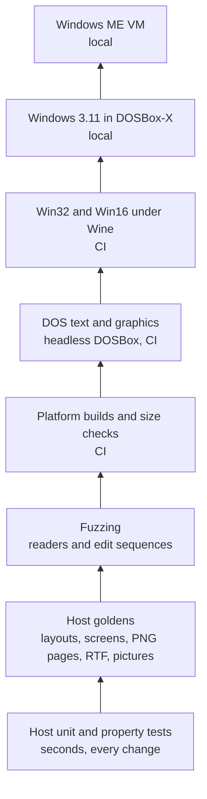

# Testing

How Quill is checked, cheapest first. Most bugs should die on the host in seconds; the emulators and VMs confirm what only a real Windows or DOS can show.

Figure 1. From the cheapest tests at the bottom to the most real at the top.

## Host tests

- **Unit and property tests** in every portable crate. The piece table, `FarVec` and undo are tested against simple models (a `String`, a `Vec`) with random operation sequences: after any sequence, the text matches the model, undoing everything gives the original, and redoing everything gives the end state. `HostStore` keeps the 32 KB chunk cap so chunk-boundary bugs show up here.
- **Layout goldens** in `tests/golden/layout/`: a text dump of every line box (story, paragraph, line, start, length, width, ascent, descent, tab positions) for each document in `tests/docs/`, laid out with each platform's metrics: `GridMeasure` (DOS text), `DeskMeasure` (DOS graphics), `CapturedMeasure` (Windows screen and printer, from width tables captured on Windows 3.11). A change to layout shows as a readable diff. `QUILL_UPDATE_GOLDEN=1` rewrites them; the diff is reviewed like code.
- **Screen goldens** in `tests/golden/screens/`: `quill-grid` screens (80 × 25 and 80 × 50, both attribute schemes) for documents, menus, dialogs, the spelling dialog and help topics, as text with an attribute layer. The DOS end-to-end run compares against these same files.
- **Page images** in `tests/golden/pages/`: PNG pages from `quill-render` through the shared painter, for eyeballing and for comparing with emulator screenshots. Deterministic: the rasterizer and fonts are pinned.
- **Formats.** `.QLD` round trips (write, read, compare models; write again, compare bytes); RTF reader goldens (RTF in, model dump out) over a corpus written by WordPad, Word 6, Word 97, Word 2003 and LibreOffice, all created for this project so they can be committed; RTF writer goldens; RTF round trips; plain text in ANSI and CP437; corrupt and truncated files of each kind give `BadFile`, never a panic.
- **Pictures.** A corpus of BMPs (1, 4, 8, 24 bit, top-down and bottom-up, RLE refused cleanly) and PNGs (every colour type and bit depth, interlaced, filtered, with and without palettes and transparency); decoded and dithered rows are hashed and compared with goldens. A large-picture test checks the decoder's peak `Store` use against the budget.
- **Spelling.** `quill-dict` output size and word count; every word in the source list is found and a list of near-misses is not; suggestion goldens for a set of misspellings; the time budget measured as nodes visited, so it is deterministic.
- **Help compiler.** `hlpc` then `hlpdump` gives back the topic tree; byte goldens for small projects; `hlpdump` reads every `.HLP` file in the Windows 3.11 tree without error (local, since the files are not ours to commit).
- **Cross-platform agreement.** Self-test scripts (below) run on the host through `quill-app` and save files; the same scripts on each platform must produce byte-identical files.

## Fuzzing

`cargo-fuzz` targets in `fuzz/`, each also run for 60 seconds in CI on every pull request with the committed corpus, and longer locally before a release:

| Target | Input | Checks |
|---|---|---|
| `rtf_read` | Bytes as RTF | No panic, bounded memory, limits enforced, read-write-read is stable |
| `qld_read` | Bytes as `.QLD` | No panic, refusals for bad counts and lengths |
| `text_read` | Bytes as text, both code pages | No panic |
| `bmp_read`, `png_read` | Bytes as pictures | No panic, dimensions checked before memory is reserved, the picture budget holds |
| `inflate` | Bytes as deflate | No panic, never writes past its window or output |
| `dic_read` | Bytes as `.DIC` | No panic, no edge index past the file |
| `hlp_read` | Bytes as `.HLP` | No panic in `hlpdump` |
| `qpk_read` | Bytes as `.QPK` | No panic, checksums refuse damage |
| `edit_ops` | A sequence of commands | Document invariants hold after every command; undo all returns to the start |

## Platform builds in CI

- Every platform builds in CI with its pinned toolchain; the packer, the `.res` writer and the go32 packer run; `ne_dump.py` and a PE checker read the results back.
- **Size checks** fail the build when a Win16 segment passes its budget, DGROUP statics pass theirs, or any executable passes its unpacked budget in the roadmap's release table; the report is posted as a job summary.
- **Float ban** and **panic-site count** run on every build; the Win32 **instruction scan** fails on anything a Pentium lacks; the Win16 **branch check** fails on any near branch that leaves its segment.

## Self-test scripts

`/SELFTEST SCRIPT` runs a script of commands through `quill-app`, the same commands keys and menus send, and writes results to `QUILL.LOG`: each step, any failure, the hash of the document after named steps, and the saved files' names. On Windows 3.1 the script ends with `ExitWindows`, so DOSBox-X exits by itself. Scripts live in `tests/selftest/` and cover typing, formatting, lists, tabs, headers, pictures, find and replace, spelling, undo all the way back, and saving in every format.

Self-test scripts check behaviour; typed keys check input. Both are used.

## DOS end-to-end (CI)

Headless DOSBox Staging, as Desk and the Liminal Installer run it (`dosrun.sh`, `SDL_VIDEODRIVER=dummy`, `cputype = 486`, which faults on instructions a 486 lacks):

- Keys are typed with `DOS_AUTOTYPE`; `QUILLDOS.EXE` writes each screen it shows to a dump file (`=== screen N ===` frames) when `QUILL_DUMP` is set; `frames.py` picks the frames, and they are compared with the host's screen goldens character for character and attribute for attribute.
- Saved files are copied out of the mounted drive and compared with the host's.
- Graphics mode is checked with screenshots taken under Xvfb (`DOS_X11=1`) and compared with the host PNG at a small pixel tolerance.

## Wine (CI)

Both Windows builds run under Wine with Xvfb in CI: `QUILL32.EXE` in a prefix set to Windows 98, and `QUILL.EXE` through Wine's Win16 support. Each starts, runs a self-test script, saves, prints to Wine's PDF printer and exits; screenshots are taken with `import -window root` and compared with the host PNG at a pixel tolerance, since Wine's font rendering differs from Windows 3.11's. Wine is a smoke test, not the reference: it is more forgiving than real Windows 3.11 in exactly the places where Win16 bugs hide (register state, segment loading).

## Windows 3.11 in DOSBox-X (local)

The real check for the Win16 build, using the pre-installed Windows for Workgroups 3.11 tree in `~/Downloads/win31.zip`. It is not redistributable, so this runs on the developer's machine and its screenshots and logs are committed as evidence, never the tree (D21). To run it by hand in a real window, see [play.md](play.md).

- The harness unzips the tree into a scratch directory, copies `QUILL.EXE`, the test documents and the script into `C:\QUILL`, sets `WIN.INI` `[windows] run=` to the test command, and boots `WIN` from the DOSBox-X `[autoexec]`.
- **Machine profiles:** `cputype = 386`, `cycles = fixed 3000` and `memsize = 4` (a 386SX-class 4 MB machine) for timing and memory; `memsize = 2` for the minimum; a fast profile for everyday runs. The tree's display driver is the S3 Trio at 800 × 600 with 64K colours; a second profile switches `SYSTEM.INI` to `VGA.DRV` for 640 × 480 × 16 so dithering and the 16-colour paths are tested.
- **Input:** self-test scripts for behaviour, and typed keys and mouse moves through `xdotool` into the DOSBox-X window under Xvfb for real input paths (accelerators, menus, dialogs, drag and drop).
- **Screenshots:** DOSBox-X's own capture or `import` of the X window, cropped to the Windows desktop, named by milestone and scene (`m6-letter-preview.png`). These feed the documentation plan.
- **Register probes** from the toolchain track run here first, in every profile.
- **Printing:** the tree has no printer installed and no printer drivers on disk, which makes the no-printer path the default test. To test printing, a driver from the Windows 3.1 install disks (a PostScript printer printing to `FILE:`) is installed in the scratch copy; the `.PRN` file is rendered with Ghostscript and compared with the host page. Which driver is available is an open point until the install disks are checked.
- **Help:** `QUILL.HLP` is opened in the tree's own `WINHELP.EXE`, both from Quill's Help menu and by `WINHELP QUILL.HLP` from the harness, with screenshots of contents, a jump, a popup and a search.

## Windows ME VM (local)

The real check for the Win32 build (and the Win16 build's bonus run on 9x), on the owner's VirtualBox VM, where `win9x-rust`'s programs were tested. The harness starts the VM headless, shares the build folder as `Z:`, runs the self-test from a StartUp shortcut or `WIN.INI` `run=`, types keys with `VBoxManage controlvm <vm> keyboardputscancode`, takes screenshots with `VBoxManage controlvm <vm> screenshotpng`, and reads `QUILL.LOG` from the share. Printing goes to a PostScript driver printing to a file, rendered with Ghostscript.

## Manual checks before a release

- The Windows 3.1 guidelines checklist: every menu item has a mnemonic, dialogs have ellipses, unavailable items grey, everything works from the keyboard, the title bar and About box follow the conventions.
- A long-document session at 386SX-class cycles: open a 100-page document with pictures, scroll end to end, type a paragraph, spell check, print preview, save; note the timings in the release notes.
- Install from each release disk image in a clean DOSBox-X tree and on the ME VM, run Quill from the Program Manager group or the Start menu, and uninstall.

## What cannot be tested here

- Real period hardware (a 386SX with 4 MB, a real VGA, a dot-matrix printer): only emulators and VMs are available, so the release notes say so.
- Windows 3.1 (not 3.11) and other display and printer drivers than the ones in the tree.
- Windows 95 and 98 directly; the ME VM stands in for the 9x family.
